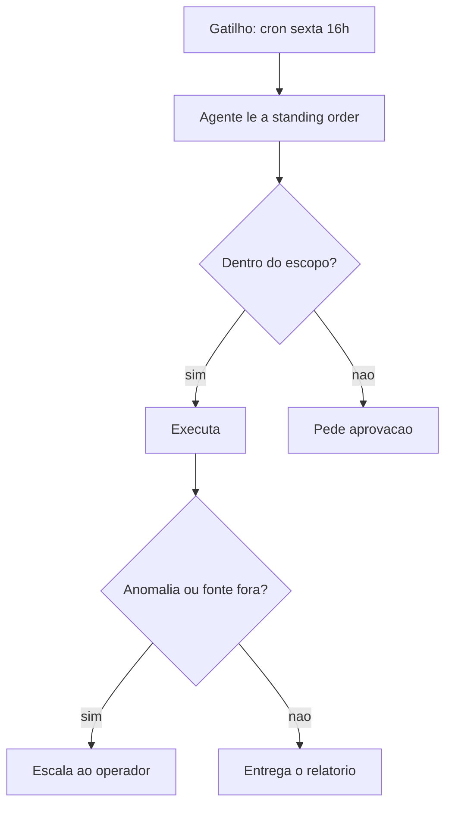

# Standing orders - autoridade permanente do agente

## Objetivo

Escrever *standing orders*: regras que dão ao agente autoridade permanente sobre um programa de trabalho, com limites claros de escopo, aprovação e escalonamento.

## Explicação

Segundo a doc, standing orders dão ao agente "autoridade operacional permanente" sobre programas definidos, para que rotinas rodem sem pedir cada tarefa. Cada programa define quatro itens:

| Item | Pergunta que responde |
|---|---|
| Escopo | O que o agente pode fazer? |
| Gatilhos | Quando roda (agenda, evento, condição)? |
| Portões de aprovação | O que exige aval humano antes? |
| Regras de escalonamento | Quando parar e pedir ajuda? |

**Onde ficam:** a recomendação é colocá-las em `AGENTS.md`, que é injetado em toda sessão (veja [[Arquivos do workspace do agente]]). Em setups maiores, use um arquivo à parte (por exemplo `standing-orders.md`) **referenciado** em `AGENTS.md`: arquivos em subdiretórios não são injetados automaticamente.

**Relação com cron:** a standing order define a autoridade e as regras; uma automação agendada impõe o horário (veja [[Automações e cron - agendar tarefas do agente]]).

> [!warning] Execuções por script
> Em runs via `openclaw agent exec` (CI), o `AGENTS.md` continua sendo injetado, a não ser que `agents.defaults.contextInjection` seja `"never"`. Standing orders nele continuam valendo.

> [!info] Limite da leitura
> A seção de boas práticas ("Do/Avoid") da página foi truncada; as recomendações abaixo são do autor da nota, não da doc.

## Exemplo prático

Um relatório semanal, no estilo da doc (texto próprio):

```markdown
## Programa - Relatorio semanal de status

Escopo: compilar dados da planilha de projetos, gerar o relatorio e enviar ao canal #status.
Gatilho: automacao toda sexta, 16h (America/Sao_Paulo).
Aprovacao: nenhuma para compilar e enviar; qualquer outro destino exige aprovacao humana.
Escalonamento: se a fonte de dados estiver indisponivel ou uma metrica variar mais de 2 desvios-padrao, nao envie; avise o operador e aguarde.
Proibido: apagar arquivos, enviar dados pessoais, alterar a planilha.
```

Agende o gatilho:

```bash
openclaw automations create --help
```

(confirme as flags da sua versão antes de escrever o comando completo).



## Armadilhas comuns

- Escrever escopo vago ("cuide dos e-mails"): o modelo preenche lacunas.
- Esquecer o portão de aprovação para ações irreversíveis.
- Achar que standing order é política: é texto no prompt. O limite real vem da política de ferramentas e das aprovações (veja [[Perfis e política de ferramentas]]).
- Colocar segredos no `AGENTS.md`.

## Resumo

- Escopo, gatilhos, aprovações, escalonamento.
- Em `AGENTS.md` ou arquivo referenciado.
- Texto orienta; política em código limita.

## Relacionados

- [[Arquivos do workspace do agente]]
- [[Automações e cron - agendar tarefas do agente]]
- [[Montagem do system prompt]]
- [[Confiança, permissões e riscos de agentes]]
- [[Perfis e política de ferramentas]]

## Exercícios

1. Quais os quatro componentes de uma standing order?
2. Por que arquivos em subdiretórios exigem referência no `AGENTS.md`?
3. Por que uma standing order não substitui a política de ferramentas?
4. Escreva um critério de escalonamento para um programa de triagem de e-mails.
