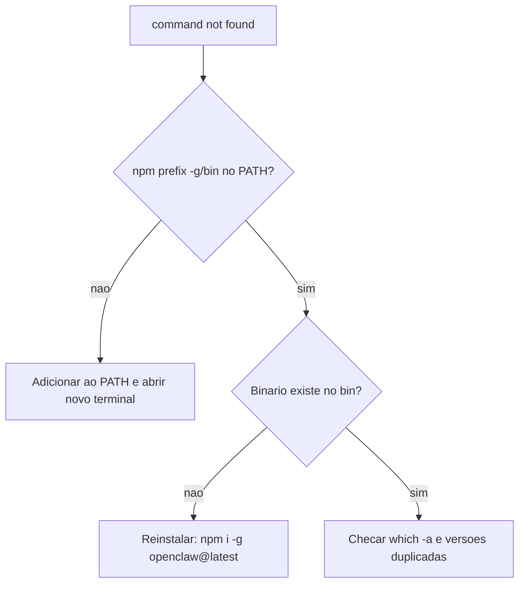

# Corrigir openclaw not found e problemas de PATH

## Objetivo

Resolver o erro mais comum depois de instalar via npm: o shell não encontra o comando `openclaw`.

## Explicação

A doc de instalação cobre o caso "openclaw not found". A causa típica: o diretório de binários globais do npm não está no `PATH`. O diagnóstico usa quatro comandos (da cópia de terceiros da doc; a página oficial lista a seção, mas não foi lida inteira):

```bash
node -v
npm -v
npm prefix -g
echo "$PATH"
```

Se `$(npm prefix -g)/bin` não aparece no `PATH`, acrescente ao `~/.zshrc` ou `~/.bashrc`:

```bash
export PATH="$(npm prefix -g)/bin:$PATH"
```

Abra um novo terminal. No Windows, adicione ao PATH a **saída** de `npm prefix -g`.

### Outros sintomas parecidos

| Sintoma | Causa provável | Verificação |
|---|---|---|
| `command not found` logo após instalar | PATH sem o bin global | `npm prefix -g` |
| Versão antiga ao rodar `openclaw` | Dois binários instalados | `which openclaw` e `openclaw --version` |
| Erro com `sharp` na instalação | libvips global instalado | doc: `SHARP_IGNORE_GLOBAL_LIBVIPS=1 npm install -g openclaw@latest` |
| pnpm não roda scripts de build | Scripts não aprovados | doc: `pnpm approve-builds -g` |

> [!tip] Binário antigo depois de atualizar
> Após uma atualização, se o serviço parar por binário mais antigo que a versão que escreveu a configuração, a doc de troubleshooting manda checar `which openclaw`, `openclaw --version` e `openclaw config get meta.lastTouchedVersion`, e corrigir o PATH ou rodar `openclaw gateway install --force` e `openclaw gateway restart`.

## Exemplo prático

Sessão de diagnóstico completa:

```bash
which -a openclaw
openclaw --version
npm prefix -g
ls "$(npm prefix -g)/bin" | grep openclaw
export PATH="$(npm prefix -g)/bin:$PATH"
openclaw doctor
```



## Armadilhas comuns

- Instalar com `sudo npm -g` e criar problemas de permissão.
- Editar `~/.bashrc` mas usar zsh (ou o inverso).
- Esquecer de abrir um novo terminal.
- Manter instalações duplicadas (npm e pnpm) com versões diferentes.

## Resumo

- Cheque `npm prefix -g` e `PATH`.
- Um só binário, uma só versão.
- Depois: `openclaw doctor`.

## Relacionados

- [[Requisitos e escolha do método de instalação]]
- [[Instalar no Linux - Node, npm e serviço systemd]]
- [[Instalar no macOS - app de barra de menus e Gateway local]]
- [[Tour rápido de instalação e primeira conversa]]
- [[Escada de diagnóstico do Gateway - status, logs e doctor]]

## Exercícios

1. Que comando mostra o prefixo global do npm?
2. Como detectar dois binários `openclaw` instalados?
3. O que fazer no Windows para corrigir o PATH?
4. Por que abrir um novo terminal depois de editar o `~/.zshrc`?
