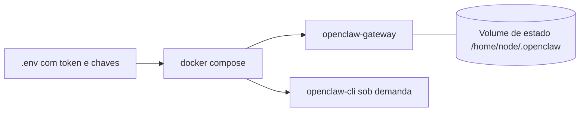

# Docker - instalar o Gateway em contêiner

## Objetivo

Subir o Gateway com Docker Compose, persistir o estado, rodar a CLI no contêiner e configurar health checks sem expor o serviço.

## Explicação

Docker é opcional: serve para Gateway isolado ou descartável, ou para hosts sem instalação local. Requisitos: Docker Desktop ou Engine com Compose v2; cerca de 6 GB de RAM para compilar a imagem localmente (imagens pré-prontas evitam isso).

**Script e arquivos:** `./scripts/docker/setup.sh` (na raiz do repositório) sincroniza o `.env`, ajusta permissões, roda o onboarding, escreve a configuração do Gateway e sobe o Compose. O arquivo é `docker-compose.yml`; o script pode gerar `docker-compose.extra.yml`.

**Imagens:** `openclaw:local` (build local), `ghcr.io/openclaw/openclaw:latest` (principal), `openclaw/openclaw:latest` (espelho Docker Hub); variantes `slim` e `browser`; tags fixas por versão (por exemplo `2026.9.3`). Evite espelhos não oficiais.

| Variável | Função |
|---|---|
| `OPENCLAW_IMAGE` | Imagem a rodar |
| `OPENCLAW_GATEWAY_TOKEN` | Token do Gateway gravado no `.env` |
| `OPENCLAW_GATEWAY_PORT` | Porta do host |
| `OPENCLAW_STATE_DIR` | Diretório de estado |
| `OPENCLAW_CONFIG_PATH` / `OPENCLAW_CONFIG_READONLY` | Configuração externa somente leitura |
| `OPENCLAW_EXTRA_MOUNTS`, `OPENCLAW_HOME_VOLUME` | Montagens extras |

Estado e configuração ficam em `/home/node/.openclaw`. Não monte só um arquivo SQLite com escrita: os arquivos auxiliares precisam do diretório pai gravável. O volume de capturas (`/state.update-captures`) guarda estado cru e credenciais: mantenha-o privado.

O fluxo manual define `gateway.bind` como `lan` e restringe `gateway.controlUi.allowedOrigins` a origens locais. O sandbox é **desligado por padrão** e não exige que o Gateway rode em contêiner.

## Exemplo prático

```bash
./scripts/docker/setup.sh
docker compose up -d openclaw-gateway
docker compose run --rm openclaw-cli dashboard --no-open
docker compose run --rm openclaw-cli channels add --channel telegram --token "<token>"
docker compose run --rm openclaw-cli doctor --json
```

Health checks (da doc):

```bash
curl -fsS http://127.0.0.1:18789/healthz
curl -fsS http://127.0.0.1:18789/startupz
curl -fsS http://127.0.0.1:18789/readyz
```

Atualização:

```bash
docker compose pull openclaw-gateway openclaw-cli
docker compose stop openclaw-gateway
docker compose up -d openclaw-gateway
```



## Armadilhas comuns

- Rodar duas réplicas sobre o mesmo volume: mantenha **uma réplica por volume de estado** e pare a antiga antes da nova.
- Apagar arquivos de lock para "destravar": corrija montagem ou permissões.
- Publicar a porta em VPS público sem revisar a cadeia `DOCKER-USER`.
- Colocar chaves de provedores no `openclaw.json` em vez de no `.env`/referências.
- Atualizar sem backup do volume (veja [[Backup e restauração do estado]]).

## Resumo

- `setup.sh` + Compose; estado em volume; token no `.env`.
- Três endpoints de saúde: `/healthz`, `/startupz`, `/readyz`.
- Uma réplica por volume; backup antes de atualizar.

## Relacionados

- [[Requisitos e escolha do método de instalação]]
- [[Hospedar em um VPS com segurança]]
- [[Onde o OpenClaw guarda estado em disco]]
- [[Configuração do Gateway em openclaw.json]]
- [[Backup e restauração do estado]]

## Exercícios

1. Onde ficam estado e configuração dentro do contêiner?
2. Qual a diferença entre `/healthz` e `/readyz`?
3. Por que não rodar duas réplicas no mesmo volume?
4. Como atualizar a imagem sem perder o estado?
