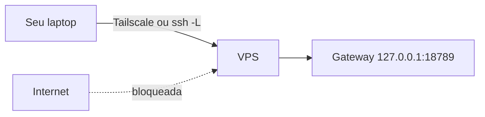

# Hospedar em um VPS com segurança

## Objetivo

Colocar o Gateway em um VPS mantendo-o em loopback, com acesso administrativo endurecido, reinício automático e estado protegido.

## Explicação

O guia oficial de VPS cita provedores como Azure, DigitalOcean, exe.dev, Fly.io, GCP, Hetzner, Hostinger, Northflank, Oracle Cloud (camada ARM gratuita), Railway e Raspberry Pi; AWS também funciona. **Não há requisitos mínimos de CPU/RAM** na página; recomenda-se disco SSD e um cache de compilação para VMs fracas e ARM.

Arquitetura: o Gateway roda no VPS e guarda estado e workspace; você conecta por Control UI, Tailscale ou SSH. **Mantenha o bind em loopback** e use túnel SSH ou Tailscale Serve. Se usar `lan` ou `tailnet`, defina `gateway.auth.token` ou `gateway.auth.password`, a menos que um proxy confiável faça a autenticação.

### Passos

1. Escolha o provedor.
2. **Proteja o acesso admin primeiro** (Tailscale ou endurecimento equivalente de SSH).
3. Instale: `openclaw onboard --install-daemon`.
4. Opcional: ajuste de partida para VMs pequenas.
5. Opcional: endurecer a unidade systemd.

## Exemplo prático

Ajuste de partida da doc (VMs pequenas/ARM):

```bash
grep -q 'NODE_COMPILE_CACHE=/var/tmp/openclaw-compile-cache' ~/.bashrc || cat >> ~/.bashrc <<'EOF'
export NODE_COMPILE_CACHE=/var/tmp/openclaw-compile-cache
mkdir -p /var/tmp/openclaw-compile-cache
export OPENCLAW_NO_RESPAWN=1
EOF
source ~/.bashrc
```

Override da unidade (`systemctl --user edit openclaw-gateway.service`):

```ini
[Service]
Environment=OPENCLAW_NO_RESPAWN=1
Environment=NODE_COMPILE_CACHE=/var/tmp/openclaw-compile-cache
Restart=always
RestartSec=2
TimeoutStartSec=90
```

Checklist mínimo de segurança do host (práticas gerais, não específicas da doc):

```bash
sudo ufw default deny incoming
sudo ufw allow OpenSSH
sudo ufw enable
openclaw security audit
```



> [!danger] Contas pessoais
> A doc proíbe conectar o ambiente compartilhado a contas Apple/Google pessoais, perfis de navegador pessoais ou gerenciadores de senha. Para agente de equipe, todos os usuários devem estar na mesma fronteira de confiança; senão separe por Gateway, host ou usuário do SO.

## Armadilhas comuns

- Abrir a porta 18789 no firewall do provedor.
- Em Docker em VPS público: esquecer a cadeia `DOCKER-USER` (veja [[Docker - instalar o Gateway em contêiner]]).
- Tratar o VPS como descartável sem backup: a doc diz para tratá-lo como a **fonte da verdade** e fazer backup regular (veja [[Backup e restauração do estado]]).
- Reinício automático sem limite de falhas mascarando um loop de erro.

## Resumo

- Loopback + túnel/Tailscale; autenticação obrigatória se sair do loopback.
- Proteja o SSH antes de instalar.
- `Restart=always` para recuperação; backup para desastre.

## Relacionados

- [[Instalação no Linux com systemd]]
- [[Acesso remoto - SSH, Tailscale e modos de bind]]
- [[Fronteiras de confiança na arquitetura]]
- [[Backup e restauração do estado]]
- [[Docker - instalar o Gateway em contêiner]]

## Exercícios

1. Por que manter o Gateway em loopback num VPS?
2. Que chaves de autenticação são obrigatórias ao usar bind `lan` ou `tailnet`?
3. Qual a ordem recomendada: instalar o OpenClaw ou proteger o SSH primeiro?
4. Que contas a doc proíbe conectar a um ambiente compartilhado?
