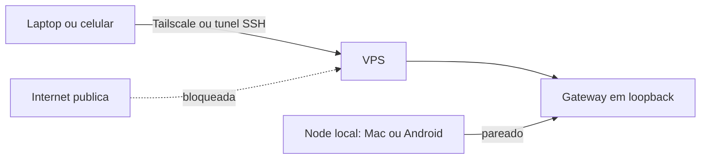

# Hospedar o OpenClaw em um VPS com acesso seguro

## Objetivo

Colocar o Gateway num servidor sempre ligado sem expor o painel à internet, mantendo o acesso administrativo separado do acesso ao Gateway.

## Explicação

A arquitetura recomendada: **o Gateway roda no VPS** (estado e workspace ficam lá) e você se conecta do laptop ou celular pela Control UI, por Tailscale ou por SSH. Dispositivos locais (Mac, iOS, Android, headless) podem ser *nodes* para tela, câmera, canvas e `system.run`, sem mover o Gateway (veja [[Gateway, clientes e nodes]]).

Provedores listados pela doc: Azure, DigitalOcean, exe.dev, Fly.io, GCP, Hetzner, Hostinger, Northflank, Oracle Cloud (camada ARM gratuita), Railway, AWS e Raspberry Pi. A lista é informativa, não uma recomendação de preço.

### Ordem das etapas

1. **Proteja o acesso administrativo primeiro.** Com Tailscale: conecte o VPS à tailnet, confirme o acesso numa segunda sessão e só então restrinja o SSH público.
2. Instale o OpenClaw e rode o onboarding.
3. (Opcional) Otimize VMs pequenas ou ARM.
4. (Opcional) Ajuste a unidade systemd.
5. Acesse pelo loopback + túnel ou Tailscale Serve.

### Regras de rede

- Mantenha o Gateway em **loopback** e acesse por túnel SSH ou Tailscale Serve.
- Se fizer bind em `lan` ou `tailnet`, defina `gateway.auth.token` ou `gateway.auth.password`, a menos que um proxy confiável cuide da autenticação.
- Não vincule contas pessoais da Apple, do Google ou gerenciadores de senhas a um agente de equipe.
- Usuários que não confiam entre si exigem **Gateways, hosts ou usuários de sistema separados**.

## Exemplo prático

Ajustes opcionais da doc para VMs pequenas (acrescentados ao `~/.bashrc`):

```bash
export NODE_COMPILE_CACHE=/var/tmp/openclaw-compile-cache
mkdir -p /var/tmp/openclaw-compile-cache
export OPENCLAW_NO_RESPAWN=1
```

Drop-in do systemd (`systemctl --user edit openclaw-gateway.service`):

```ini
[Service]
Environment=OPENCLAW_NO_RESPAWN=1
Environment=NODE_COMPILE_CACHE=/var/tmp/openclaw-compile-cache
Restart=always
RestartSec=2
TimeoutStartSec=90
```

Acesso do laptop:

```bash
ssh -N -L 18789:127.0.0.1:18789 usuario@vps
# depois, no navegador: http://127.0.0.1:18789/
```



> [!tip] Persistência
> Trate o VPS como fonte da verdade e faça backup periódico do estado e do workspace (veja [[Backup e restauração com openclaw backup]]). A doc também recomenda SSD para estado e cache.

## Armadilhas comuns

- Abrir a 18789 no firewall do provedor "só para testar".
- Fechar o SSH público antes de validar o acesso por Tailscale.
- Dar ao agente do VPS credenciais pessoais (e-mail, nuvem) com permissões amplas.
- Ignorar `exit 137` (OOM) em VMs pequenas.

## Resumo

- Gateway no VPS em loopback; acesso por túnel ou tailnet.
- Segurança administrativa antes da instalação.
- Um Gateway por fronteira de confiança.

## Relacionados

- [[Acesso remoto - SSH, Tailscale e modos de bind]]
- [[Instalar no Linux - Node, npm e serviço systemd]]
- [[Fronteiras de confiança na arquitetura]]
- [[Gateway, clientes e nodes]]
- [[Backup e restauração com openclaw backup]]

## Exercícios

1. Por que garantir o acesso por Tailscale antes de fechar o SSH público?
2. Quando é obrigatório definir `gateway.auth.token` ou `password`?
3. O que fazer quando usuários não confiam uns nos outros?
4. Que variável a doc usa para evitar *respawn* em VMs pequenas?
