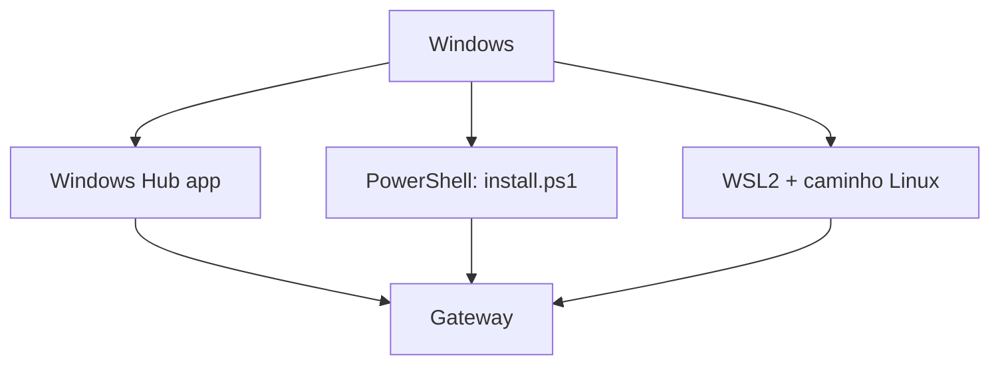

# Instalar no Windows - Hub, PowerShell e WSL2

## Objetivo

Conhecer as três rotas de instalação no Windows e escolher a mais adequada, com os cuidados de cada uma.

## Explicação

A página oficial `install` lista, para Windows: o **aplicativo nativo Windows Hub** (recomendado, com instaladores assinados x64 e arm64), o **instalador CLI em PowerShell** e um **Gateway em WSL2**. Há ainda um aplicativo desktop multiplataforma em Tauri como alternativa.

| Rota | Quando usar | Observação |
|---|---|---|
| Windows Hub | Uso diário no Windows | App companheiro nativo |
| PowerShell | Preferir CLI nativo | Instalador `install.ps1` (comando de cópia de terceiros) |
| WSL2 | Quer o comportamento mais próximo do Linux | Siga a nota de Linux dentro do WSL2 |

> [!warning] Fonte do comando
> O comando do instalador PowerShell abaixo vem de uma cópia antiga da doc hospedada por terceiros, e uma versão anterior da doc "recomendava fortemente WSL2" no Windows. A página oficial atual **destaca o Windows Hub**. Reconfirme em `docs.openclaw.ai/install` antes de executar.

### Cuidados em WSL2

- O serviço do Gateway depende do gerenciador de serviços disponível na distribuição; a doc de Linux diz que, sem gerenciador suportado, o Gateway roda em primeiro plano ou sob supervisor próprio.
- O WSL2 tem rede própria: acessar `127.0.0.1:18789` a partir do Windows costuma funcionar por encaminhamento de localhost, mas **verifique** na sua máquina.
- Mantenha o estado dentro do sistema de arquivos do WSL (não em `/mnt/c`) para evitar lentidão e problemas de permissão.

## Exemplo prático

Dentro do WSL2 (Ubuntu), siga o caminho de Linux:

```bash
node -v
npm i -g openclaw@latest
openclaw onboard --install-daemon
openclaw gateway status
```

No PowerShell (baixe e leia antes de executar):

```powershell
Invoke-WebRequest -UseBasicParsing https://openclaw.ai/install.ps1 -OutFile install.ps1
Get-Content .\install.ps1 | more
.\install.ps1 -NoOnboard
openclaw doctor
```

Se `openclaw` não for encontrado, adicione a saída de `npm prefix -g` ao PATH do Windows.



## Armadilhas comuns

- Guardar o workspace em `/mnt/c` dentro do WSL2.
- Rodar `iwr | iex` sem ler o script.
- Confundir o Gateway do WSL2 com um instalado no Windows e ter dois processos disputando a porta.
- Esquecer de reiniciar o terminal após alterar o PATH.

## Resumo

- Hub, PowerShell ou WSL2.
- Reconfirme comandos na página oficial.
- Mantenha o estado no sistema de arquivos nativo da rota escolhida.

## Relacionados

- [[Requisitos e escolha do método de instalação]]
- [[Instalar no Linux - Node, npm e serviço systemd]]
- [[O Gateway como serviço em segundo plano]]
- [[Gateway, clientes e nodes]]
- [[Corrigir openclaw not found e problemas de PATH]]

## Exercícios

1. Quais as três rotas de instalação no Windows citadas pela doc?
2. Por que evitar `/mnt/c` no WSL2?
3. Por que baixar o `install.ps1` antes de executar?
4. Que informação desta nota veio de fonte de terceiros?
