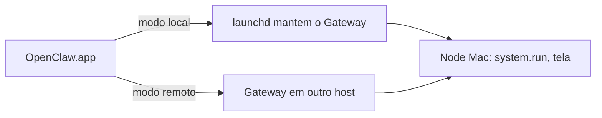

# Instalar no macOS - app de barra de menus e Gateway local

## Objetivo

Instalar e operar o OpenClaw no Mac, entendendo o papel do aplicativo de barra de menus, os dois modos de Gateway e as permissões do macOS.

## Explicação

O **OpenClaw.app** é o companheiro de barra de menus do macOS. Segundo a doc, ele oferece interface nativa, prompts de permissão, notificações, WebChat, entrada por voz, painel de widgets e ferramentas de node hospedadas no Mac como `system.run`. Exige **macOS 26.2 (Tahoe) ou posterior**. O download é um `.dmg` (preferido) ou `.zip` nas releases do GitHub.

O **Quick Chat** é um compositor estilo Spotlight para a sessão principal, aberto por padrão com Option-Espaço.

### Dois modos

| Modo | Descrição |
|---|---|
| Local | Este Mac roda o Gateway e o mantém vivo com **launchd** |
| Remoto | Outro host roda o Gateway; o Mac o controla por SSH, LAN ou Tailnet |

Nos dois modos o node do Mac usa o runtime privado embutido no app. O CLI separado só é necessário para instalar ou gerir um Gateway local que pertence ao app. Na aba **Connection** há **Install Gateway**, **Update Gateway** e **Repair Gateway**.

> [!warning] Rótulo do serviço
> A página não informa o rótulo exato do serviço launchd. Uma página de atualização de terceiros menciona rótulos legados `com.openclaw.*` e atuais `bot.molt.<perfil>`; **não confirmado** na doc atual. Para ver o que está instalado: `openclaw gateway status`.

### Permissões (TCC)

O app pede permissões de tela, microfone, fala, automação e acessibilidade. Revise em **Dashboard → Settings → This Mac → Permissions**. Conceda só o que usar: cada permissão amplia o que o agente pode fazer no seu Mac (veja [[Fronteiras de confiança na arquitetura]]).

## Exemplo prático

Instalação só por CLI, sem o app:

```bash
curl -fsSL https://openclaw.ai/install.sh -o install.sh && less install.sh
bash install.sh
openclaw onboard --install-daemon
openclaw gateway status
openclaw dashboard
```

Se o app avisar de incompatibilidade de protocolo com um Gateway antigo, rode `openclaw update` no host do Gateway.



## Armadilhas comuns

- Conceder todas as permissões do macOS "para não ser incomodado".
- Misturar um Gateway do app com outro iniciado manualmente na mesma porta 18789.
- Deixar o Mac dormir e achar que o agente "parou" (o Gateway só roda com o Mac acordado).
- Executar `system.run` sem entender as aprovações (veja [[Aprovações de exec e allowlists]]).

## Resumo

- App de barra de menus + Gateway local via launchd, ou modo remoto.
- Permissões TCC em Settings → This Mac → Permissions.
- `openclaw gateway status` é a verdade sobre o serviço.

## Relacionados

- [[Requisitos e escolha do método de instalação]]
- [[O Gateway como serviço em segundo plano]]
- [[Gateway, clientes e nodes]]
- [[Control UI e dashboard]]
- [[Aprovações de exec e allowlists]]

## Exercícios

1. Quais são os dois modos de Gateway do app do macOS?
2. Onde se revisam as permissões TCC?
3. Qual versão mínima do macOS a doc exige para o app?
4. Por que o Mac dormindo afeta o agente?
