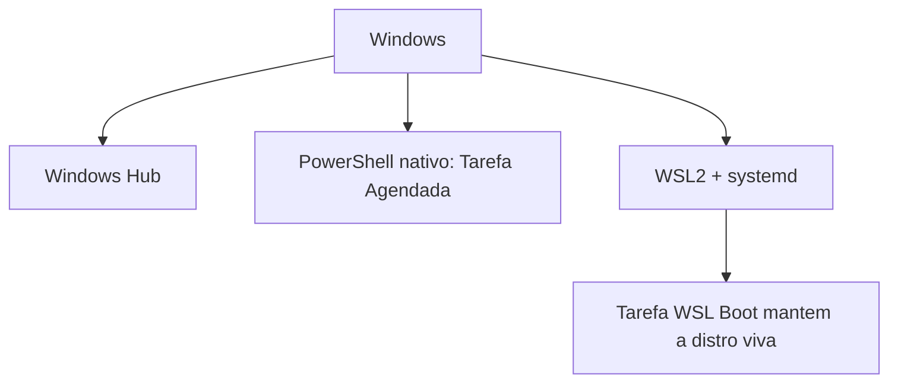

# Instalação no Windows - nativo e WSL2

## Objetivo

Escolher entre Windows Hub, Gateway nativo no PowerShell e WSL2, instalar corretamente e evitar as armadilhas de rede e de ciclo de vida do WSL.

## Explicação

A página de plataforma lista quatro caminhos:

| Caminho | Perfil |
|---|---|
| Windows Hub | App desktop nativo recomendado (WinUI), tray, chat, diagnósticos, Gateway WSL próprio para setup; instala sem admin |
| App Tauri | Alternativa: Gateway local com runtime Bun embutido ou conexão remota |
| CLI e Gateway nativos | Usuários de terminal, via PowerShell |
| WSL2 | Runtime do Gateway mais compatível com Linux |

O Gateway nativo roda como **Tarefa Agendada** do seu usuário, com gatilhos de boot e logon, e pode iniciar antes do login sem senha armazenada.

## Exemplo prático

Nativo:

```powershell
iwr -useb https://openclaw.ai/install.ps1 | iex
openclaw --version
openclaw doctor
openclaw gateway status --json
openclaw gateway install
```

WSL2:

```powershell
wsl --install -d Ubuntu-24.04
```

```bash
curl -fsSL https://openclaw.ai/install.sh | bash
openclaw gateway status
```

Habilitar systemd dentro do WSL:

```bash
sudo tee /etc/wsl.conf >/dev/null <<'EOF'
[boot]
systemd=true
EOF
```

```powershell
wsl --shutdown
```

Inicialização sem login (WSL):

```bash
sudo apt-get install -y dbus-x11
sudo loginctl enable-linger "$(whoami)"
openclaw gateway install
```

```powershell
schtasks /create /tn "WSL Boot" /tr "wsl.exe -d Ubuntu --exec dbus-launch true" /sc onstart /ru "$env:USERNAME"
```



## Armadilhas comuns

- `/ru SYSTEM` na tarefa: distros WSL são por usuário e o SYSTEM não as vê. Use `/ru "$env:USERNAME"`.
- WSL 2.6.1.0+ pode encerrar a distro 15 a 20 segundos após o último cliente sair; `dbus-launch true` contorna.
- A rede do WSL é virtual: para acesso LAN use `netsh interface portproxy` e uma regra de firewall; o IP do WSL pode mudar após reinício.
- Política de execução do PowerShell bloqueando `openclaw.ps1`: não altere a política, use `openclaw.cmd`.
- Chat web remoto exige HTTPS ou localhost.

> [!warning] Atualização a partir da 2026.9.4
> A doc alerta que o atualizador publicado pode falhar em migrações de esquema além do 17. Faça um backup verificado e siga o procedimento manual do gerenciador de pacotes (veja [[Backup e restauração do estado]]); não rebaixe marcadores de esquema.

## Resumo

- Hub para desktop, PowerShell para terminal, WSL2 para máxima compatibilidade.
- Tarefa Agendada com o usuário certo.
- Cuidado com IP do WSL e ciclo de vida da distro.

## Relacionados

- [[Requisitos e escolha do método de instalação]]
- [[Instalação no Linux com systemd]]
- [[O Gateway como serviço em segundo plano]]
- [[Acesso remoto - SSH, Tailscale e modos de bind]]
- [[Backup e restauração do estado]]

## Exercícios

1. Por que a tarefa do WSL não deve usar `/ru SYSTEM`?
2. Para que serve `dbus-launch true` na tarefa de boot?
3. O que fazer se o PowerShell bloquear `openclaw.ps1`?
4. Por que o IP do WSL exige atenção ao usar portproxy?
