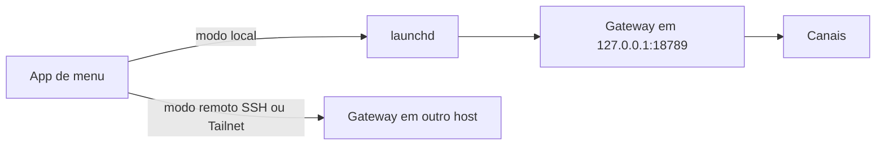

# Instalação no macOS - script e app de menu

## Objetivo

Instalar o OpenClaw em um Mac, manter o Gateway vivo via `launchd` e entender o papel do app de barra de menu.

## Explicação

No macOS há dois componentes que não se confundem:

- **CLI + Gateway:** instalados pelo script oficial. O serviço gerenciado é um **LaunchAgent**, criado por `openclaw onboard --install-daemon` ou `openclaw gateway install`.
- **App de barra de menu (companion):** interface nativa com bandeja, notificações, WebChat, entrada de voz, painel de widgets e ferramentas de node hospedadas no Mac (como `system.run`). Também tem uma barra flutuante de chat rápido, aberta por padrão com Option+Espaço.

O app opera em dois modos:

| Modo | Significado |
|---|---|
| Local | Este Mac roda o Gateway sob `launchd` |
| Remoto | Outro host roda o Gateway; o Mac controla por SSH, LAN ou Tailnet |

O macOS pede permissões de tela, microfone, fala, automação e acessibilidade; as de notificação ficam em **Dashboard → Settings → This Mac → Permissions**. Cada permissão é uma superfície de risco: conceda só o que usar.

> [!warning] Rótulo do LaunchAgent
> A página do app não informa o rótulo. A página de desinstalação cita `ai.openclaw.gateway` (e `ai.openclaw.<perfil>` para perfis). Confirme com `launchctl list | grep -i openclaw` antes de mexer à mão.

## Exemplo prático

```bash
curl -fsSL https://openclaw.ai/install.sh | bash
openclaw onboard --install-daemon
openclaw gateway status
openclaw dashboard
```

Atualizar um Gateway antigo e reiniciar:

```bash
openclaw update
openclaw gateway restart
```

Se o app de menu é dono do pacote, a atualização é feita pelo atualizador do app: `openclaw update` devolve só uma dica.



## Armadilhas comuns

- Instalar o CLI e o app e achar que o Gateway sobe sozinho sem `--install-daemon`.
- Conceder acessibilidade e gravação de tela sem necessidade.
- Mac em repouso: o Gateway para de responder (para uso 24/7 prefira um servidor).
- Usar o mesmo Mac pessoal, com contas logadas, para um agente aberto a grupos.

## Resumo

- Script oficial + `--install-daemon` cria o LaunchAgent.
- App de menu é companion, local ou remoto.
- Permissões do macOS: mínimo necessário.

## Relacionados

- [[Requisitos e escolha do método de instalação]]
- [[O Gateway como serviço em segundo plano]]
- [[Control UI e dashboard]]
- [[Acesso remoto - SSH, Tailscale e modos de bind]]
- [[Onboarding e verificação pós-instalação]]

## Exercícios

1. Que comando cria o serviço gerenciado no macOS?
2. Qual a diferença entre modo local e remoto do app?
3. Por que um Mac que dorme não serve como Gateway 24/7?
4. Como descobrir o rótulo real do LaunchAgent na sua máquina?
