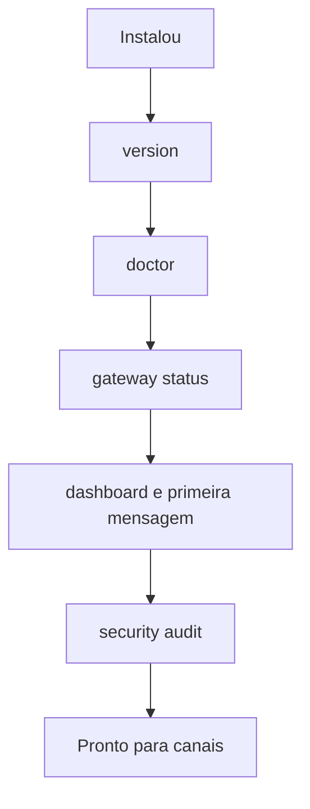

# Onboarding e verificação pós-instalação

## Objetivo

Percorrer o onboarding, validar a instalação com os comandos oficiais e fechar a primeira lista de endurecimento básico.

## Explicação

O onboarding (`openclaw onboard`) configura modelo, autenticação, Gateway e, opcionalmente, canais e o serviço em segundo plano (`--install-daemon`). Comandos relacionados já confirmados: `openclaw configure`, `openclaw setup`, `openclaw dashboard` (veja [[Tour rápido de instalação e primeira conversa]]). Em automações existe `openclaw onboard --non-interactive` (a doc de Windows mostra `--accept-risk --skip-health`; **não use** `--accept-risk` sem entender o que aceita).

### Verificação em quatro camadas

| Camada | Comando | O que prova |
|---|---|---|
| CLI | `openclaw --version` | Binário no `PATH` |
| Configuração/estado | `openclaw doctor` | Config válida, migrações, plugins |
| Serviço | `openclaw gateway status` | Gateway ativo (`--deep` procura instalações extras) |
| Canais | `openclaw channels status --probe` | Canais conectados |

## Exemplo prático

```bash
openclaw --version
openclaw doctor
openclaw gateway status --deep
openclaw channels status --probe
openclaw config validate
openclaw security audit
```

Se `openclaw` não for encontrado:

```bash
node -v
npm prefix -g
echo "$PATH"
export PATH="$(npm prefix -g)/bin:$PATH"   # coloque em ~/.zshrc ou ~/.bashrc
```

Primeira conversa de teste: abra `openclaw dashboard` e pergunte "qual é o seu workspace?". Compare a resposta com `/context list`, não com a "memória" do modelo.



> [!tip] Antes de ligar canais
> Só conecte Telegram/WhatsApp depois de `doctor`, `status` e `security audit` limpos. Defina `dmPolicy` e `allowFrom` antes do primeiro contato (veja [[Pareamento e política de DM]]).

## Armadilhas comuns

- `openclaw` não encontrado por causa do `PATH` do npm global.
- Pular o `doctor` após atualizar.
- Ligar canais antes de revisar política de DM.
- Guardar chaves em texto no `openclaw.json` em vez de variáveis/referências.

## Resumo

- Quatro camadas de verificação: CLI, doctor, serviço, canais.
- `security audit` logo após o onboarding.
- Canais só depois do básico verde.

## Relacionados

- [[Tour rápido de instalação e primeira conversa]]
- [[Configuração do Gateway em openclaw.json]]
- [[Pareamento e política de DM]]
- [[Control UI e dashboard]]
- [[Doctor e reparos do estado]]

## Exercícios

1. Que quatro comandos validam a instalação?
2. Por que rodar `security audit` antes de conectar canais?
3. Como corrigir "openclaw: command not found" com npm global?
4. Para que serve `gateway status --deep`?
