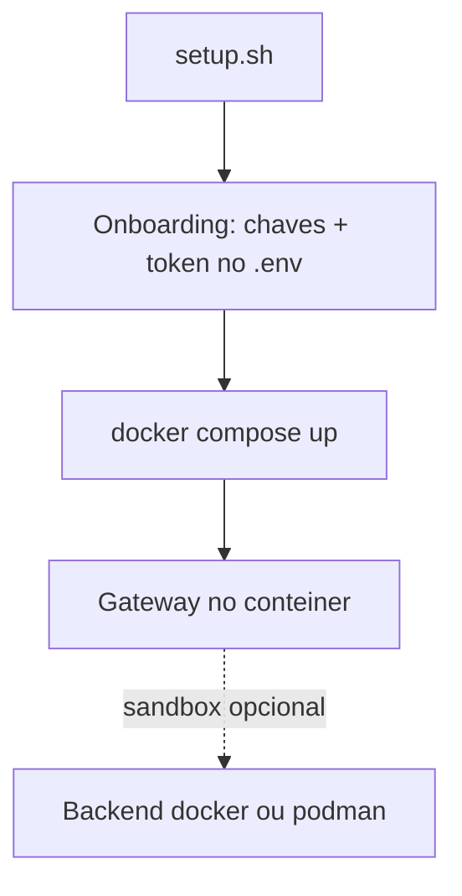

# OpenClaw em Docker - setup.sh, imagens e sandbox

## Objetivo

Subir o Gateway com Docker Compose usando o script oficial de setup, escolher a imagem e entender o que o contêiner **não** isola por padrão.

## Explicação

Pré-requisitos da doc: Docker Desktop ou Docker Engine com **Compose v2**, pelo menos **6 GB de RAM** para compilar a imagem localmente (imagens pré-compiladas dispensam isso) e disco suficiente para imagens e logs. Em VPS ou host público, revise o endurecimento de exposição de rede, em especial a cadeia `DOCKER-USER` do firewall.

O script é `./scripts/docker/setup.sh`, executado na raiz do repositório. Ele compila a imagem local `openclaw:local`, roda o onboarding (pede chaves de provedor, **gera um token do Gateway e grava no `.env`**) e inicia o Gateway com Compose.

### Imagens

| Origem | Como |
|---|---|
| Local | `./scripts/docker/setup.sh` |
| Pré-compilada | `export OPENCLAW_IMAGE="ghcr.io/openclaw/openclaw:latest"` |
| Espelho Docker Hub | `OPENCLAW_IMAGE="openclaw/openclaw:latest"` |

Tags: `latest`, `main`, `extended-stable` e de versão. Variantes `slim` e `-browser` (com Chromium).

### Instalação offline

```bash
docker load -i openclaw-image.tar
export OPENCLAW_IMAGE="ghcr.io/openclaw/openclaw:latest"
./scripts/docker/setup.sh --offline
```

`--offline` exige a imagem local e desativa pulls e builds implícitos do Compose.

> [!warning] Volumes, portas e healthcheck
> A página truncou antes de volumes, mounts, porta, bind, UID/permissões e healthcheck. Esses detalhes **não foram confirmados**; leia `docs.openclaw.ai/install/docker` e inspecione o `docker-compose.yml` do repositório antes de produção.

### Sandbox não é o contêiner do Gateway

O sandbox é **desligado por padrão** e **não exige** que o Gateway rode em contêiner. O backend padrão usa só a CLI `docker`; `"podman"` é opção nativa, e há backends SSH e OpenShell. Para usuários não confiáveis, use um Gateway por fronteira de confiança, de preferência sob usuários de SO ou hosts distintos. Variáveis citadas: `OPENCLAW_SANDBOX=1` e `OPENCLAW_DOCKER_SOCKET`.

## Exemplo prático

```bash
git clone https://github.com/openclaw/openclaw.git
cd openclaw
export OPENCLAW_IMAGE="ghcr.io/openclaw/openclaw:latest"
./scripts/docker/setup.sh
docker compose ps
docker compose logs -f
```



> [!danger] Docker socket
> Montar o socket do Docker dentro de um contêiner dá controle quase total do host a quem executar nele. Só habilite o sandbox via socket entendendo esse risco.

## Armadilhas comuns

- Publicar a porta do Gateway no host sem firewall e sem autenticação.
- Perder o `.env` com o token ou versioná-lo.
- Achar que "está em Docker" equivale a "está isolado".
- Usar tag `latest` sem fixar versão em produção.

## Resumo

- `./scripts/docker/setup.sh` faz build, onboarding e start.
- `OPENCLAW_IMAGE` escolhe a imagem; `--offline` para ambientes isolados.
- Sandbox é outro mecanismo, desligado por padrão.

## Relacionados

- [[Requisitos e escolha do método de instalação]]
- [[Fronteiras de confiança na arquitetura]]
- [[Hospedar o OpenClaw em um VPS com acesso seguro]]
- [[Onde o OpenClaw guarda estado em disco]]
- [[Backup e restauração com openclaw backup]]

## Exercícios

1. Onde o script de setup grava o token do Gateway?
2. Qual a diferença entre rodar o Gateway em Docker e ativar o sandbox?
3. Que variável escolhe a imagem usada pelo script?
4. Que partes da página de Docker não foram confirmadas nesta nota?
