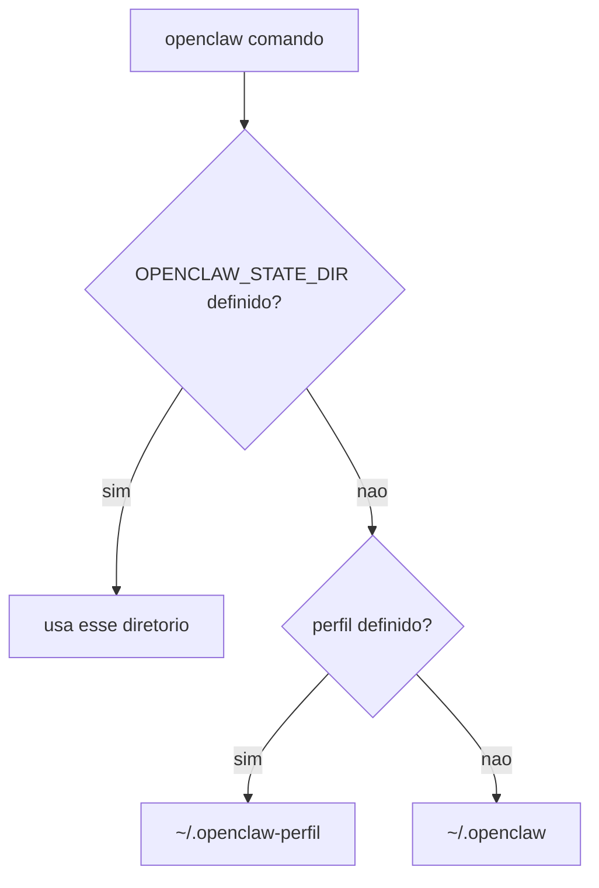

# Perfis, variáveis de ambiente e caminhos de estado

## Objetivo

Entender como `OPENCLAW_STATE_DIR`, `OPENCLAW_CONFIG_PATH`, `OPENCLAW_PROFILE` e `--profile` mudam onde o OpenClaw lê e escreve, e como isso afeta backup, migração e remoção.

## Explicação

Valores confirmados nas páginas de migração, desinstalação e Docker:

| Item | Padrão / comportamento |
|---|---|
| Diretório de estado | `~/.openclaw` |
| Perfil nomeado | `~/.openclaw-<perfil>` (via `--profile` ou `OPENCLAW_PROFILE`) |
| `OPENCLAW_STATE_DIR` | Sobrescreve o diretório de estado |
| `OPENCLAW_CONFIG_PATH` | Aponta o arquivo de configuração (pode ficar fora do estado) |
| Workspace | `~/.openclaw/workspace` (dentro do estado, a menos que configurado fora) |
| Serviço launchd (macOS) | `ai.openclaw.gateway` ou `ai.openclaw.<perfil>` |
| Unidade systemd (Linux) | `openclaw-gateway.service` ou `openclaw-gateway-<perfil>.service` |

Dentro do estado ficam: `openclaw.json`, as lojas de autenticação (SQLite por agente e compartilhada) e `credentials/`, sessões e estado de canais (como logins de WhatsApp e Telegram). No workspace ficam `MEMORY.md`, `USER.md`, skills e prompts (veja [[Onde o OpenClaw guarda estado em disco]]).

Regra de ouro da doc: use **o mesmo perfil** (ou o mesmo `OPENCLAW_STATE_DIR`) em todos os comandos relacionados, por exemplo `openclaw gateway restart` e `openclaw doctor`.

## Exemplo prático

Um perfil de testes isolado, para não tocar no agente de produção:

```bash
export OPENCLAW_PROFILE=teste
openclaw onboard --install-daemon
openclaw status
openclaw doctor
```

Ou com diretório explícito:

```bash
OPENCLAW_STATE_DIR=$HOME/oc-lab openclaw status
```



> [!warning] Precedência não confirmada
> As páginas lidas não definem explicitamente a ordem entre `OPENCLAW_STATE_DIR` e perfis. O diagrama é a leitura mais natural; confirme com `openclaw status`, que mostra o caminho efetivo do estado.

## Armadilhas comuns

- Fazer backup de um perfil e esquecer os outros: cada perfil exige backup separado.
- Caminhos externos configurados (workspaces, lojas) fora do estado: o `doctor --fix` os segue e pode alterar os originais se você copiou só parte.
- Rodar `doctor` sem o perfil correto e "consertar" o estado errado.
- Remover o estado e perder o workspace dentro dele.

## Resumo

- Estado padrão `~/.openclaw`; perfis em `~/.openclaw-<perfil>`.
- Mesmo perfil em todos os comandos.
- `openclaw status` mostra o caminho efetivo.

## Relacionados

- [[Onde o OpenClaw guarda estado em disco]]
- [[Configuração do Gateway em openclaw.json]]
- [[Roteamento multiagente e bindings]]
- [[Backup e restauração do estado]]
- [[Desinstalar e migrar para outra máquina]]

## Exercícios

1. Onde fica o estado de um perfil chamado `lab`?
2. Por que usar o mesmo perfil em `gateway restart` e `doctor`?
3. Como descobrir o caminho efetivo do estado?
4. Por que cada perfil exige seu próprio backup?
