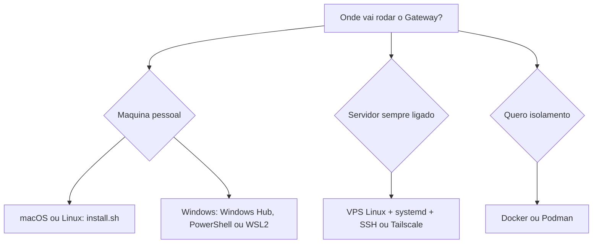

# Requisitos e escolha do método de instalação

## Objetivo

Escolher o método de instalação adequado ao seu cenário (laptop, servidor, contêiner) e conhecer os requisitos de Node e de sistema antes de rodar qualquer comando.

## Explicação

A página oficial `install` lista seis caminhos:

| Método | Quando usar |
|---|---|
| Script instalador (`install.sh` / `install.ps1`) | Recomendado; instala o Node se preciso |
| Instalador com prefixo local (`install-cli.sh`) | Manter OpenClaw e Node sob `~/.openclaw`, sem tocar no sistema |
| `npm`, `pnpm` ou `bun` global | Você já gerencia o Node |
| A partir do código-fonte | Contribuir ou rodar um checkout |
| Do GitHub `main` | Testar o que ainda não foi lançado |
| Docker, Podman, Nix, Ansible | Contêineres, declarativo, frotas |

Sistemas suportados: macOS, Linux e Windows (nativo e WSL2; o WSL2 é descrito como mais estável). `pnpm` só é necessário para compilar do código-fonte; `bun` serve apenas para a CLI global, e o Node continua recomendado como runtime do daemon.

> [!warning] Divergência sobre a versão do Node
> A página `install` diz "Node 24 (recomendado) ou Node 22.16+". A página `platforms/linux` diz "Node 26 (recomendado), ou 24.22.1+ / 26.12.1+". A doc muda a cada release (calendário v2026.10.x). **Rode o instalador oficial, que cuida do Node**, e confirme com `node -v` e a página `docs.openclaw.ai/install/node` no dia da instalação.

### Árvore de decisão



## Exemplo prático

Instalação recomendada (macOS, Linux, WSL2) e verificação:

```bash
curl -fsSL https://openclaw.ai/install.sh | bash
openclaw --version
openclaw doctor
openclaw gateway status
```

Sem rodar o onboarding automaticamente:

```bash
curl -fsSL https://openclaw.ai/install.sh | bash -s -- --no-onboard
```

> [!tip] Leia antes de executar
> Piping de `curl | bash` executa código remoto. Baixe o script (`curl -fsSLo install.sh https://openclaw.ai/install.sh`), leia e só então execute. Confira também que o domínio é oficial (veja [[Nomes antigos, domínios falsos e como verificar a fonte]]).

## Armadilhas comuns

- Instalar de um domínio parecido ou de pacote npm com nome semelhante.
- Misturar instalação via npm e via script, resultando em dois `openclaw` no `PATH`.
- Escolher Docker sem entender volumes: o estado some junto com o contêiner.
- Ignorar que o Gateway precisa ficar ligado para os canais responderem.

## Resumo

- Script instalador é o padrão; npm/pnpm para quem já tem Node.
- Windows: Hub, PowerShell nativo ou WSL2.
- Versão do Node: confirme na hora, a doc diverge entre páginas.

## Relacionados

- [[Tour rápido de instalação e primeira conversa]]
- [[Para quem é o OpenClaw e o que ele exige]]
- [[Instalação no macOS - script e app de menu]]
- [[Instalação no Linux com systemd]]
- [[Docker - instalar o Gateway em contêiner]]

## Exercícios

1. Qual a diferença entre `install.sh` e `install-cli.sh`?
2. Por que a versão exigida do Node deve ser reconfirmada no dia?
3. Que comandos verificam uma instalação concluída?
4. Quando faz sentido usar Docker em vez do script?
