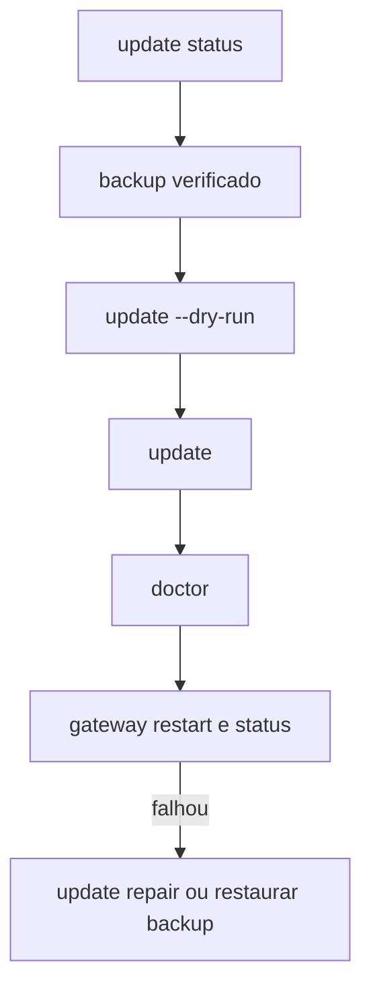

# Atualizar o OpenClaw e escolher o canal de release

## Objetivo

Atualizar com segurança, escolhendo o canal certo, com backup antes e verificação depois.

## Explicação

O OpenClaw lança versões por calendário em ritmo alto (veja [[Crescimento da comunidade e ritmo de releases]]), então atualizar é rotina. A CLI oficial:

| Comando | Função |
|---|---|
| `openclaw update` | Executa a atualização (`openclaw --update` é alias) |
| `openclaw update status [--json]` | Somente leitura: canal, disponibilidade, último relatório |
| `openclaw update wizard` | Interativo: escolhe canal e se reinicia o Gateway |
| `openclaw update repair` | Repara uma atualização que não terminou |
| `openclaw update cleanup --dry-run` | Inspeciona cópias de recuperação superadas |

### Flags principais

| Flag | Efeito |
|---|---|
| `--channel <stable\|extended-stable\|beta\|dev>` | Define e salva o canal após sucesso; `extended-stable` é só pacote |
| `--tag <dist-tag\|versão\|spec>` | Alvo só desta atualização, sem mudar o canal |
| `--dry-run` | Mostra o plano sem instalar, sincronizar plugins ou reiniciar |
| `--no-restart` | Pula o reinício gerenciado |
| `--json` | Resultado em JSON |
| `--yes` | Pula confirmações; **não** concede aprovação de exec nem aceita mudança de capacidades de plugin |

Canais `stable`, `extended-stable` e `beta` são baseados em pacote; `dev` usa checkout Git e build. O conteúdo exato de cada canal está na página "Development channels" (não lida).

### Comportamento por tipo de instalação

- **Pacote (npm/pnpm/bun):** o atualizador prepara o pacote em área privada e roda checagens de admissão antes de trocar o instalado; um Gateway ativo reinicia sozinho ao detectar a troca.
- **Git:** verifica alterações não commitadas antes de mexer.
- **Docker/Podman/Kubernetes:** troca de imagem; o entrypoint roda o Doctor antes de iniciar.
- **App do macOS:** o atualizador do app; `openclaw update` só dá uma dica.
- **Nix** (`OPENCLAW_NIX_MODE=1`): atualizações que mudam estado ficam desabilitadas.

> [!warning] Cobertura parcial
> A página `install/updating` tem mais de 119 mil caracteres e foi lida só até 100 mil; rollback e recuperação de publicação ficaram fora. A doc afirma que cópias automáticas de configuração **não** são backup completo do estado.

## Exemplo prático

Rotina segura:

```bash
openclaw update status
openclaw backup create --output ~/Backups/openclaw --verify
openclaw update --dry-run
openclaw update
openclaw doctor
openclaw gateway restart
openclaw gateway status --deep
```

Em Docker:

```bash
docker compose pull openclaw-gateway openclaw-cli
docker compose stop openclaw-gateway
docker compose up -d openclaw-gateway
```



## Armadilhas comuns

- Atualizar sem backup e sem ler as notas de release (flagradas por `--dry-run`).
- Usar `--yes` achando que ele aprova tudo: não aprova exec nem capacidades de plugin.
- Trocar de canal `stable` para `dev` em produção.
- Esquecer `doctor --post-upgrade` para checar compatibilidade de plugins (flag descrita na página do doctor).

## Resumo

- `update status` → backup → `--dry-run` → `update` → `doctor` → reinício → verificação.
- Canais: `stable`, `extended-stable`, `beta`, `dev`.
- Cada tipo de instalação atualiza de um jeito.

## Relacionados

- [[Crescimento da comunidade e ritmo de releases]]
- [[Backup e restauração do estado]]
- [[Doctor e reparos do estado]]
- [[O Gateway como serviço em segundo plano]]
- [[Docker - instalar o Gateway em contêiner]]

## Exercícios

1. Para que serve `openclaw update --dry-run`?
2. O que `--yes` não faz?
3. Como a atualização difere entre npm global e Docker?
4. Que comandos você roda logo depois de atualizar?
