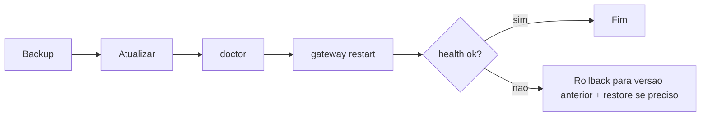

# Atualizar o OpenClaw e voltar a uma versão anterior

## Objetivo

Atualizar com segurança, verificar o resultado e voltar atrás quando uma versão nova quebra algo.

## Explicação

O OpenClaw usa versões por calendário (série v2026.10.x, com releases frequentes; veja [[Crescimento da comunidade e ritmo de releases]]). Atualizar com frequência é bom para segurança, mas trate cada update "como se estivesse publicando infraestrutura": **backup, atualizar, checar, reiniciar, verificar**.

> [!warning] Fonte parcialmente antiga
> A página de atualização lida é uma cópia de terceiros de fevereiro de 2026 (`openclaw-atom@2026.2.25`). Comandos básicos tendem a ser estáveis, mas confirme em `docs.openclaw.ai/install/updating` (não lida diretamente) e com `openclaw update --help`. O fluxo de rollback por `npm i -g openclaw@<versão>` é o mais simples e provavelmente atual.

### Fluxo recomendado

1. **Backup** (veja [[Backup e restauração com openclaw backup]]). A doc lista `~/.openclaw/openclaw.json`, `~/.openclaw/credentials/` e `~/.openclaw/workspace`.
2. **Atualizar**:
   - reexecutar o instalador (atualiza no lugar), ou
   - `npm i -g openclaw@latest` / `pnpm add -g openclaw@latest`.
3. **`openclaw doctor`**: migra configuração obsoleta, audita políticas de DM, verifica a saúde do Gateway e migra serviços antigos.
4. **Reiniciar e verificar**: `openclaw gateway restart`, `openclaw health`, `openclaw logs --follow`. Se o Gateway roda como serviço, prefira `gateway restart` a matar PIDs.

### Canais de atualização

`openclaw update --channel stable|beta|dev` (instalações git e npm); `--tag <dist-tag|versão>` para uma instalação pontual. Em instalações por código-fonte, `openclaw update` exige worktree limpo, faz rebase (canal dev), instala dependências, compila, roda doctor e reinicia (`--no-restart` evita o reinício).

### Rollback

```bash
npm view openclaw version
npm i -g openclaw@2026.10.7
openclaw doctor
openclaw gateway restart
```

(O número acima é um exemplo de formato; use uma versão que exista.) Se o Gateway falhar após o *downgrade*, o troubleshooting oficial cita `protocol mismatch` com clientes antigos: `openclaw gateway status --deep` e reinicie os clientes.

## Exemplo prático

```bash
openclaw --version
openclaw backup create --verify
npm i -g openclaw@latest
openclaw doctor
openclaw gateway restart
openclaw health
openclaw --version
```

Problema conhecido pós-update na doc de troubleshooting: erro `plugin load failed: dependency tree corrupted` ou 401 de provedor por cópia antiga de OAuth se resolvem com `openclaw doctor --fix` seguido de `openclaw gateway restart`.



> [!danger] Variável perigosa
> `OPENCLAW_ALLOW_OLDER_BINARY_DESTRUCTIVE_ACTIONS=1` existe só para *downgrade* deliberado ou recuperação de emergência, por comando isolado. Nunca a deixe definida no ambiente.

## Armadilhas comuns

- Atualizar sem backup.
- Esquecer o `doctor` e carregar configuração obsoleta.
- Atualizar o CLI e deixar o serviço apontando para o binário antigo.
- Usar `latest` automaticamente em produção sem janela de teste.

## Resumo

- Backup → update → doctor → restart → health.
- Rollback com versão fixa via npm.
- Binário antigo e serviço desalinhados são fonte comum de falhas.

## Relacionados

- [[Backup e restauração com openclaw backup]]
- [[Escada de diagnóstico do Gateway - status, logs e doctor]]
- [[Crescimento da comunidade e ritmo de releases]]
- [[O Gateway como serviço em segundo plano]]
- [[Rotina de operação - checklist e boas práticas]]

## Exercícios

1. Quais as cinco etapas de uma atualização segura?
2. Como instalar uma versão específica do npm para fazer rollback?
3. O que o `openclaw doctor` faz depois de uma atualização?
4. Por que nunca deixar `OPENCLAW_ALLOW_OLDER_BINARY_DESTRUCTIVE_ACTIONS=1` definida?
