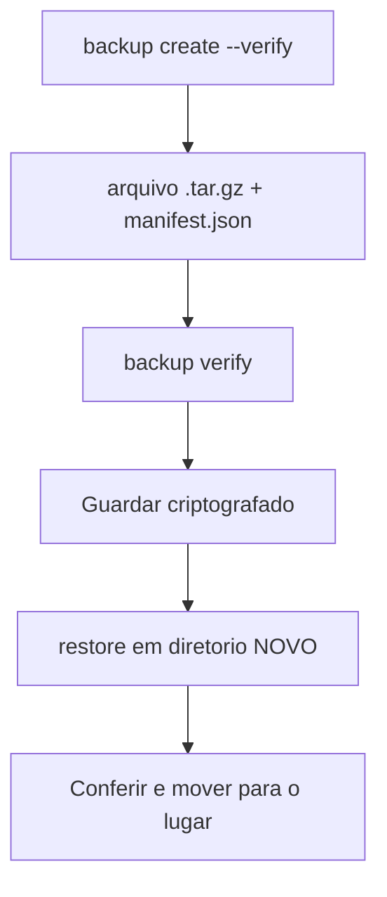

# Backup e restauração com openclaw backup

## Objetivo

Criar, verificar e restaurar backups do estado do OpenClaw com o comando nativo, entendendo o que entra, o que não entra e por que o arquivo é sensível.

## Explicação

`openclaw backup` gera um arquivo `.tar.gz` com carimbo de data do estado (veja [[Onde o OpenClaw guarda estado em disco]]). Subcomandos confirmados na página:

| Subcomando | Função |
|---|---|
| `create` | Cria o arquivo; `--to` envia a um local de armazenamento nomeado |
| `list` | Lista arquivos remotos (`--from <local>`) |
| `verify` | Verifica um arquivo local ou remoto |
| `restore` | Restaura **em um diretório novo**, nunca no lugar |
| `sqlite create/list/verify/restore` | Snapshots portáteis de um banco SQLite |
| `git init/create/log/verify/restore` | Dumps JSONL por tabela em repositório Git seu |
| `enable` / `disable` | Jobs agendados de backup externo ou Git |
| `record` | Registra o resultado de um backup externo (ex.: timer do restic) |

### Flags de `create`

`--output <caminho>` (nunca sobrescreve), `--verify`, `--only-config` (só o JSON ativo, **não é ponto de recuperação completo**), `--no-include-workspace`, `--dry-run`, `--to`, e retenção `--keep-daily/--keep-weekly/--keep-monthly <n>` (sem elas nada é apagado).

### O que entra

Diretório de estado (normalmente `~/.openclaw`) e a configuração ativa; `credentials/` se estiver fora do estado; diretórios de todos os agentes; workspaces (salvo `--no-include-workspace`); recursos duráveis de plugins ativos; bancos SQLite (pela API de backup online, compactados com `VACUUM`).

### O que não entra

Arquivos voláteis (sessões e logs, filas de entrega, locks do navegador, sockets e PID, temporários), `node_modules` de plugins, o índice `plugin-skills/` e raízes gerenciadas pelo instalador (`dev/`, `git/`, `npm/`, `tmp/`, `tools/`).

> [!danger] O arquivo é sensível
> Um backup completo contém **credenciais**. Guarde criptografado, com permissão restrita, fora de repositórios públicos e de pastas sincronizadas sem criptografia.

### Formato

Raiz com carimbo de data e diretório `payload/`; um `manifest.json` (esquema versão 1) na raiz. `verify` exige exatamente um manifesto, rejeita caminhos e links inseguros e confere cada item declarado.

## Exemplo prático

```bash
openclaw backup create --dry-run --json
openclaw backup create --output ~/Backups --verify
openclaw backup verify ./2026-10-29T08-00-00.000-03-00-openclaw-backup.tar.gz
openclaw backup restore ./2026-10-29T08-00-00.000-03-00-openclaw-backup.tar.gz --target ./restaurado
```

Retenção em armazenamento externo (nome `offsite` precisa existir na sua configuração):

```bash
openclaw backup create --to offsite --keep-daily 7 --keep-weekly 4 --keep-monthly 12
openclaw backup list --from offsite
openclaw backup verify --from offsite latest
```



## Armadilhas comuns

- Nunca testar o `restore`: backup que não restaura não é backup.
- Usar só `--only-config` achando que é recuperação completa.
- Esquecer que logs e sessões ativas não entram.
- Deixar o arquivo com credenciais em nuvem sem criptografia.

## Resumo

- `create`, `verify`, `restore` (sempre em diretório novo).
- Entra estado, credenciais, agentes, workspace; sai volátil.
- Trate o arquivo como segredo e teste restaurações.

## Relacionados

- [[Onde o OpenClaw guarda estado em disco]]
- [[Arquivos do workspace do agente]]
- [[Atualizar o OpenClaw e voltar a uma versão anterior]]
- [[Hospedar o OpenClaw em um VPS com acesso seguro]]
- [[Rotina de operação - checklist e boas práticas]]

## Exercícios

1. Por que o `restore` nunca restaura "no lugar"?
2. O que a flag `--only-config` não inclui?
3. Que itens ficam de fora do backup?
4. Por que o arquivo de backup deve ser tratado como segredo?
