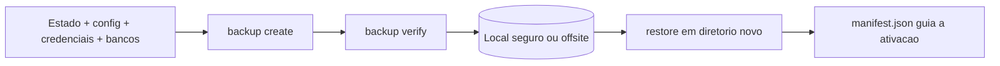

# Backup e restauração do estado

## Objetivo

Criar, verificar e restaurar backups completos com `openclaw backup`, sabendo o que entra, o que fica de fora e como proteger o arquivo gerado.

## Explicação

`openclaw backup create` gera um `.tar.gz` com estado, configuração, credenciais, bancos dos agentes e, opcionalmente, workspaces. Subcomandos confirmados na página `cli/backup`:

| Comando | Função |
|---|---|
| `backup create` | Cria o arquivo; `--to <local>` envia para armazenamento nomeado |
| `backup list [--from <local>]` | Lista arquivos locais ou remotos |
| `backup verify <arquivo>` | Valida o arquivo |
| `backup restore <arquivo> --target <dir>` | Restaura só em diretório novo ou vazio |
| `backup sqlite create/verify/restore` | Snapshots portáteis de um SQLite (`--global` ou `--agent <id>`) |
| `backup git init/create/verify/restore` | Dumps JSONL por tabela em repositório Git seu |
| `backup enable --to <local> --every 24h --keep-daily 7` / `disable` | Backups agendados |
| `backup record` | Registra o resultado de um job externo (ex.: restic) |

Flags: `--output <caminho>`, `--verify`, `--only-config` (apenas o JSON ativo, **não** é ponto de recuperação completo), `--no-include-workspace`, `--dry-run`, `--json`.

**Incluído:** diretório de estado e config ativa, `credentials/`, diretórios de agentes, workspaces descobertos, recursos duráveis de plugins, bancos SQLite via API de backup online. **Excluído:** sessões e logs voláteis, filas temporárias, travas do navegador, sockets, PIDs, `node_modules` de plugins, diretórios `dev/ git/ npm/ tmp/ tools/` e capturas privadas de atualização.

O arquivo tem uma raiz com `manifest.json` (esquema 1) e `payload/`. O `verify` rejeita travessia de caminho e links simbólicos inseguros.

> [!danger] O arquivo contém segredos
> Arquivos completos incluem credenciais e perfis de autenticação. Guarde-os criptografados, com permissão restrita, nunca em repositório público. Backups Git sem `--exclude-secrets` carregam material de credencial: o remoto precisa ser privado.

### Limites e comportamento de restauração

- Não é um snapshot atômico entre config e bancos.
- **Restaurar é um rollback:** credenciais de canal (principalmente WhatsApp) podem precisar de novo vínculo; aprovações pendentes e estado de entrega também voltam no tempo; plugins podem precisar de `openclaw plugins update <id>` ou reinstalação.
- "Restauração nunca ativa no lugar": com o Gateway parado, use o `manifest.json` para mover os arquivos ou aponte `OPENCLAW_STATE_DIR` para o estado restaurado.
- Com PostgreSQL, o backup recusa rodar com o Gateway ativo.

## Exemplo prático

```bash
mkdir -p ~/Backups/openclaw && chmod 700 ~/Backups/openclaw
openclaw backup create --dry-run
openclaw backup create --output ~/Backups/openclaw --verify
openclaw backup list
openclaw backup verify ~/Backups/openclaw/<arquivo>.tar.gz
# teste de restauracao em diretorio limpo
openclaw backup restore ~/Backups/openclaw/<arquivo>.tar.gz --target ~/restore-teste
```



## Armadilhas comuns

- Nunca testar a restauração: backup sem teste é esperança.
- Guardar o arquivo no mesmo disco/host do Gateway.
- Copiar o diretório com o Gateway ligado (SQLite com WAL inconsistente): pare o Gateway ou use `backup create`.
- Confundir `--only-config` com backup completo.
- Esquecer um perfil: cada perfil precisa do seu backup.

## Resumo

- `create --verify`, guarde fora do host, teste `restore` em diretório limpo.
- Arquivo = segredos: proteja.
- Restore é rollback: relinke canais e atualize plugins.

## Relacionados

- [[Onde o OpenClaw guarda estado em disco]]
- [[Atualizar o OpenClaw e escolher o canal de release]]
- [[Desinstalar e migrar para outra máquina]]
- [[Perfis, variáveis de ambiente e caminhos de estado]]
- [[Rotina de manutenção e checklist de operação]]

## Exercícios

1. Por que `--only-config` não é um backup completo?
2. O que o `restore` faz e não faz com o estado ativo?
3. Que cuidados o arquivo de backup exige?
4. Escreva a sequência para validar que seu backup é restaurável.
