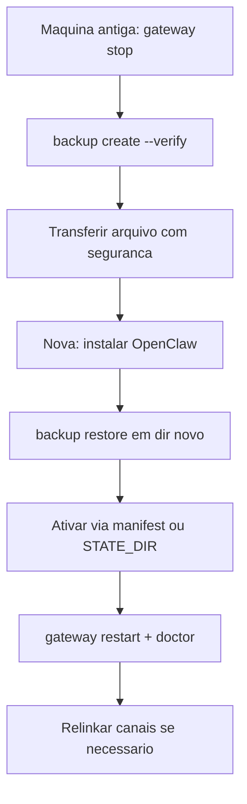

# Desinstalar e migrar para outra máquina

## Objetivo

Remover o OpenClaw sem deixar serviços órfãos e mover um agente completo para outra máquina sem corromper o estado.

## Explicação

### Desinstalar

Com a CLI ainda instalada, `openclaw uninstall` pergunta o escopo (por padrão só o serviço do Gateway). Flags `--service`, `--state`, `--workspace`, `--app` escolhem um escopo cada; `--all` seleciona os quatro. A remoção do estado **mantém** os workspaces configurados, a menos que `--workspace` também seja usado. O comando retorna código diferente de zero se algum escopo falhar.

Manual: `openclaw gateway stop` → `openclaw gateway uninstall` → mover para fora o workspace que quiser guardar (inclusive `~/.openclaw/workspace`) → apagar o estado (`${OPENCLAW_STATE_DIR:-$HOME/.openclaw}`) e, se `OPENCLAW_CONFIG_PATH` apontar para fora, esse arquivo. Repita para cada perfil. No macOS remova também `/Applications/OpenClaw.app`.

Sem a CLI: no macOS, `launchctl bootout gui/$UID/ai.openclaw.gateway` e remova o `.plist` em `~/Library/LaunchAgents/`; no Linux, a unidade `openclaw-gateway.service` (instalações muito antigas podem ter `clawdbot-gateway.service`). Os comandos de Linux e Windows ficaram truncados na leitura.

### Migrar

Copie o diretório de estado (`~/.openclaw/` por padrão) e o workspace (`MEMORY.md`, `USER.md`, skills, prompts). A doc recomenda o backup oficial.

## Exemplo prático

Simulação segura da remoção:

```bash
openclaw uninstall --dry-run --all
```

Migração:

```bash
# maquina antiga
openclaw gateway stop
mkdir -p ~/Backups/openclaw
openclaw backup create --output ~/Backups/openclaw --verify

# maquina nova (apos instalar o OpenClaw)
openclaw backup restore <arquivo.tar.gz> --target ~/openclaw-restaurado
# com o Gateway parado, ative usando o manifest.json ou OPENCLAW_STATE_DIR
openclaw gateway restart
openclaw doctor
```



> [!warning] Cuidados da migração
> Pare o Gateway antes de copiar (SQLite com WAL). A posse dos arquivos deve ser do usuário que roda o Gateway. É preciso **reiniciar** completamente (recarga não basta). O diretório criado pelo onboarding na máquina nova é substituído pelo estado restaurado.

## Armadilhas comuns

- Esquecer que o workspace dentro do estado é apagado junto com ele.
- Transferir o backup por canal inseguro (contém credenciais).
- Duas máquinas com o mesmo estado e os mesmos canais ao mesmo tempo (mensagens duplicadas, sessões conflitantes).
- Não relinkar WhatsApp após restauração.

## Resumo

- `uninstall --dry-run --all` antes; mova o workspace que quer manter.
- Migrar = backup verificado + restore em diretório novo + reinício + doctor.
- Nunca dois Gateways sobre o mesmo estado.

## Relacionados

- [[Backup e restauração do estado]]
- [[Perfis, variáveis de ambiente e caminhos de estado]]
- [[O Gateway como serviço em segundo plano]]
- [[Onde o OpenClaw guarda estado em disco]]
- [[Doctor e reparos do estado]]

## Exercícios

1. O que `openclaw uninstall --all` seleciona?
2. Por que parar o Gateway antes de copiar o estado?
3. O que acontece com o workspace ao remover o estado?
4. Liste a sequência de migração de uma máquina para outra.
