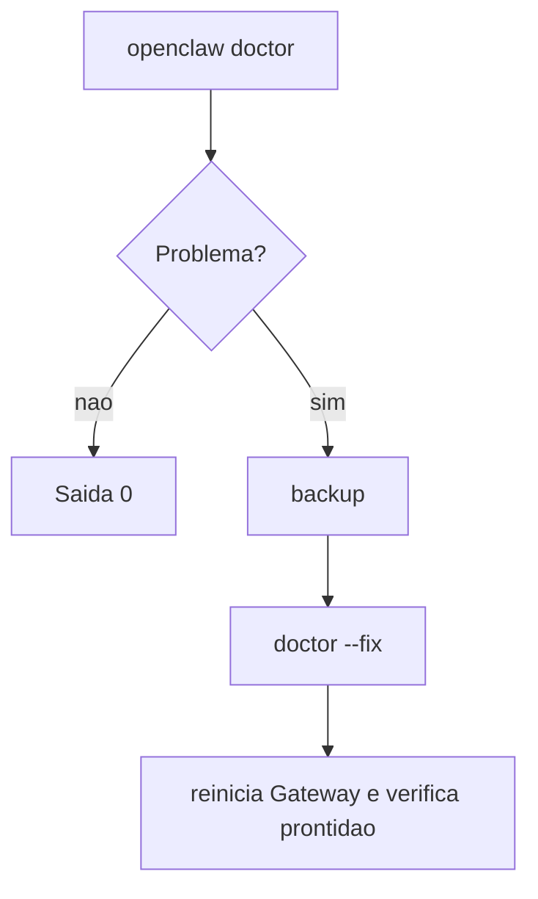

# Doctor e reparos do estado

## Objetivo

Usar o `openclaw doctor` em modo consultivo, de lint ou de reparo, entendendo suas garantias de segurança e códigos de saída.

## Explicação

O Doctor verifica a saúde da instalação (configuração, estado, bancos dos agentes, plugins, serviços) e pode reparar. Posturas:

| Postura | Comando | Comportamento |
|---|---|---|
| Guiada | `openclaw doctor` | Fluxo interativo; pode copiar config legada e aplicar migrações automáticas |
| Consultiva | `openclaw doctor --json` | Somente leitura; sai com 0 mesmo com problemas: leia `ok` e `findings` |
| Reparo | `openclaw doctor --fix` (alias `--repair`) | Aplica reparos suportados |
| Lint | `openclaw doctor --lint [--json]` | Leitura com códigos de saída por limiar, para CI |

Flags úteis: `--yes`, `--non-interactive` (não impede escrita: migrações seguras ainda rodam), `--deep` (procura instalações extras do Gateway), `--force` (reparos agressivos, sozinha continua guiada), `--post-upgrade` (compatibilidade de plugins), `--generate-gateway-token`, `--full-integrity-check`, `--state-sqlite compact`, `--session-sqlite <modo>` (`inspect`, `dry-run`, `import`, `validate`, `compact`, `recover`, `restore`).

**Verifica e repara:** validade da config, migrações de estado (inclusive aprovações de exec e sessões legadas), esquema e integridade dos bancos, posse do serviço e deriva de instalação, erros de carga de plugins, credenciais de autenticação, pré-requisitos do navegador e entradas de aprovação de exec inativas.

### Garantias de segurança

- Reparo explícito para o Gateway gerenciado correspondente, confere a posse, reinicia uma vez e verifica prontidão.
- Se a config raiz mudou depois da proposta, o Doctor **preserva o arquivo mais novo** e sai com erro.
- Roda backups pré-reparo antes de alterar.
- Reatribuir identidade de cliente exige `--fix --yes`.
- **Códigos de saída:** 0 sucesso/nada pendente; 1 avisos, erros, migrações obrigatórias adiadas ou falhas de plugin (execução avulsa não interativa); 2 config não pôde ser lida ou banco não resolvido, sem migrações.

> [!warning] Estado copiado
> `--fix` segue caminhos explicitamente configurados fora de `OPENCLAW_STATE_DIR`. Se você copiou só parte do estado, o Doctor pode modificar os originais. Copie workspaces e lojas externas e reescreva os caminhos na configuração copiada.

## Exemplo prático

```bash
openclaw doctor
openclaw doctor --json
openclaw doctor --lint --severity-min warning
openclaw doctor --deep
openclaw backup create --verify
openclaw doctor --fix
openclaw doctor --fix --non-interactive
openclaw doctor --post-upgrade
```

Para permissões de canal use `openclaw channels capabilities --channel <nome> --target channel:<id>` e `openclaw channels status --probe`, não o Doctor.



## Armadilhas comuns

- Rodar `--fix` sem backup próprio e sem o perfil certo.
- Achar que `--non-interactive` é "somente leitura": não é.
- Usar `--force` como interruptor universal.
- Ignorar o código de saída em CI: use `--lint`.

## Resumo

- Guiado, consultivo (`--json`), reparo (`--fix`), lint (`--lint`).
- Preserva config mais nova, faz backup, verifica prontidão.
- Saídas 0, 1 e 2 têm significados distintos.

## Relacionados

- [[Atualizar o OpenClaw e escolher o canal de release]]
- [[Backup e restauração do estado]]
- [[Onde o OpenClaw guarda estado em disco]]
- [[Logs e diagnóstico]]
- [[Onboarding e verificação pós-instalação]]

## Exercícios

1. Qual a diferença entre `doctor --json` e `doctor --lint`?
2. Por que `--non-interactive` não é somente leitura?
3. O que o Doctor faz se a config mudou durante a análise?
4. Que perigo existe ao rodar `--fix` em estado parcialmente copiado?
