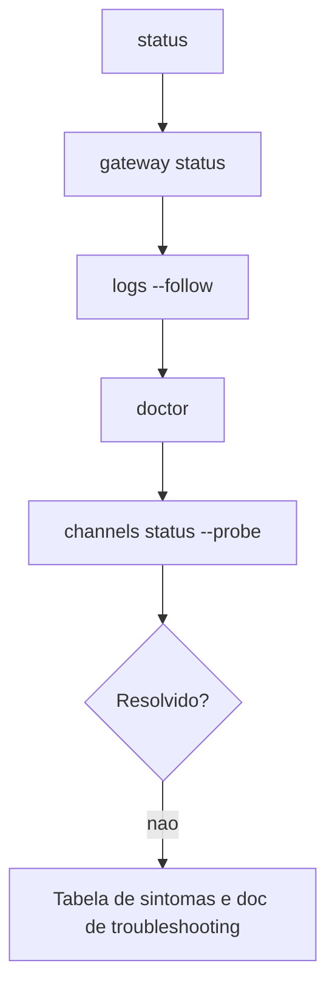

# Escada de diagnóstico do Gateway - status, logs e doctor

## Objetivo

Seguir sempre a mesma sequência de comandos ao investigar um problema, em vez de tentar correções aleatórias.

## Explicação

A página oficial de troubleshooting do Gateway (lida em cópia vietnamita; os comandos são os mesmos em qualquer idioma) propõe uma "escada": cinco comandos, nesta ordem.

```bash
openclaw status
openclaw gateway status
openclaw logs --follow
openclaw doctor
openclaw channels status --probe
```

### Como é a saída saudável

- `openclaw gateway status`: `Runtime: running` e `Connectivity probe: ok`.
- `openclaw doctor`: sem erros bloqueantes.
- `openclaw channels status --probe`: estado por conta, com `works` ou `audit ok` onde suportado.

### O que cada degrau responde

| Degrau | Pergunta |
|---|---|
| `status` | O sistema está de pé em linhas gerais? |
| `gateway status` | O serviço roda e responde na porta? (`--deep` mostra mais) |
| `logs --follow` | O que acontece enquanto reproduzo o problema? |
| `doctor` | A configuração, as migrações e o serviço estão corretos? (`--fix` aplica correções) |
| `channels status --probe` | Os canais realmente conectam? |

Para verificar a instalação, a doc de instalação lista também `openclaw doctor`, `openclaw status` e `openclaw dashboard`.



## Exemplo prático

Cenário: o bot parou de responder no Telegram.

```bash
openclaw gateway status --deep        # esta rodando?
openclaw channels status --probe      # Telegram conecta?
openclaw pairing list --channel telegram
openclaw logs --follow                # envie uma mensagem e observe
openclaw doctor --fix                 # so se o doctor indicar correcoes
```

Se o canal "funciona mas não responde", o log costuma mostrar `pairing request`, `drop guild message (mention required` ou `blocked`: causas de pareamento, menção ou allowlist (veja [[Pareamento e política de DM]]).

> [!tip] Registre o que você mudou
> Mude uma coisa por vez e anote. Se `doctor --fix` alterar algo, faça backup antes em ambientes importantes.

## Armadilhas comuns

- Reiniciar o Gateway antes de ler o log e perder o contexto do erro.
- Rodar `doctor --fix` às cegas sem ler o que ele propõe.
- Diagnosticar canal quando o Gateway nem está de pé.
- Esquecer `--probe`: sem ele o status não prova conectividade.

## Resumo

- Cinco comandos em ordem: `status`, `gateway status`, `logs --follow`, `doctor`, `channels status --probe`.
- Saída saudável: `Runtime: running` e `Connectivity probe: ok`.
- Um ajuste por vez.

## Relacionados

- [[Logs do Gateway e como lê-los]]
- [[O processo Gateway e a porta 18789]]
- [[Pareamento e política de DM]]
- [[Resolver erros comuns do Gateway - tabela de sintomas]]
- [[Corrigir openclaw not found e problemas de PATH]]

## Exercícios

1. Cite os cinco comandos da escada de diagnóstico na ordem.
2. Como é uma saída saudável de `openclaw gateway status`?
3. Por que usar `--probe` em `channels status`?
4. Que sinais no log indicam problema de pareamento ou menção?
