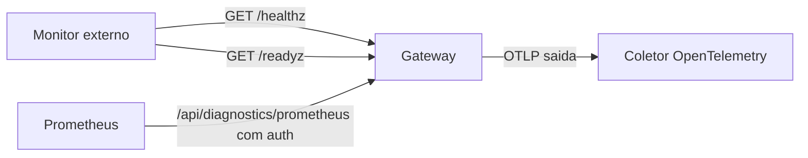

# Health checks e monitoramento do Gateway

## Objetivo

Monitorar o Gateway com os endpoints de saúde, a CLI de status e métricas, e alertar sem expor o serviço.

## Explicação

Confirmado na documentação de Docker:

| Endpoint | Pergunta que responde |
|---|---|
| `/healthz` | Vivo? (usado pelo `HEALTHCHECK` da imagem) |
| `/startupz` | Já iniciou e admite tráfego? (use em orquestradores) |
| `/readyz` | Pronto de verdade, inclusive canais? Falhas fortes de canal contam como não pronto |

Métricas Prometheus usam a porta do Gateway em `/api/diagnostics/prometheus`, **atrás da autenticação do Gateway**; a exportação OpenTelemetry é de saída e não precisa de porta publicada. O `openclaw gateway health --token ...` também é citado na doc de Docker.

CLI local: `openclaw status`, `openclaw health` (já usados em partes anteriores), `openclaw gateway status [--deep]` e `openclaw channels status --probe`. Em Linux, o `status` e o Doctor avisam sobre `TimeoutStopSec` baixo e sobre instalações sem gerenciador de serviço.

## Exemplo prático

Script de verificação para um cron do sistema (adapte, é um exemplo próprio):

```bash
#!/usr/bin/env bash
set -u
URL=http://127.0.0.1:18789
if ! curl -fsS --max-time 5 "$URL/readyz" >/dev/null; then
  echo "OpenClaw nao pronto em $(date -Is)" >> "$HOME/oc-alertas.log"
  openclaw gateway status --deep >> "$HOME/oc-alertas.log" 2>&1
  openclaw logs --limit 50 --plain >> "$HOME/oc-alertas.log" 2>&1
fi
```

Agendar no cron do sistema a cada 5 minutos:

```bash
( crontab -l 2>/dev/null; echo '*/5 * * * * /home/usuario/oc-check.sh' ) | crontab -
```



> [!tip] Alerta sem expor
> Rode o verificador no próprio host (loopback). Para monitorar de fora, use túnel/Tailscale em vez de abrir a porta (veja [[Hospedar em um VPS com segurança]]).

## Armadilhas comuns

- Usar só `/healthz` e perder falhas de canal (use `/readyz`).
- Abrir o Prometheus sem autenticação.
- Alertar a cada falha transitória: exija duas falhas consecutivas.
- Não monitorar a idade do último backup.

## Resumo

- `/healthz`, `/startupz`, `/readyz` têm papéis distintos.
- Métricas atrás de autenticação.
- Monitor local ou via túnel.

## Relacionados

- [[O processo Gateway e a porta 18789]]
- [[O Gateway como serviço em segundo plano]]
- [[Logs e diagnóstico]]
- [[Docker - instalar o Gateway em contêiner]]
- [[Hospedar em um VPS com segurança]]

## Exercícios

1. Qual endpoint considera falhas de canal?
2. Por que as métricas Prometheus ficam atrás de autenticação?
3. Qual a vantagem de monitorar pelo loopback?
4. Escreva um critério de alerta que evite falsos positivos.
