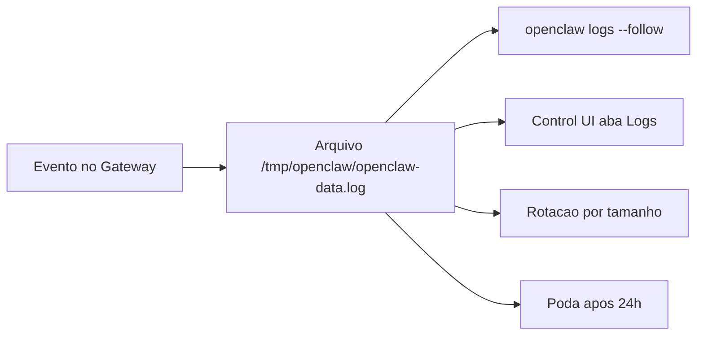

# Logs do Gateway e como lê-los

## Objetivo

Saber onde estão os logs do Gateway, como acompanhá-los em tempo real e quais cuidados de privacidade tomar ao compartilhá-los.

## Explicação

### Arquivos

- Padrão: `/tmp/openclaw/openclaw-AAAA-MM-DD.log`.
- Perfis nomeados: `/tmp/openclaw/openclaw-<perfil>-AAAA-MM-DD.log` (`--dev` escreve `openclaw-dev-...`).
- A data usa o fuso local do host do Gateway.
- Se `/tmp/openclaw` for inseguro ou indisponível, ou no Windows, os logs vão para um diretório `openclaw-<uid>` sob o diretório temporário do SO.
- Arquivos datados são **removidos após 24 horas**.
- Rotação: quando a próxima escrita passaria de `logging.maxFileBytes` (padrão 100 MB), o arquivo rota; até cinco arquivos numerados são mantidos.
- Override: `logging.file` em `~/.openclaw/openclaw.json`.

> [!warning] Não lido
> As chaves `logging.level`, `consoleLevel`, `consoleStyle`, `redactSensitive` e diagnósticos aparecem no índice, mas a leitura truncou antes delas. **Não as use sem verificar** em `docs.openclaw.ai/logging.md` (ou `openclaw config schema`).

### `openclaw logs`

| Flag | Padrão | Efeito |
|---|---|---|
| `--follow` | desligado | Acompanha e reconecta com *backoff* |
| `--limit <n>` | 200 | Máximo de linhas por busca |
| `--max-bytes <n>` | 250000 | Máximo de bytes por busca |
| `--interval <ms>` | 1000 | Intervalo de poll ao seguir |
| `--json` | desligado | JSON por linha |
| `--plain` | desligado | Força texto simples em TTY |
| `--no-color` | n/a | Sem cores ANSI |

A aba **Logs** da Control UI também acompanha o log em arquivo (veja [[Control UI e dashboard]]).

## Exemplo prático

```bash
openclaw logs --follow
openclaw --profile work logs --follow
openclaw logs --limit 500 --json | head
ls -lh /tmp/openclaw/
grep -i "mention required" /tmp/openclaw/openclaw-$(date +%F).log
```

Padrões de procura que a doc de troubleshooting associa a causas: `pairing request`, `drop guild message (mention required` e `blocked` (canal funciona mas não responde); `refusing to bind gateway ... without auth`; `EADDRINUSE`.



> [!danger] Logs podem conter dados sensíveis
> Mensagens, nomes e trechos de conversas podem aparecer. Antes de colar logs em fóruns ou issues, revise e remova tokens, números de telefone e conteúdo privado.

## Armadilhas comuns

- Procurar um incidente antigo e descobrir que o log foi podado após 24 h.
- Compartilhar logs completos sem revisão.
- Tentar diagnosticar sem `--follow` e sem reproduzir o problema em tempo real.
- Assumir que `/tmp` sobrevive a reinicializações do servidor.

## Resumo

- Arquivo diário em `/tmp/openclaw`, poda em 24 h, rotação em 100 MB.
- `openclaw logs --follow` para tempo real.
- Revise antes de compartilhar.

## Relacionados

- [[Escada de diagnóstico do Gateway - status, logs e doctor]]
- [[Control UI e dashboard]]
- [[Streaming de respostas e fila de comandos]]
- [[Memória como superfície de ataque e privacidade]]
- [[Rotina de operação - checklist e boas práticas]]

## Exercícios

1. Onde fica o arquivo de log padrão do Gateway?
2. Por quanto tempo os arquivos datados são mantidos?
3. Que flag exibe logs em JSON por linha?
4. Por que revisar logs antes de compartilhá-los?
