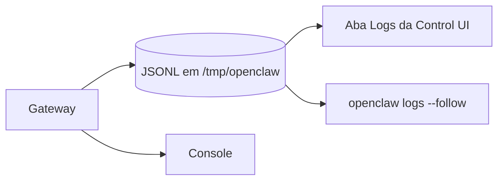

# Logs e diagnóstico

## Objetivo

Ler e configurar logs do Gateway, ajustar níveis, seguir eventos em tempo real e entender a redação de segredos.

## Explicação

> [!info] Fonte
> Esta nota usa a página `logging` em coreano (espelho oficial acessível). Termos e valores foram mantidos como estão; confirme na versão em inglês se algo parecer divergente.

**Superfícies:** arquivo de log JSONL escrito pelo Gateway (a aba **Logs** da Control UI o acompanha em tempo real) e saída de console no terminal que roda o Gateway.

**Arquivo:** padrão `/tmp/openclaw/openclaw-YYYY-MM-DD.log` (data no fuso do host). Se `/tmp/openclaw` não for seguro (no Windows, sempre), usa um diretório por usuário `openclaw-<uid>` no temporário do SO. Arquivos diários são apagados após 24 horas; passando de `logging.maxFileBytes` (padrão 100 MB) há rotação para `openclaw-YYYY-MM-DD.1.log`, com até 5 arquivos. Caminho configurável em `logging.file`.

**Níveis:** `silent`, `fatal`, `error`, `warn`, `info`, `debug`, `trace`. `logging.level` (arquivo, padrão `info`), `logging.consoleLevel` (console). `OPENCLAW_LOG_LEVEL` vence o arquivo de configuração; `--log-level <nível>` vence a variável naquele comando; `--verbose` afeta só console e logs WebSocket.

### `openclaw logs`

| Flag | Padrão | Função |
|---|---|---|
| `--follow` | desligado | Segue e reconecta se cair |
| `--limit <n>` | 200 | Máximo de linhas |
| `--max-bytes <n>` | 250000 | Máximo de bytes |
| `--interval <ms>` | 1000 | Intervalo de polling |
| `--json` | desligado | Um objeto JSON por linha (tipos: `meta`, `log`, `notice`, `raw`, `error`) |
| `--plain`, `--no-color`, `--utc` | | Formatação |
| `--url`, `--token`, `--timeout <ms>` | timeout 30000 | RPC; ao usar `--url`, passe também credenciais |

Logs por canal: `openclaw channels logs --channel whatsapp` (padrão `all`; `--lines`, `--json`).

### Redação

`logging.redactSensitive` aceita `off` ou `tools` (padrão `tools`); `logging.redactPatterns` substitui os padrões padrão. A redação ocorre antes de gravar em disco (logs, transcrições de sessão, eventos da UI). Com `off`, payloads de fronteira de segurança continuam redigidos.

## Exemplo prático

```json5
{
  logging: {
    level: "info",
    consoleLevel: "info",
    consoleStyle: "pretty",   // pretty | compact | json
    redactSensitive: "tools",
    redactPatterns: ["sk-.*"],
  },
}
```

```bash
openclaw logs --follow
openclaw logs --json --limit 50
openclaw channels logs --channel telegram --lines 100
OPENCLAW_LOG_LEVEL=debug openclaw gateway --verbose --ws-log compact
```

Diagnósticos estruturados estão ligados por padrão (`diagnostics.enabled: false` desliga). Variáveis de depuração de transporte (`OPENCLAW_DEBUG_MODEL_PAYLOAD=full-redacted`) podem expor prompts e mensagens: **só durante a depuração**.



## Armadilhas comuns

- Logs em `/tmp`: somem com reinício do host e são apagados em 24 horas; exporte o que precisa para investigação.
- `debug`/`trace` em produção: volume alto e dados sensíveis.
- Colar logs em issues públicas sem revisar: redação não é infalível.
- Usar `--url` sem credenciais explícitas: erro `gateway url override requires explicit credentials`.

## Resumo

- Arquivo JSONL diário + console; níveis de `silent` a `trace`.
- `openclaw logs --follow` para tempo real.
- Segredos são redigidos, mas revise antes de compartilhar.

## Relacionados

- [[Control UI e dashboard]]
- [[O processo Gateway e a porta 18789]]
- [[Doctor e reparos do estado]]
- [[Health checks e monitoramento do Gateway]]
- [[Streaming de respostas e fila de comandos]]

## Exercícios

1. Onde ficam os logs por padrão e por quanto tempo?
2. Que valor vence: `logging.level` ou `OPENCLAW_LOG_LEVEL`?
3. O que faz `--follow` quando a conexão cai?
4. Por que `full-redacted` deve ser usado só durante depuração?
