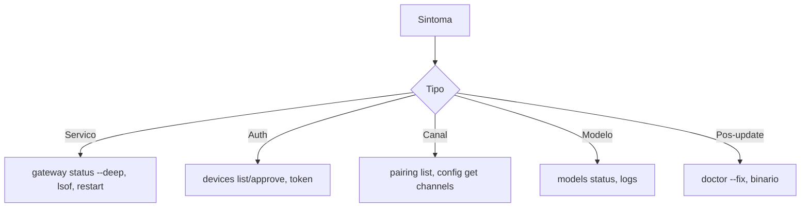

# Resolver erros comuns do Gateway - tabela de sintomas

## Objetivo

Ter uma referência rápida de sintomas conhecidos, causas prováveis e correções, retirada da página oficial de troubleshooting do Gateway.

## Explicação

A tabela abaixo traduz e resume os casos da doc (lida em cópia vietnamita; a versão em inglês deve ter o mesmo conteúdo, mas **confirme** na sua versão).

| Sintoma | Causa provável | Correção |
|---|---|---|
| Pós-update: `plugin load failed: dependency tree corrupted` | Registro de plugins falhou | `openclaw doctor --fix` e `openclaw gateway restart` |
| Pós-update: 401 do provedor | Cópia antiga de OAuth | `openclaw doctor --fix` |
| Serviço para após update, binário antigo | Binário mais antigo que a versão que gravou a config | `which openclaw`, `openclaw --version`, `openclaw config get meta.lastTouchedVersion`; corrigir PATH ou `openclaw gateway install --force` + `gateway restart` |
| `protocol mismatch` após downgrade | Cliente antigo conectado | `openclaw gateway status --deep` e reiniciar clientes |
| `skipping skills path ... reason=symlink-escape` | Symlink aponta fora da raiz de skills | `realpath ~/.agents/skills/<nome>` e `openclaw config get skills.load`; adicione só alvos confiáveis a `allowSymlinkTargets` |
| `HTTP 429: rate_limit_error: Extra usage is required` (Anthropic) | Contexto longo sem elegibilidade | `openclaw models status`; usar janela padrão, credencial elegível ou fallback |
| `Your request was blocked` (403) | WAF/CDN do provedor | `openclaw logs --follow`; liberar regra estreita, não desligar a proteção do site inteiro |
| Backend local: `/v1/models` ok, turno falha | Backend não aguenta prompt grande | testar `openclaw infer model run --model <provedor/modelo> --prompt "..." --json`; talvez `compat.requiresStringContent`, `compat.strictMessageKeys` ou `compat.supportsTools: false` |
| Canal ok, sem resposta | Pareamento, menção ou allowlist | `openclaw pairing list --channel <canal>` e `openclaw config get channels` |
| `device identity required` / `origin not allowed` (Control UI) | Contexto inseguro ou origem não permitida | HTTPS ou localhost; adicionar a origem em `gateway.controlUi.allowedOrigins` |
| `AUTH_TOKEN_MISMATCH` / `AUTH_DEVICE_TOKEN_MISMATCH` | Token divergente | Repetir conforme `canRetryWithDeviceToken`; rotacionar/reaprovar via `openclaw devices` |
| `PAIRING_REQUIRED` | Dispositivo não aprovado | `openclaw devices list` e `openclaw devices approve <requestId>` |
| `Runtime: stopped`, `EADDRINUSE` | Serviço parado ou porta em uso | `openclaw gateway status --deep`, `lsof -i :18789`, `openclaw gateway restart` |
| `Gateway start blocked: set gateway.mode=local` | Falta `gateway.mode` | `gateway.mode="local"` ou `openclaw onboard --mode local` |
| `refusing to bind gateway ... without auth` | Bind fora do loopback sem autenticação | Definir token ou senha antes do bind |

> [!warning] Os subcomandos de `openclaw devices`
> `list` e `approve <requestId>` aparecem na doc de troubleshooting; os demais subcomandos de `devices` e `nodes` seguem **não confirmados**.

## Exemplo prático

Caso "Control UI não abre pelo domínio":

```bash
openclaw config get gateway.controlUi
openclaw config set gateway.controlUi.allowedOrigins '["https://painel.exemplo.com"]'
openclaw config validate
openclaw gateway restart
```

(A forma exata do valor JSON em `config set` pode variar: use `openclaw config schema` e confirme.)



## Armadilhas comuns

- Copiar o comando de correção sem entender a causa.
- Desligar a proteção do provedor ou da rede inteira para "resolver" um 403.
- Usar `OPENCLAW_ALLOW_OLDER_BINARY_DESTRUCTIVE_ACTIONS=1` fora de emergência.
- Liberar `allowedOrigins` com curinga amplo.

## Resumo

- Muitos erros pós-update se resolvem com `doctor --fix` + `gateway restart`.
- Auth e pareamento: `devices` e `pairing`.
- Prefira correções estreitas e reversíveis.

## Relacionados

- [[Escada de diagnóstico do Gateway - status, logs e doctor]]
- [[Acesso remoto - SSH, Tailscale e modos de bind]]
- [[Control UI e dashboard]]
- [[Pareamento e política de DM]]
- [[Atualizar o OpenClaw e voltar a uma versão anterior]]

## Exercícios

1. Que comando resolve `plugin load failed` após uma atualização?
2. O que causa `refusing to bind gateway ... without auth`?
3. Como verificar quem ocupa a porta 18789?
4. Por que não desligar o WAF inteiro ao ver `Your request was blocked`?
