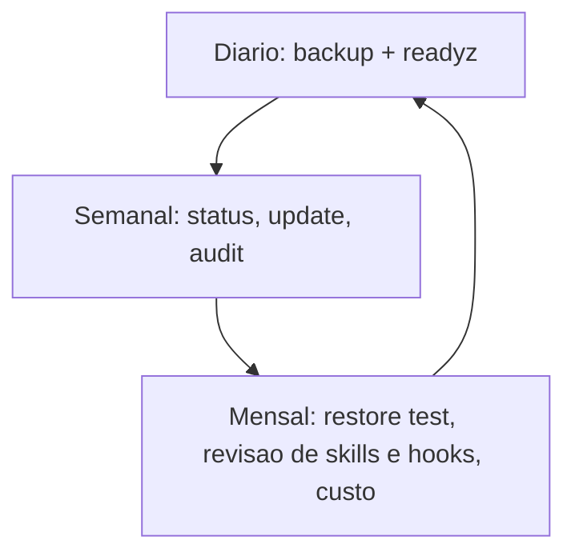

# Rotina de manutenção e checklist de operação

## Objetivo

Transformar as tarefas de operação em uma rotina curta, diária, semanal e mensal, com comandos reais e critérios de sucesso.

## Explicação

Esta nota consolida a pasta 14 em um plano de operação. Os comandos vêm das notas anteriores; o calendário é uma sugestão do autor, não da doc.

| Frequência | Tarefa | Comando |
|---|---|---|
| Diária (automática) | Backup agendado | `openclaw backup enable --to <local> --every 24h --keep-daily 7` |
| Diária | Saúde | `/readyz` por monitor local |
| Semanal | Status do canal | `openclaw channels status --probe` |
| Semanal | Atualização | `openclaw update status` e, se for o caso, o fluxo seguro |
| Semanal | Auditoria | `openclaw security audit` |
| Mensal | Teste de restauração | `openclaw backup restore ... --target` em diretório limpo |
| Mensal | Revisão de skills, hooks e automações | `openclaw skills list`, `openclaw hooks list`, `openclaw automations list` |
| Mensal | Limpeza de memória e custos | `/usage cost`, revisão de `MEMORY.md` |

## Exemplo prático

Script semanal (exemplo próprio, revise antes de usar):

```bash
#!/usr/bin/env bash
set -u
echo "== versao ==";   openclaw --version
echo "== update ==";   openclaw update status
echo "== doctor ==";   openclaw doctor --lint --severity-min warning
echo "== gateway ==";  openclaw gateway status --deep
echo "== canais ==";   openclaw channels status --probe
echo "== auditoria =="; openclaw security audit
echo "== skills ==";   openclaw skills list
echo "== automacoes =="; openclaw automations list
```



> [!tip] Registre o que fez
> Mantenha um diário curto (`manutencao.md`) com data, versão e o que mudou. Ajuda a voltar atrás e é útil em incidentes (veja [[Template - Incidente de Segurança]]).

## Armadilhas comuns

- Backup agendado que ninguém testa.
- Atualizar na sexta à noite sem plano de rollback.
- Deixar skills e automações antigas ativas "porque funcionam".
- Ignorar o custo de tokens até a fatura chegar (veja [[Custo e escolha de modelo]]).

## Resumo

- Diário (backup, saúde), semanal (status, audit), mensal (restore, revisão).
- Registre mudanças.
- Automatize o que puder, teste o que importa.

## Relacionados

- [[Atualizar o OpenClaw e escolher o canal de release]]
- [[Backup e restauração do estado]]
- [[Doctor e reparos do estado]]
- [[Health checks e monitoramento do Gateway]]
- [[Custo e escolha de modelo]]

## Exercícios

1. Quais tarefas você automatizaria e quais manteria manuais?
2. Por que o teste de restauração é mensal e não só diário?
3. Que comando lista automações para revisão?
4. Escreva um critério de "pronto" para a revisão semanal.
