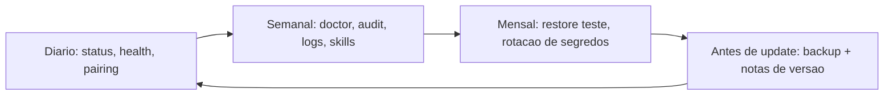

# Rotina de operação - checklist e boas práticas

## Objetivo

Transformar o que foi visto nesta pasta numa rotina curta, repetível e segura para quem opera um Gateway de verdade.

## Explicação

Um Gateway é um serviço com credenciais, canais e acesso a ferramentas. Operá-lo é um trabalho de rotina, não apenas de instalação. A divisão a seguir é uma **sugestão do autor** montada sobre comandos confirmados nas notas anteriores.

### Diário (ou a cada alerta)

- `openclaw gateway status` e `openclaw health`.
- Revisar pedidos de pareamento pendentes (`openclaw pairing list`).
- Olhar o consumo: `/usage cost` no chat (veja [[Custo e escolha de modelo]]).

### Semanal

- `openclaw doctor` e `openclaw security audit` (a segurança é aprofundada em pastas posteriores).
- Ler `openclaw logs` em busca de `blocked`, `EADDRINUSE`, 401/403 repetidos.
- Revisar `openclaw skills list` e `openclaw hooks list`: algo novo que você não instalou?
- Conferir automações: `openclaw automations list`.

### Antes de cada atualização

- `openclaw backup create --verify`, guardar cópia criptografada (veja [[Backup e restauração com openclaw backup]]).
- Ler as notas de versão, atualizar, `doctor`, `gateway restart`, `health` (veja [[Atualizar o OpenClaw e voltar a uma versão anterior]]).

### Mensal

- Testar uma **restauração** de backup em diretório novo.
- Rotacionar tokens e chaves de API; revogar dispositivos e nodes que não usa.
- Revisar allowlists, `dmPolicy` e o perfil de ferramentas dos agentes.



> [!tip] Automatize o que for seguro
> Alertas de "Gateway parado" e backups agendados (`openclaw backup enable`, não detalhado aqui; veja a doc) valem mais que disciplina manual. Mas mantenha as aprovações de exec em tarefas automáticas (veja [[Aprovações de exec e allowlists]]).

## Exemplo prático

Script de verificação semanal (rode manualmente e leia a saída):

```bash
#!/usr/bin/env bash
set -u
echo "== status ==";  openclaw gateway status
echo "== health ==";  openclaw health
echo "== doctor ==";  openclaw doctor
echo "== audit  ==";  openclaw security audit
echo "== canais ==";  openclaw channels status --probe
echo "== skills ==";  openclaw skills list
echo "== hooks  ==";  openclaw hooks list
echo "== autom. =="; openclaw automations list
```

## Armadilhas comuns

- Instalar e esquecer: sem rotina, atualizações e revisões nunca acontecem.
- Nunca testar restauração.
- Acumular skills, hooks e automações que ninguém revisa.
- Deixar tokens antigos válidos depois de trocar de aparelho.

## Resumo

- Diário, semanal, mensal e pré-atualização.
- Backups testados e segredos rotacionados.
- Revisão periódica do que está habilitado.

## Relacionados

- [[Backup e restauração com openclaw backup]]
- [[Atualizar o OpenClaw e voltar a uma versão anterior]]
- [[Logs do Gateway e como lê-los]]
- [[Custo e escolha de modelo]]
- [[Escada de diagnóstico do Gateway - status, logs e doctor]]

## Exercícios

1. Que verificações você faria todo dia?
2. Por que testar uma restauração mensalmente?
3. O que revisar sobre skills, hooks e automações a cada semana?
4. Monte seu próprio checklist de pré-atualização com cinco itens.
