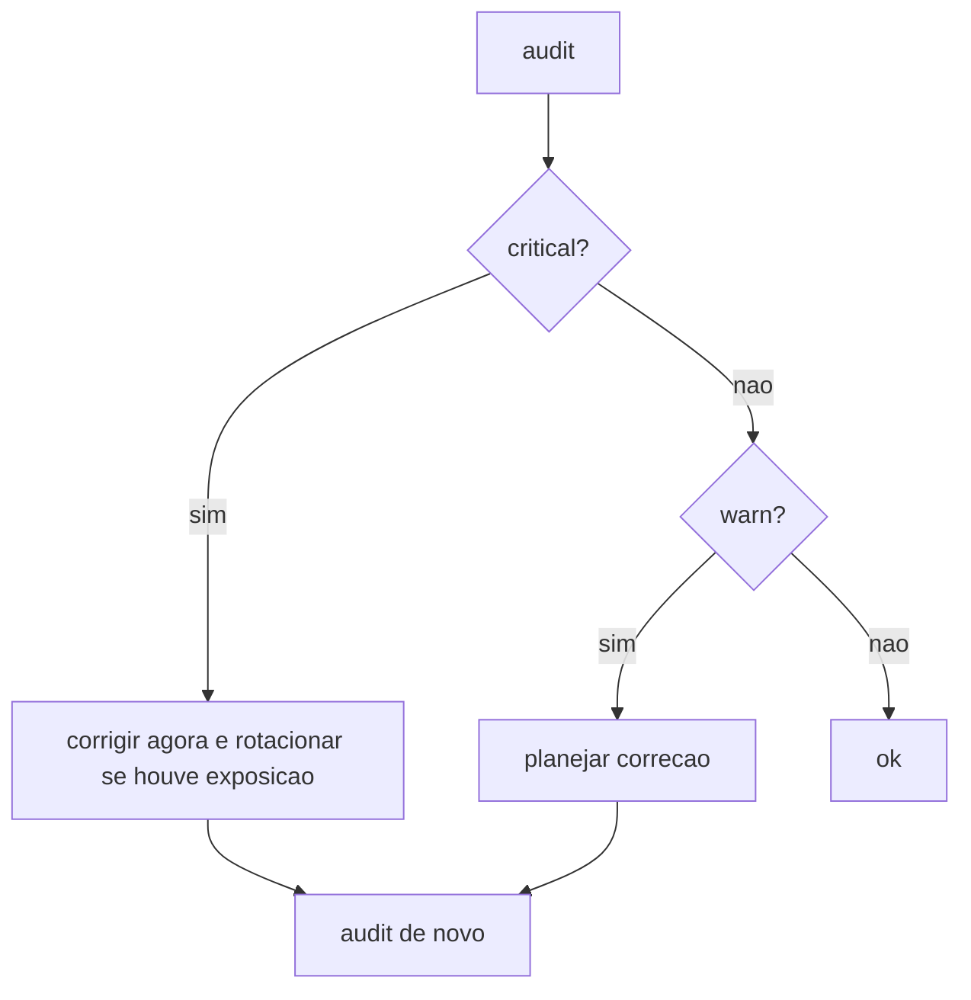

# Auditoria com openclaw security audit

## Objetivo

Usar `openclaw security audit` como verificação rotineira, interpretar `checkId` e severidade e saber o que `--fix` faz (e não faz).

## Explicação

`openclaw security audit` examina configuração e estado e pode aplicar correções seguras.

| Flag | Efeito |
|---|---|
| `--deep` | Acrescenta checagens ao vivo do Gateway e coletores de segurança de plugins |
| `--token <t>` / `--password <p>` / `--auth password` | Credenciais só para esta execução (não alteram config nem SecretRef) |
| `--fix` | Aplica reparos seguros |
| `--json` | Saída legível por máquina |

Cada achado tem `checkId`, `severity` e indicação de auto-correção. O resultado tem `summary` e `findings`; com `--json` aparecem `suppressedFindings`.

### O que `--fix` muda

- `groupPolicy="open"` → `allowlist` (inclui variantes por conta).
- Em WhatsApp, popula `groupAllowFrom` a partir de `allowFrom` armazenado, sob certas condições.
- Aperta permissões de arquivos de estado, configuração, credenciais e includes (`chmod` em POSIX, `icacls` no Windows).

### O que `--fix` **não** muda

Não rotaciona tokens, senhas ou chaves; não desativa ferramentas; não altera bind, autenticação ou rede; não remove plugins ou skills.

### Exemplos de checagens confirmadas

| checkId | Severidade | Significado |
|---|---|---|
| `fs.state_dir.perms_world_writable` | critical | Qualquer um pode modificar o estado |
| `fs.state_dir.perms_group_writable` | warn | Grupo pode modificar o estado |
| `fs.state_dir.perms_readable` | warn | Estado legível por outros |
| `fs.config.perms_writable` | critical | Outros podem alterar auth, política ou config |
| `runtime.node_security_patch` | warn | Node abaixo do patch recomendado (24.22.1+ ou 26.12.1+) |

> [!warning] Lista incompleta
> A página `audit-checks` tem mais de 111 mil caracteres e só o início (runtime e permissões de arquivos) foi lido. Checagens de exposição, ferramentas, canais, plugins e modelos existem, mas seus IDs não foram confirmados aqui. `gateway.probe_*`, `plugins.code_safety*` e `skills.code_safety*` só rodam com `--deep`.

## Exemplo prático

```bash
openclaw security audit
openclaw security audit --deep
openclaw security audit --json | jq '.summary'
openclaw security audit --deep --json | jq '.findings[] | select(.severity=="critical") | .checkId'
openclaw security audit --fix
```



## Armadilhas comuns

- Rodar `--fix` e achar que tudo foi resolvido: bind, autenticação e skills ficam como estão.
- Esquecer o `--deep` e perder achados de plugins e skills.
- Suprimir achados sem registro de motivo.
- Passar senha na linha de comando em máquina compartilhada (aparece no histórico e na lista de processos).

## Resumo

- Auditoria rotineira; `--deep` para o quadro completo.
- `--fix` só mexe em permissões e `groupPolicy`.
- Trate `critical` como incidente em potencial.

## Relacionados

- [[Linha de base endurecida em 60 segundos]]
- [[Doctor e reparos do estado]]
- [[Rotina de manutenção e checklist de operação]]
- [[Onde o OpenClaw guarda estado em disco]]
- [[Checklist de hardening e resposta a incidentes]]

## Exercícios

1. O que `--fix` não altera?
2. Que checagens só rodam com `--deep`?
3. Qual a severidade de `fs.config.perms_writable` e por quê?
4. Como listar apenas os `checkId` críticos em JSON?
