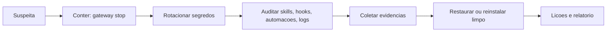

# Checklist de hardening e resposta a incidentes

## Objetivo

Reunir os controles da pasta em um checklist único e ter um roteiro de resposta a incidentes alinhado com a doc (Conter, Rotacionar, Auditar, Coletar).

## Explicação

### Checklist de hardening

| # | Controle | Verificação |
|---|---|---|
| 1 | Bind em loopback; acesso por túnel/Tailscale | `openclaw gateway status --deep`, teste de fora |
| 2 | Autenticação com token longo, em SecretRef | `openclaw secrets audit --check` |
| 3 | Perfil de ferramentas mínimo; `deny` de `group:runtime` e `group:fs` quando possível | `openclaw config get tools` |
| 4 | `tools.exec` em `deny` ou `ask`; `tools.elevated.enabled: false` | `openclaw exec-policy show` |
| 5 | Sandbox `non-main` ou `all` | `openclaw sandbox explain` |
| 6 | DMs por pareamento; grupos com allowlist e menção | `openclaw security audit` |
| 7 | Skills revisadas e com versão fixa | `openclaw skills list`, `skills verify` |
| 8 | Permissões de arquivos | `security audit --fix` |
| 9 | Backup verificado fora do host | `openclaw backup verify` |
| 10 | Node e OpenClaw atualizados | `openclaw update status` |

### Resposta a incidentes (doc: Contain, Rotate, Audit, Collect)

1. **Conter:** pare o Gateway (`openclaw gateway stop`), desconecte canais, isole o host da rede se houver exfiltração.
2. **Rotacionar:** se segredos podem ter vazado, **assuma comprometimento**: troque tokens do Gateway, chaves de provedores, tokens de canais (BotFather, WhatsApp relink), senhas e chaves SSH do host.
3. **Auditar:** `openclaw security audit --deep`, revise `openclaw skills list`, `plugins`, `hooks list`, `automations list`, logs e transcrições.
4. **Coletar:** preserve logs, versão, configuração (sem segredos) e linha do tempo para o relatório (veja [[Template - Incidente de Segurança]]).

> [!tip] Treine antes
> Simule um incidente em um perfil de teste: pare, rotacione uma chave falsa, restaure de backup. Descobrir que o backup não restaura durante um incidente real é tarde demais.

## Exemplo prático

Sequência mínima de contenção:

```bash
openclaw gateway stop
openclaw backup create --output ~/Backups/incidente --verify
openclaw security audit --deep --json > auditoria.json
openclaw skills list --json > skills.json
openclaw hooks list
openclaw automations list
```



## Armadilhas comuns

- Rotacionar só a chave de modelo e esquecer tokens de canal e SSH.
- Apagar logs "para limpar" antes de coletar.
- Restaurar um backup feito depois do comprometimento.
- Não revisar automações e hooks: são persistência clássica.

## Resumo

- Dez controles verificáveis por comando.
- Conter, Rotacionar, Auditar, Coletar.
- Treine a restauração e registre o incidente.

## Relacionados

- [[Linha de base endurecida em 60 segundos]]
- [[Auditoria com openclaw security audit]]
- [[Backup e restauração do estado]]
- [[Template - Incidente de Segurança]]
- [[Gestão de segredos com SecretRef]]

## Exercícios

1. Quais as quatro fases de resposta da doc?
2. Por que "assumir comprometimento" ao suspeitar de vazamento?
3. Que superfícies de persistência revisar além das skills?
4. Escreva os três primeiros comandos que você rodaria numa suspeita.
