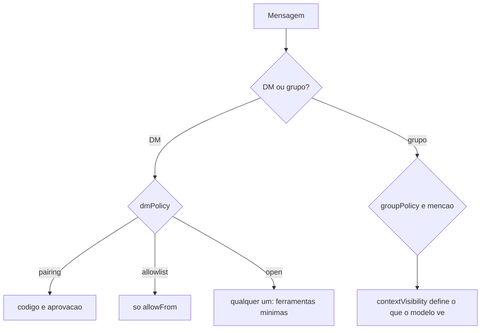

# Controle de acesso a DMs e grupos

## Objetivo

Combinar política de DM, allowlists, menção em grupos e isolamento de sessão para limitar quem fala com o agente e o que ele enxerga.

## Explicação

A doc de segurança trata o acesso em camadas. Chaves e valores (versão hindi espelhada, nomes em inglês):

| Chave | Valores |
|---|---|
| `channels.*.dmPolicy` (ou `*.dm.policy`) | `pairing`, `allowlist`, `open`, `disabled` |
| `session.dmScope` | `main`, `per-channel-peer`, `per-account-channel-peer`, `per-peer` |
| `allowFrom`, `groupAllowFrom`, `groupPolicy` | Allowlists em duas camadas e política de grupo |
| `requireMention`, `agents.entries.*.groupChat.mentionPatterns` | Menção obrigatória em grupos |
| `contextVisibility` | `all`, `allowlist`, `allowlist_quote` |
| `tools.toolsBySender` | Política de ferramentas por remetente |

Ideias-chave:

- **Quem pode falar** (autorização de gatilho) é diferente de **o que o modelo vê** (visibilidade de contexto). Um grupo pode permitir que só alguns disparem o agente, mas o histórico do grupo entra no contexto conforme `contextVisibility`.
- `dmScope: "main"` junta todas as DMs numa sessão; em multiusuário isso mistura conversas. `per-channel-peer` separa por canal e remetente.
- `open` aceita qualquer remetente: use só com perfil de ferramentas mínimo e sem segredos no workspace.

## Exemplo prático

Perfil "assistente de comunidade":

```json5
{
  session: { dmScope: "per-channel-peer" },
  channels: {
    telegram: {
      dmPolicy: "pairing",
      groupPolicy: "allowlist",
      groups: { "*": { requireMention: true } },
    },
  },
  tools: { profile: "messaging", deny: ["group:runtime", "group:fs"] },
}
```

```bash
openclaw pairing list telegram
openclaw channels status --probe
openclaw security audit
```



## Armadilhas comuns

- `dmScope: "main"` com várias pessoas: vazamento entre conversas.
- Permitir grupo aberto com agente que tem `exec`.
- Esquecer que reações, citações e histórico entram no contexto (veja [[Memória como superfície de ataque e privacidade]]).
- Allowlist com identificadores errados (nome de usuário em vez de ID numérico, por exemplo no Telegram).

## Resumo

- Quatro políticas de DM, quatro escopos de sessão.
- Gatilho e visibilidade de contexto são coisas separadas.
- Menção obrigatória e allowlists em grupos.

## Relacionados

- [[Pareamento e política de DM]]
- [[Allowlists e política de ferramentas por chat]]
- [[Grupos - menção obrigatória e groupPolicy]]
- [[Sessões e chaves de sessão]]
- [[Memória como superfície de ataque e privacidade]]

## Exercícios

1. Qual a diferença entre autorização de gatilho e visibilidade de contexto?
2. Por que `dmScope: "main"` é arriscado com várias pessoas?
3. Que perfil de ferramentas combina com `dmPolicy: "open"`?
4. Como listar pareamentos pendentes de um canal?
