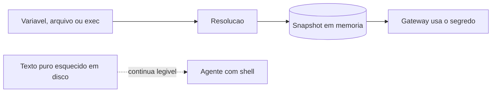

# Gestão de segredos com SecretRef

## Objetivo

Tirar chaves e tokens do texto puro da configuração usando SecretRef e entender os limites dessa proteção.

## Explicação

Em vez de colocar credenciais em texto no `openclaw.json`, o OpenClaw aceita **objetos SecretRef** com um formato único:

```json5
{ source: "env" | "file" | "exec", provider: "default", id: "..." }
```

| Origem | `id` |
|---|---|
| `env` | Nome de variável em maiúsculas (`OPENAI_API_KEY`); também vale `"${OPENAI_API_KEY}"` em campos SecretInput |
| `file` | Ponteiro JSON absoluto (`/providers/openai/apiKey`) ou `value` em provedores `singleValue` |
| `exec` | Identificador tipo caminho (`providers/openai/apiKey#value`); `.` e `..` rejeitados |

Provedores em `secrets.providers`: `env` (com `allowlist` opcional), `file` (`mode` `json` ou `singleValue`, `path`, `maxBytes`) e `exec` (comando **absoluto, sem shell**, `args`, `passEnv`, `jsonOnly`, `trustedDirs`, `timeoutMs`).

### Comportamento

- Segredos resolvem para um **snapshot em memória** na partida e no reload, não sob demanda.
- Partida falha cedo se uma referência ativa não resolve; no reload, falha mantém o último snapshot bom e emite `SECRETS_RELOADER_DEGRADED`.
- Se há referência e texto puro, a referência vence (`SECRETS_REF_OVERRIDES_PLAINTEXT`).
- Para credenciais de provedores de modelo há valores-sentinela locais ao processo, trocados pelo real só na saída da requisição.

### Comandos

| Comando | Função |
|---|---|
| `openclaw secrets audit --check` | Acha restos de texto puro e referências não resolvidas |
| `openclaw secrets configure --apply` | Configuração interativa e aplicação |
| `openclaw secrets apply --from <plano>` | Aplica um plano (`--dry-run`, `--allow-exec`) |
| `openclaw secrets reload` | Reresolve após rotacionar um segredo |

Superfícies suportadas: chaves de provedores em `openclaw.json` e `auth-profiles.json`, tokens e senhas do Gateway, variáveis de servidores MCP em `plugins.entries.acpx.config.mcpServers` e dados SSH do sandbox. Credenciais geradas em runtime (refresh de OAuth) ficam de fora.

> [!danger] Limite importante
> SecretRef **não isola o processo nem protege arquivos em disco**. Qualquer texto puro deixado em `openclaw.json`, `auth-profiles.json`, `.env`, `models.json` gerado ou backups continua legível por um agente com acesso a arquivos ou shell. Use `audit --check` como portão de migração e isolamento do SO/contêiner para o restante.

## Exemplo prático

```json5
{
  secrets: {
    providers: {
      default: { source: "env" },   // ilustrativo; confirme a forma exata no esquema
    },
  },
  gateway: {
    auth: { mode: "token", token: { source: "env", provider: "default", id: "OPENCLAW_GATEWAY_TOKEN" } },
  },
}
```

```bash
export OPENCLAW_GATEWAY_TOKEN="$(openssl rand -hex 32)"
openclaw secrets audit --check
openclaw secrets reload
```



## Armadilhas comuns

- Migrar para SecretRef e esquecer o `.env` e os backups antigos com a chave.
- Usar provedor `exec` com caminho relativo ou shell.
- Rotacionar o segredo e não rodar `openclaw secrets reload`.
- Registrar a variável em log de CI.

## Resumo

- Formato `{ source, provider, id }`; origens `env`, `file`, `exec`.
- Snapshot em memória; falha de reload mantém o último bom.
- Não protege arquivos em disco: limpe o texto puro.

## Relacionados

- [[Configuração do Gateway em openclaw.json]]
- [[Logs e diagnóstico]]
- [[Memória como superfície de ataque e privacidade]]
- [[Auditoria com openclaw security audit]]
- [[Vazamento de credenciais e de dados - onde e como acontece]]

## Exercícios

1. Quais são as três origens de um SecretRef?
2. O que acontece se um reload não consegue resolver um segredo?
3. Por que SecretRef não impede um agente com shell de ler um `.env`?
4. Que comando verifica se sobrou texto puro?
