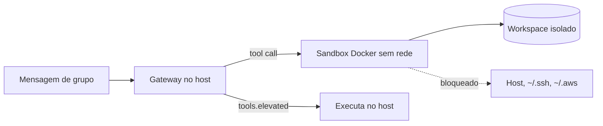

# Isolamento com sandbox - modos, escopo e backends

## Objetivo

Configurar o sandbox para reduzir o raio de impacto das ferramentas do agente e entender o que ele **não** protege.

## Explicação

O sandbox vem **desativado por padrão**, controlado por `agents.defaults.sandbox` (global) ou `agents.list[].sandbox` (por agente). O processo do Gateway **sempre roda no host**; só a execução de ferramentas (`exec`, `read`, `write`, `edit`, `apply_patch`, `process` e o navegador opcional) vai para o sandbox. A doc avisa: não é uma barreira de segurança perfeita.

| Chave | Valores (padrão em negrito) |
|---|---|
| `agents.defaults.sandbox.mode` | **`off`**, `non-main`, `all` |
| `agents.defaults.sandbox.scope` | **`agent`**, `session`, `shared` |
| `agents.defaults.sandbox.backend` | **`docker`**, `ssh`, `openshell` |
| `workspaceAccess` | **`none`**, `ro` (em `/agent`), `rw` (em `/workspace`) |

`non-main` isola tudo menos a sessão principal; sessões de grupo e canal são sempre "não principais". No backend Docker os padrões incluem `network: "none"`, `readOnlyRoot: true`, `capDrop: ["ALL"]` e a imagem `openclaw-sandbox:bookworm-slim`.

### Montagens (`docker.binds`)

Formato `host:container:modo`. Origens perigosas (`/etc`, `/proc`, `/var/run`, `~/.ssh`, `~/.aws`) são bloqueadas por padrão. Existem overrides com `dangerously...` no nome: evite.

### Fora do sandbox

O Gateway em si e tudo que passar por `tools.elevated` (caminho `gateway` ou `node`). Sem sandbox ativo o elevated não faz diferença; para impedir `exec` de vez, negue-o na política de ferramentas.

> [!info] Podman e outros
> A página lida documenta `docker`, `ssh` e `openshell`; **não** documenta Podman como backend do sandbox, embora a página de instalação cite Podman como forma de rodar o Gateway.

## Exemplo prático

Ponto de partida recomendado pela doc:

```json5
{
  agents: {
    defaults: {
      sandbox: {
        mode: "non-main",
        scope: "session",
        workspaceAccess: "none",
        backend: "docker",
      },
    },
  },
}
```

```bash
openclaw config validate
openclaw gateway restart
openclaw sandbox list
openclaw sandbox explain
openclaw sandbox recreate
```



## Armadilhas comuns

- Achar que sandbox protege o Gateway: ele só isola ferramentas.
- `network: "none"` quebra instalação de pacotes: use imagem própria com as dependências.
- `docker.env` com segredos: visíveis em `docker inspect`.
- Deixar `tools.elevated` ligado e anular o isolamento.
- Gateway em Docker (DooD): caminhos do workspace precisam ser absolutos do host.

## Resumo

- Desligado por padrão; comece com `non-main` + `session` + `none`.
- Isola ferramentas, não o Gateway.
- Elevated é a porta dos fundos: mantenha desligado.

## Relacionados

- [[Aprovações de exec e allowlists]]
- [[Perfis e política de ferramentas]]
- [[Docker - instalar o Gateway em contêiner]]
- [[Navegador gerenciado pelo agente]]
- [[Linha de base endurecida em 60 segundos]]

## Exercícios

1. O que o modo `non-main` isola?
2. Por que o sandbox não protege o processo do Gateway?
3. Qual o efeito de `workspaceAccess: "ro"`?
4. Que risco o `tools.elevated` traz para quem ativou o sandbox?
