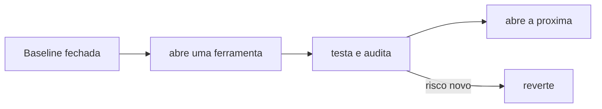

# Linha de base endurecida em 60 segundos

## Objetivo

Aplicar a linha de base endurecida recomendada pela doc e entender o que cada bloco faz, para só abrir permissões depois.

## Explicação

A página de segurança aponta para uma "Hardened baseline (60 seconds)". O JSON abaixo foi extraído da **versão hindi espelhada** da página (a versão em inglês aponta para a subpágina sem reproduzir o conteúdo na leitura). Os nomes de chave são os da doc, em inglês.

```json5
{
  gateway: {
    mode: "local",
    bind: "loopback",
    auth: { mode: "token", token: "replace-with-long-random-token" },
  },
  session: {
    dmScope: "per-channel-peer",
  },
  tools: {
    profile: "messaging",
    deny: ["group:automation", "group:runtime", "group:fs", "sessions_spawn", "sessions_send"],
    fs: { workspaceOnly: true },
    exec: { security: "deny", ask: "always" },
    elevated: { enabled: false },
  },
  channels: {
    whatsapp: { dmPolicy: "pairing", groups: { "*": { requireMention: true } } },
  },
}
```

### O que cada bloco faz

| Bloco | Efeito |
|---|---|
| `gateway.bind: "loopback"` + `auth.mode: "token"` | Só acessível localmente e exige token longo e aleatório |
| `session.dmScope: "per-channel-peer"` | Isola sessões de DM por canal e remetente |
| `tools.profile: "messaging"` | Perfil restrito a mensagens e sessões |
| `tools.deny` | Remove automação, execução, arquivos e criação/envio entre sessões |
| `tools.fs.workspaceOnly` | Arquivos só dentro do workspace |
| `tools.exec.security: "deny"`, `ask: "always"` | Sem execução no host; se for liberada, sempre perguntar |
| `tools.elevated.enabled: false` | Sem escape do sandbox |
| `channels.whatsapp...` | DMs por pareamento; grupos só com menção |

> [!warning] Valide antes de aplicar
> O esquema é estrito e muda entre versões. Rode `openclaw config validate` e compare com `openclaw config schema` da sua instalação. O token do exemplo é um marcador: gere um valor real (`openssl rand -hex 32`) e prefira SecretRef (veja [[Gestão de segredos com SecretRef]]).

## Exemplo prático

```bash
openssl rand -hex 32
openclaw config validate
openclaw gateway restart
openclaw security audit
openclaw exec-policy show
```

Depois, abra permissões uma a uma e **reaudite** a cada mudança:



## Armadilhas comuns

- Copiar o JSON e esquecer de trocar o token de marcador.
- Misturar a baseline com `tools.exec.mode` sem checar a política efetiva (`exec-policy show`).
- Remover `deny` "só para testar" e deixar assim.
- Aplicar a baseline num agente que precisa de skills com `exec` e se confundir com a falha.

## Resumo

- Loopback, token, perfil `messaging`, sem exec, sem elevated, DMs por pareamento.
- Valide, audite e abra permissões gradualmente.
- Fonte do JSON: espelho hindi; confirme no seu esquema.

## Relacionados

- [[Perfis e política de ferramentas]]
- [[A ferramenta exec e os modos de permissão]]
- [[Pareamento e política de DM]]
- [[Configuração do Gateway em openclaw.json]]
- [[Auditoria com openclaw security audit]]

## Exercícios

1. Qual chave restringe o acesso a arquivos ao workspace?
2. Para que serve `session.dmScope: "per-channel-peer"`?
3. Por que reauditar a cada permissão aberta?
4. Como gerar um token forte para `gateway.auth.token`?
