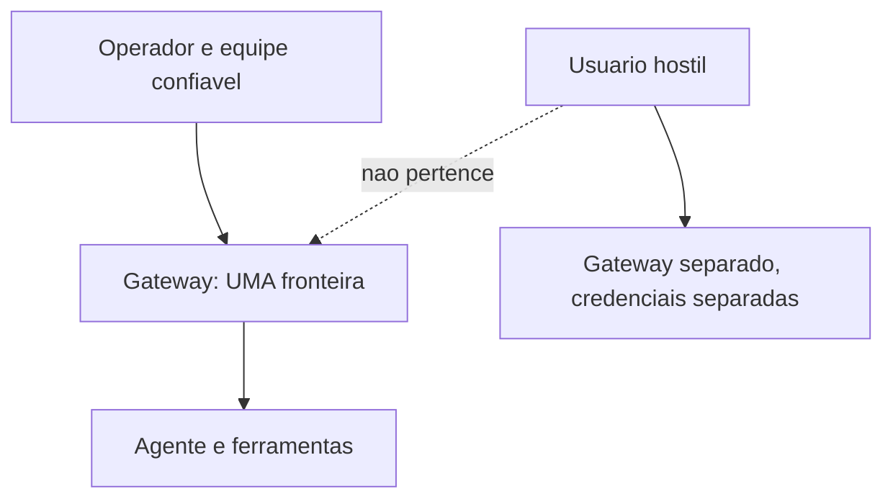

# Modelo de segurança do OpenClaw - um operador, uma fronteira

## Objetivo

Entender a premissa de segurança do OpenClaw: um Gateway = uma fronteira de confiança, e o que isso implica para quem compartilha o agente.

## Explicação

A página oficial de segurança parte de "**uma fronteira de confiança por Gateway**". Um único operador, ou uma equipe cujos membros confiam uns nos outros, fica dentro dessa fronteira. O OpenClaw **não foi projetado como fronteira multi-inquilino hostil**: se há usuários mutuamente adversários, use Gateways, credenciais e (idealmente) usuários do SO ou hosts separados.

Consequências práticas:

- Quem autentica no Gateway é tratado como operador confiável (veja [[Fronteiras de confiança na arquitetura]]).
- Agentes com a ferramenta de mensagens podem, por padrão, enviar entre conversas e provedores de canal. Existe restrição para limitar ao provedor ou conversa atual.
- Compartilhar um agente num grupo não cria isolamento entre membros: o que um pede o agente executa com a autoridade do agente.

### Padrões seguros confirmados

| Item | Padrão |
|---|---|
| Bind em instalação normal | Loopback |
| DM de remetente desconhecido | Resposta com código de pareamento |
| Acesso a grupos | Allowlist, geralmente com menção obrigatória |
| Imagens de contêiner | Bind exposto: exigem autenticação |



> [!warning] O agente é o ponto único de falha
> Se o agente tem shell, arquivos e navegador, **qualquer texto que o modelo leia** pode tentar usá-los. Por isso a segurança se apoia em política em código (ferramentas, sandbox, aprovações), não em instruções no prompt (veja [[Confiança, permissões e riscos de agentes]]).

## Exemplo prático

Decisão de topologia para uma comunidade com 3 grupos diferentes:

```text
Equipe interna confiavel           -> 1 Gateway, perfil coding, sandbox non-main
Clientes (mensagens publicas)      -> Gateway separado, perfil messaging, sem exec
Experimentos com skills de terceiros -> perfil de teste (OPENCLAW_PROFILE) em outro host
```

## Armadilhas comuns

- Achar que `dmPolicy: "pairing"` cria multi-inquilinato: ela controla quem fala com o agente, não o que o agente pode fazer por cada um.
- Reutilizar o mesmo Gateway para pessoas que não confiam entre si.
- Esquecer que imagens Docker nascem com bind exposto.
- Tratar o prompt de sistema como "regra de segurança".

## Resumo

- Um Gateway, uma fronteira; adversários exigem Gateways separados.
- Padrões: loopback, pareamento, grupos com allowlist e menção.
- Segurança real = política em código + isolamento.

## Relacionados

- [[Confiança, permissões e riscos de agentes]]
- [[Fronteiras de confiança na arquitetura]]
- [[Pareamento e política de DM]]
- [[Linha de base endurecida em 60 segundos]]
- [[Docker - instalar o Gateway em contêiner]]

## Exercícios

1. O que significa "uma fronteira de confiança por Gateway"?
2. Que padrão de bind vale numa instalação normal e qual vale em contêiner?
3. Por que `dmPolicy` não substitui separação de Gateways?
4. Como você separaria um agente de equipe de um agente público?
