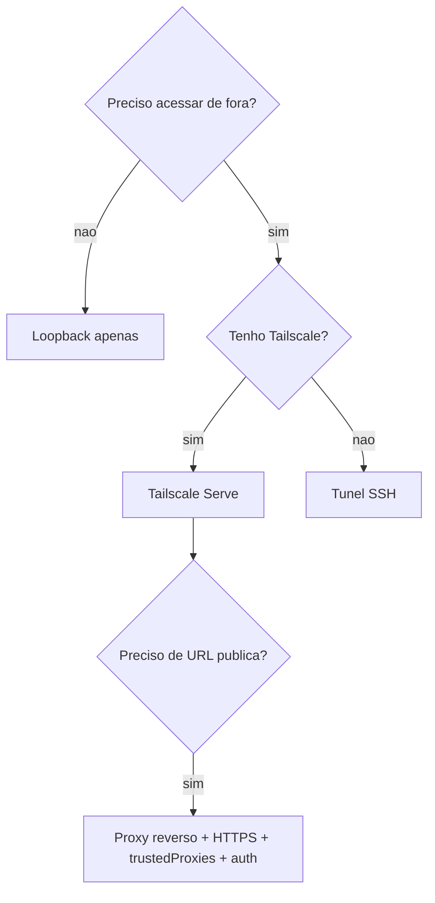

# Superfície de rede - bind, autenticação e exposição

## Objetivo

Decidir como o Gateway é alcançado (loopback, túnel, Tailscale, proxy) e quais chaves de exposição exigem atenção.

## Explicação

A página de segurança lista, para exposição de rede: bind, porta e firewall; publicação de portas Docker com UFW; descoberta mDNS/Bonjour; autenticação do WebSocket; cabeçalhos de identidade do Tailscale Serve; proxy reverso; HSTS; e Control UI sobre HTTP. Também há um runbook de exposição (pré-checagem e rollback), autenticação por proxy confiável e documentação separada de rate limits.

### Escada de exposição (do mais seguro ao mais arriscado)

| Nível | Forma | Observação |
|---|---|---|
| 1 | Loopback + túnel SSH | Recomendado para hosts sem tela |
| 2 | Loopback + Tailscale Serve | Sem porta pública |
| 3 | Bind `lan` ou `tailnet` | Exige `gateway.auth.token` ou `password`, salvo proxy confiável |
| 4 | Proxy reverso com `gateway.trustedProxies` | Configure HTTPS/HSTS; o proxy vira parte da fronteira |
| 5 | Porta pública direta | Evite; se inevitável, TLS (`wss://`), autenticação forte e firewall |

Chaves sensíveis citadas na doc: `gateway.trustedProxies`, `gateway.auth.allowTailscale`, `gateway.nodes.pairing.autoApproveCidrs`, `gateway.nodes.pairing.sshVerify`, `discovery.mdns.mode` (`minimal`, `full`, `off`) e todas as chaves `dangerous*`/`dangerously*`.

> [!warning] Docker publica portas à frente do UFW
> Em VPS com Docker, regras do UFW podem não valer para portas publicadas; a doc manda revisar a cadeia `DOCKER-USER` (veja [[Docker - instalar o Gateway em contêiner]]).

## Exemplo prático

Verificar o que está escutando e testar de fora:

```bash
ss -ltnp | grep 18789
openclaw gateway status --deep
openclaw security audit --deep
# de OUTRA maquina (deve falhar se estiver so em loopback):
curl -m 5 http://IP-DO-SERVIDOR:18789/healthz
```

Desligar descoberta mDNS em rede que não é sua (confirme o valor no esquema):

```bash
openclaw config set discovery.mdns.mode off
openclaw config validate
openclaw gateway restart
```



## Armadilhas comuns

- Bind `lan` sem token: qualquer um na rede fala com o agente.
- Confiar em `gateway.trustedProxies` sem conferir que o proxy remove cabeçalhos de identidade vindos de fora.
- Deixar o mDNS em `full` em redes compartilhadas.
- Expor a Control UI por HTTP simples.

## Resumo

- Loopback + túnel ou Tailscale como padrão.
- Fora do loopback: autenticação obrigatória e TLS.
- Teste a exposição **de fora**, não só localmente.

## Relacionados

- [[Acesso remoto - SSH, Tailscale e modos de bind]]
- [[Hospedar em um VPS com segurança]]
- [[O processo Gateway e a porta 18789]]
- [[Docker - instalar o Gateway em contêiner]]
- [[Auditoria com openclaw security audit]]

## Exercícios

1. Que opção de exposição evita qualquer porta pública?
2. O que muda ao usar bind `lan` ou `tailnet`?
3. Por que testar a exposição a partir de outra máquina?
4. Qual o risco de `discovery.mdns.mode: "full"` numa rede compartilhada?
