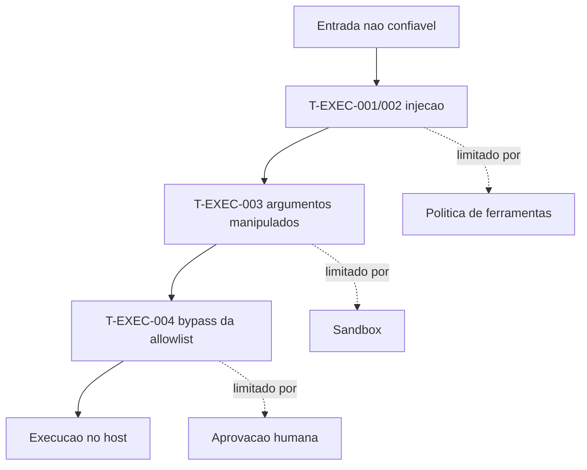

# Mapa de ameaças do OpenClaw - MITRE ATLAS e execução

## Objetivo

Conhecer como a documentação organiza ameaças usando o MITRE ATLAS e ler o risco residual de cada uma sem otimismo ingênuo.

## Explicação

A doc mantém um modelo de ameaças ("Threat Model ATLAS") com páginas por tática. A página de **execução** (tática AML.TA0005) lista quatro ameaças, com mitigações e risco residual declarados pelos próprios autores:

| ID | Ameaça | Mitigações citadas | Risco residual (segundo a doc) |
|---|---|---|---|
| T-EXEC-001 | Injeção de prompt direta | Detecção de padrões, encapsulamento de conteúdo externo, resistência do modelo | Depende do modelo; atacantes adaptativos superam 80% contra defesas de ponta; modelos menores são mais fáceis de conduzir |
| T-EXEC-002 | Injeção de prompt indireta | Encapsulamento com fronteira aleatória, normalização de homóglifos e tokens especiais, aviso de segurança | O encapsulamento é orientação "branda"; política de ferramentas e sandbox devem refletir o dano aceitável |
| T-EXEC-003 | Injeção em argumentos de ferramentas | Aprovações de exec para comandos perigosos | **Alto**, depende do julgamento do usuário |
| T-EXEC-004 | Bypass de aprovações de exec | Allowlist com modo ask, normalização de comandos | **Alto**; normalização reduz, não elimina a ofuscação |

> [!warning] Cobertura
> Só a página de execução foi lida. As demais páginas do modelo (reconhecimento, acesso inicial, persistência, exfiltração, etc.) existem na árvore da doc, mas **seus IDs não foram confirmados**. A doc não define IDs separados para "abuso de ferramentas" nem "fuga de sandbox".

### Como usar o mapa

Um modelo de ameaças serve para decidir **onde investir controles**. Para cada ameaça: (1) o que a protege, (2) o que acontece se essa proteção falhar, (3) o que limita o estrago. O padrão da doc é admitir que prompt e modelo são camadas *probabilísticas* e que o limite real é a política em código.



## Exemplo prático

Planilha de risco simples para o seu agente (copie para uma nota sua):

```text
Ameaca | Agente tem a capacidade? | Controle ativo | Dano se falhar
T-EXEC-002 (conteudo de pagina) | sim: web_fetch | sandbox + sem exec | leitura indevida
T-EXEC-004 (bypass allowlist)   | nao: exec=deny   | politica        | nenhum
```

Se a resposta à primeira coluna é "não", a ameaça fica fora do seu perfil: **remover a capacidade é o controle mais forte**.

## Armadilhas comuns

- Ler "baixo risco orgânico" como "risco baixo para você": atacantes adaptativos importam em agentes expostos.
- Contar o encapsulamento de conteúdo como controle suficiente.
- Aprovar comandos sem ler os argumentos (T-EXEC-003 depende de você).
- Não revisar o modelo de ameaças a cada release.

## Resumo

- Quatro ameaças de execução, duas com risco residual alto.
- Mitigações de prompt são probabilísticas; limite real = política + sandbox + aprovação.
- Remover a capacidade vence qualquer filtro.

## Relacionados

- [[Confiança, permissões e riscos de agentes]]
- [[Fronteiras de confiança na arquitetura]]
- [[Prompt injection direta e indireta - como se defender]]
- [[Abuso de ferramentas e bypass de aprovações de exec]]
- [[Isolamento com sandbox - modos, escopo e backends]]

## Exercícios

1. Quais as duas ameaças de execução com risco residual "alto"?
2. Por que o encapsulamento de conteúdo externo é "orientação branda"?
3. Qual é o controle mais forte contra uma ameaça cuja capacidade você não precisa?
4. Preencha uma linha da planilha de risco para o seu agente.
