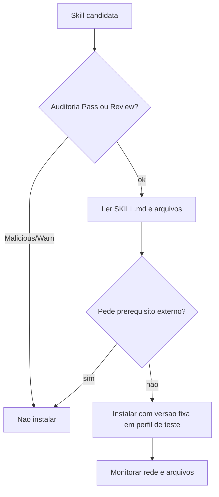

# Skills e plugins maliciosos - o caso ClawHavoc

## Objetivo

Aprender, com um caso real, como um ecossistema de skills pode ser usado como vetor de ataque e como se defender sem depender só da varredura do registro.

## Explicação

### O que foi relatado

Segundo a reportagem da eSecurity Planet (3 de fevereiro de 2026), pesquisadores da Koi Security auditaram o ClawHub e relataram **341 skills maliciosas entre 2.857**, sendo **335 ligadas a uma única campanha**, batizada ClawHavoc. As contagens variam entre fontes e semanas de remoção (veja o aviso em [[Fontes]]): trate números como ordem de grandeza.

Padrões descritos publicamente:

- Isca: skills disfarçadas de ferramentas populares (carteiras e rastreadores de cripto, bots de mercado de previsões, utilitários de vídeo, atualizadores, integrações com Google Workspace).
- *Typosquatting*: nomes parecidos com pacotes legítimos.
- O ponto de comprometimento era um **"pré-requisito" falso** na documentação da skill: baixar um arquivo ou colar um comando no terminal, que instalava um infostealer comercial.
- Alvo: máquinas ligadas 24/7 com credenciais valiosas (chaves de API, tokens, SSH, carteiras).
- Variações: skills que abriam shell reverso durante o uso normal e outras que enviavam credenciais da configuração para serviços externos.

A mesma reportagem cita, em artigo de 9 de fevereiro de 2026, a adição de varredura do VirusTotal ao ClawHub; **não foi possível verificar os detalhes** da mudança a partir da página lida.

### O que o ClawHub oferece hoje (documentação)

A página de auditorias de segurança descreve estados **Pass, Review, Warn, Malicious, Pending e Error**, níveis de risco (Low, Medium, High, separados do estado) e achados com severidade de Info a Critical. A doc afirma que auditorias são "sinais fortes, não garantias". Antes de instalar, confira: estado e risco, achados, credenciais e variáveis exigidas, dono, origem, versão, changelog, downloads e estrelas.

> [!warning] Leitura parcial
> A lista completa de varreduras e o processo de denúncia ficaram na parte truncada da página.

## Exemplo prático

Procedimento de revisão antes de instalar uma skill de terceiros:

```bash
openclaw skills search "calendar" --limit 5
openclaw skills verify @autor/calendario --json
# baixe/leia o SKILL.md e arquivos de apoio ANTES de instalar
openclaw skills install @autor/calendario --version 1.0.0
openclaw skills info calendario
```

Sinais de alerta no `SKILL.md`:

```text
- exige baixar e rodar um "instalador" externo ou colar um comando em base64
- pede variaveis de ambiente que nao combinam com a funcao (chave SSH para um clima)
- instrui o agente a enviar arquivos ou credenciais para uma URL
- nome quase igual ao de uma skill popular, autor recem-criado
```



## Armadilhas comuns

- Confiar em downloads e estrelas.
- Instalar a skill "para ver" na máquina principal.
- Atualizar com `update --all` sem revisar.
- Executar o "pré-requisito" que a skill pede: o agente não é o único que pode ser enganado.

## Resumo

- Cadeia de suprimentos de skills é um vetor real e documentado.
- Rejeite skills que exigem instaladores externos ou comandos colados.
- Versão fixa, perfil de teste, sandbox e rede restrita.

## Relacionados

- [[ClawHub, plugins e o ecossistema]]
- [[ClawHub - publicar, versões e verificação]]
- [[A CLI openclaw skills]]
- [[Nomes antigos, domínios falsos e como verificar a fonte]]
- [[Checklist de hardening e resposta a incidentes]]

## Exercícios

1. Qual era o "ponto de comprometimento" típico nas skills da campanha?
2. Por que auditorias do registro não bastam?
3. Cite três sinais de alerta num `SKILL.md`.
4. Por que fixar a versão ajuda contra atualizações maliciosas?
