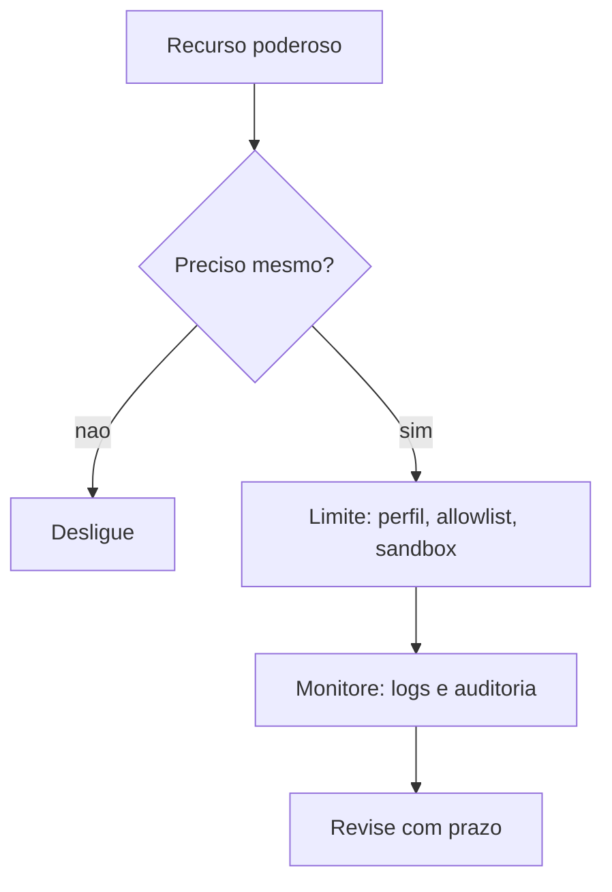

# Superfícies de alto risco - elevated, navegador, nodes e hooks

## Objetivo

Reconhecer os recursos que, quando ligados, ampliam muito o raio de dano, e saber o que a doc recomenda para cada um.

## Explicação

A página de segurança lista, como áreas de risco de ferramentas e plugins: ferramentas do plano de controle, **execução em nodes (`system.run`)**, skills dinâmicas, plugins, sandbox, delegação para subagentes, modo somente leitura e perfis de acesso por agente. "Acesso total sem sandbox" é um perfil separado e de risco mais alto.

| Superfície | Por que é arriscada | Controle documentado |
|---|---|---|
| `tools.elevated` | Executa `exec` **fora do sandbox** (caminho `gateway` ou `node`) | `tools.elevated.enabled: false` na baseline |
| `system.run` em nodes | Executa comandos em outra máquina pareada | Pareamento, aprovações no host de destino, `gateway.nodes.pairing.*` (evite `autoApproveCidrs` amplo) |
| Navegador | Controla um navegador real; pode alcançar rede interna | Política SSRF estrita por padrão; `browser.ssrfPolicy.dangerouslyAllowPrivateNetwork` é sensível |
| Perfil `user` do navegador | Anexa à sua sessão logada | Prefira o perfil isolado `openclaw` |
| Hooks internos | Código confiável no processo do Gateway, sem sandbox | Revisar código antes de habilitar |
| Webhooks de entrada | Entrada HTTP que inicia runs | Token exclusivo, `allowedAgentIds`, `allowRequestSessionKey: false`; `allowUnsafeExternalContent` desligado |
| Subagentes (`sessions_spawn`, `sessions_send`) | Delegação e comunicação entre sessões | Entram em `tools.deny` na baseline |
| Plugins | Código com acesso amplo | Instalar de origem confiável, revisar capacidades |

> [!danger] Chaves `dangerous*`
> A doc lista todas as chaves `dangerous*` e `dangerously*` como sensíveis. Trate qualquer uma como "assinatura de risco": só use com justificativa escrita e prazo.

## Exemplo prático

Revisão trimestral de superfícies:

```bash
openclaw config get tools.elevated
openclaw config get tools.exec
openclaw nodes pending
openclaw hooks list
openclaw automations list
openclaw plugins list
openclaw security audit --deep
grep -rn "dangerous" ~/.openclaw/openclaw.json
```

> [!warning] Comandos não totalmente confirmados
> `openclaw plugins list` e `openclaw nodes pending` aparecem em páginas lidas, mas as listas completas de subcomandos não foram confirmadas; use `--help` na sua versão.



## Armadilhas comuns

- Ligar `elevated` "temporariamente" e esquecer.
- Parear nodes com aprovação automática por faixa de IP ampla.
- Dar ao navegador acesso à rede privada sem necessidade.
- Habilitar hooks de pacotes baixados sem ler o código.

## Resumo

- Elevated, nodes, navegador logado, hooks e `dangerous*` são as maiores alavancas de risco.
- Cada recurso tem controle próprio; desligar é o melhor.
- Revise periodicamente com a auditoria profunda.

## Relacionados

- [[Navegador gerenciado pelo agente]]
- [[Hooks internos e webhooks HTTP de entrada]]
- [[Gateway, clientes e nodes]]
- [[Isolamento com sandbox - modos, escopo e backends]]
- [[Checklist de hardening e resposta a incidentes]]

## Exercícios

1. Por que `tools.elevated` anula o sandbox?
2. Que risco há em `gateway.nodes.pairing.autoApproveCidrs` amplo?
3. Por que o perfil `user` do navegador é mais arriscado que `openclaw`?
4. Quais chaves a doc classifica como sensíveis pelo nome?
