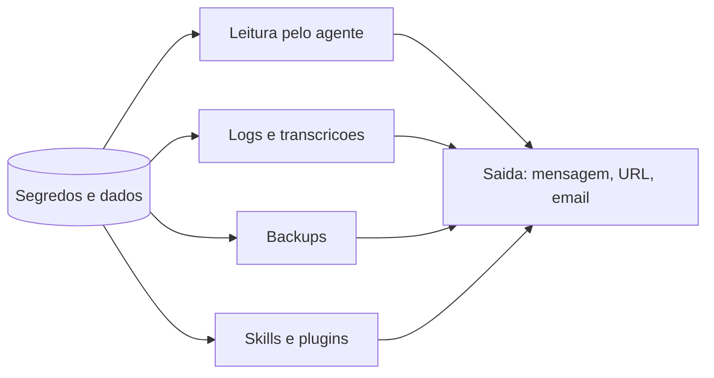

# Vazamento de credenciais e de dados - onde e como acontece

## Objetivo

Mapear onde segredos e dados privados residem num sistema OpenClaw, por que caminhos eles escapam e como reduzir cada risco.

## Explicação

A doc de segurança dedica uma seção ao armazenamento de credenciais (mapa de armazenamento, permissões, `.env` no workspace, conteúdo de logs e transcrições) e à varredura de segredos. A partir das páginas lidas, os pontos de residência são:

| Local | Contém | Risco principal |
|---|---|---|
| `openclaw.json` | Tokens e chaves se estiverem em texto puro | Leitura por agente com arquivos/shell |
| `auth-profiles.json`, lojas SQLite de autenticação | Chaves e OAuth | Idem; cópias em backups |
| `credentials/` | Credenciais de canais | Relink necessário se vazar |
| `.env` (estado e workspace) | Variáveis de ambiente | Skills e agentes podem lê-lo |
| Logs e transcrições de sessão | Mensagens, argumentos de ferramentas | Redação cobre padrões conhecidos, não tudo |
| Arquivos de backup | Estado completo + credenciais | Arquivo é um "cofre" portátil |
| Memória (`MEMORY.md`, notas) | Dados pessoais citados em conversas | Entram no contexto e podem ser exfiltrados |
| `docker inspect` (variáveis do sandbox) | Valores de `docker.env` | Visíveis a quem acessa o Docker |

### Como escapam

1. **Leitura direta:** agente com `read`/`exec` lendo arquivos do estado (injeção indireta pede isso).
2. **Saída:** o agente envia conteúdo para uma URL, e-mail ou canal (ferramenta de mensagens ou `web_fetch` com dados na consulta).
3. **Logs e suporte:** colar logs e `doctor --json` em fóruns; modo de depuração `full-redacted` incluindo mensagens.
4. **Backups e migrações:** arquivos em nuvem sem criptografia.
5. **Skills de terceiros:** variáveis de ambiente exigidas "em excesso".

> [!danger] Redação não é garantia
> `logging.redactSensitive` (padrão `tools`) e `redactPatterns` mascaram padrões conhecidos antes de gravar, mas texto livre (um CPF digitado numa conversa) segue nos logs e transcrições.

## Exemplo prático

Inventário rápido (comandos de leitura; revise o resultado, não cole em lugar público):

```bash
openclaw security audit --fix
openclaw secrets audit --check
ls -ld ~/.openclaw ~/.openclaw/credentials
stat -c '%a %n' ~/.openclaw/openclaw.json
grep -rIl --include='*.env' -e 'KEY' ~/.openclaw/workspace 2>/dev/null | head
```

Redução de superfície:

```text
1. Chaves em SecretRef; apagar texto puro e .env antigos
2. Agente sem acesso ao diretorio de estado (sandbox, workspaceAccess none)
3. Skills com env minimo; revisar requires.env
4. Backups criptografados e fora do host
5. Redigir logs antes de compartilhar; evitar modo full-redacted
```



## Armadilhas comuns

- Achar que a chave está segura só porque está "no .env".
- Compartilhar `openclaw doctor --json` e logs sem revisar.
- Memória guardando dados de terceiros sem necessidade (privacidade e LGPD).
- Esquecer o histórico de shell e o histórico do Git.

## Resumo

- Segredos vivem em muitos lugares além do `openclaw.json`.
- A saída (mensagens, URLs) é o caminho de exfiltração.
- Menos segredos no agente + isolamento + backups protegidos.

## Relacionados

- [[Gestão de segredos com SecretRef]]
- [[Logs e diagnóstico]]
- [[Backup e restauração do estado]]
- [[Memória como superfície de ataque e privacidade]]
- [[Checklist de hardening e resposta a incidentes]]

## Exercícios

1. Cite quatro lugares onde um segredo pode residir num sistema OpenClaw.
2. Por que a redação de logs não substitui higiene de dados?
3. Que ferramenta de saída pode servir de canal de exfiltração?
4. Que passos você tomaria para um backup que precisa ir para a nuvem?
