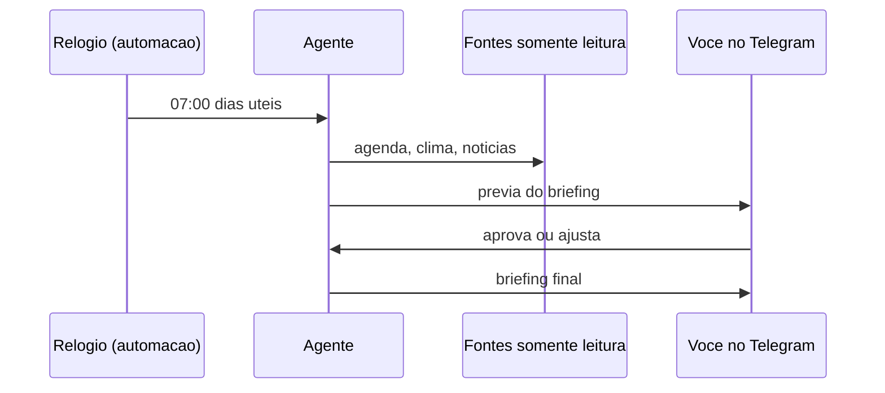

# Assistente pessoal em chat - briefing, lembretes e memória

## Objetivo

Descrever o caso de uso mais comum, um assistente pessoal acessível pelo app de mensagens que você já usa, com lembretes, briefing periódico e memória de longo prazo.

## Explicação

Três blocos do OpenClaw se combinam:

1. **Canal** (Telegram, WhatsApp etc.): a interface (veja [[Telegram - configurar o bot passo a passo]]).
2. **Automações**: o relógio que acorda o agente (veja [[Automações e cron - agendar tarefas do agente]]).
3. **Memória em Markdown**: o que o agente lembra entre sessões (veja [[Arquivos de memória em Markdown]]).

Uma "receita" de briefing publicada por terceiros (Fast.io, 2026; conteúdo do blog, não da documentação oficial) descreve: ler a agenda do dia, varrer e-mails não lidos filtrados por lista de remetentes prioritários, buscar clima e manchetes, formatar um resumo, **pausar para aprovação** e entregar em Slack ou Telegram, em dias úteis às 7h, com sessão persistente. O desenho é útil; as integrações (agenda, e-mail) dependem de skills ou MCP que você precisa escolher e auditar.

### Anatomia

| Parte | Escolha mínima segura |
|---|---|
| Entrada | DM por pareamento, só você |
| Gatilho | Automação cron com `--tz` explícito |
| Fontes | Somente leitura (agenda, clima) |
| Memória | `USER.md` com preferências; nada de segredos |
| Saída | Mensagem a você mesmo |



## Exemplo prático

Lembrete único (formato confirmado na doc, texto adaptado):

```bash
openclaw automations create "2026-11-05T13:00:00Z" \
  --name "Lembrete reuniao" \
  --session main \
  --system-event "Lembrete: reuniao com o time as 10h" \
  --wake now \
  --delete-after-run
```

Para o briefing recorrente use `--cron` e `--tz` (veja o projeto prático). Memória: peça ao agente "lembre que prefiro resumos de no máximo cinco linhas" e confira o resultado em `USER.md` ou `MEMORY.md` (veja [[Arquivos do workspace do agente]]).

## Armadilhas comuns

- Esquecer o fuso e receber o briefing três horas antes.
- Dar acesso de **escrita** à agenda ou e-mail "por conveniência".
- Deixar a memória acumular dados de terceiros sem revisão.
- Briefing longo demais: custo de tokens e leitura (veja [[Custo e escolha de modelo]]).

## Resumo

- Canal + automação + memória = assistente pessoal.
- Fontes somente leitura e aprovação antes de ações.
- Fuso explícito; memória revisada.

## Relacionados

- [[Automações e cron - agendar tarefas do agente]]
- [[Arquivos de memória em Markdown]]
- [[Telegram - configurar o bot passo a passo]]
- [[Boas práticas de memória e janela de contexto]]
- [[Projeto - Briefing matinal agendado]]

## Exercícios

1. Que três componentes formam um assistente pessoal?
2. Por que as fontes devem ser somente leitura no início?
3. Que flag evita erro de horário em uma automação cron?
4. Onde conferir o que o agente "lembrou"?
