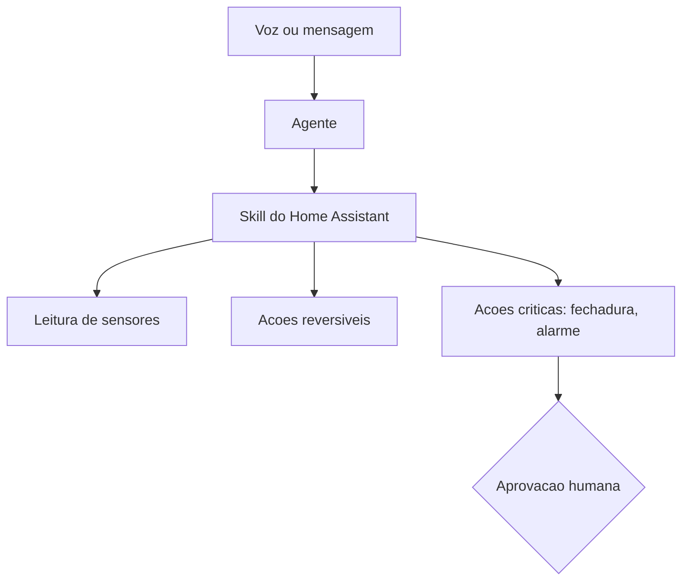

# Casa, voz e integrações físicas

## Objetivo

Conhecer os usos de voz, casa conectada e hardware documentados pela comunidade e os cuidados quando o agente passa a afetar o mundo físico.

## Explicação

A showcase cita, nas categorias **Voz e telefone** e **Casa e hardware**: ponte telefônica com latência baixa, transcrição multilíngue por OpenRouter, controle de dispositivos via skill do Home Assistant em linguagem natural, aspirador robô, purificador de ar, automação baseada em Nix com painéis do Grafana, e um add-on para rodar o Gateway no Home Assistant OS.

O que isso exige do OpenClaw:

- **Nodes** (dispositivos pareados que expõem capacidades, como o app do macOS com ferramentas locais; veja [[Gateway, clientes e nodes]]).
- **Skills** que traduzem linguagem natural em chamadas a APIs locais.
- **Rede local**: o Gateway precisa alcançar a casa (e o acesso remoto a ele deve seguir o padrão seguro).

### Matriz de risco físico

| Ação | Reversível? | Controle sugerido |
|---|---|---|
| Ler sensores, temperatura | Sim | Livre |
| Ligar luzes, ajustar termostato | Sim | Permitir com limites |
| Abrir fechaduras, desarmar alarme | Não trivial | **Aprovação humana sempre** ou não permitir |
| Compras e pagamentos | Não | Fora do escopo do agente |
| Câmeras e microfones | Privacidade | Desligar por padrão; revisar logs |



## Exemplo prático

Política de ferramentas conceitual para um agente doméstico (ilustrativa; valide o esquema na sua versão):

```text
- Perfil minimo + somente a skill do Home Assistant
- Entidades permitidas: luz.*, clima.*, sensor.*  (nada de lock.* nem alarm_control_panel.*)
- Sem exec, sem arquivos fora do workspace
- DM apenas de membros da familia (allowFrom)
- Voz: transcricao local ou provedor confiavel; sem armazenar audio
```

> [!warning] Fora do que foi verificado
> Nomes de skills, comandos e chaves da integração com Home Assistant **não foram lidos** aqui. Siga a documentação da skill escolhida e revise o código dela (veja [[Skills e plugins maliciosos - o caso ClawHavoc]]).

## Armadilhas comuns

- Deixar o agente controlar fechaduras por comando de voz de qualquer pessoa na sala.
- Expor o Gateway à internet para "controlar a casa de fora" em vez de usar Tailscale ou túnel.
- Convidados ou crianças com acesso ao canal do agente.
- Gravar áudio sem aviso aos moradores.

## Resumo

- Voz e casa usam skills e nodes; o risco cresce com a irreversibilidade.
- Ações críticas exigem aprovação ou ficam de fora.
- Acesso remoto sempre pelo caminho seguro.

## Relacionados

- [[Gateway, clientes e nodes]]
- [[Instalação no macOS - script e app de menu]]
- [[Superfícies de alto risco - elevated, navegador, nodes e hooks]]
- [[Mapa de casos de uso - o que a comunidade constrói]]
- [[Superfície de rede - bind, autenticação e exposição]]

## Exercícios

1. Que ações físicas devem exigir aprovação humana?
2. Por que não expor o Gateway à internet para controlar a casa?
3. Que papel têm os nodes em integrações de voz e hardware?
4. Monte uma lista de entidades permitidas para um agente doméstico.
