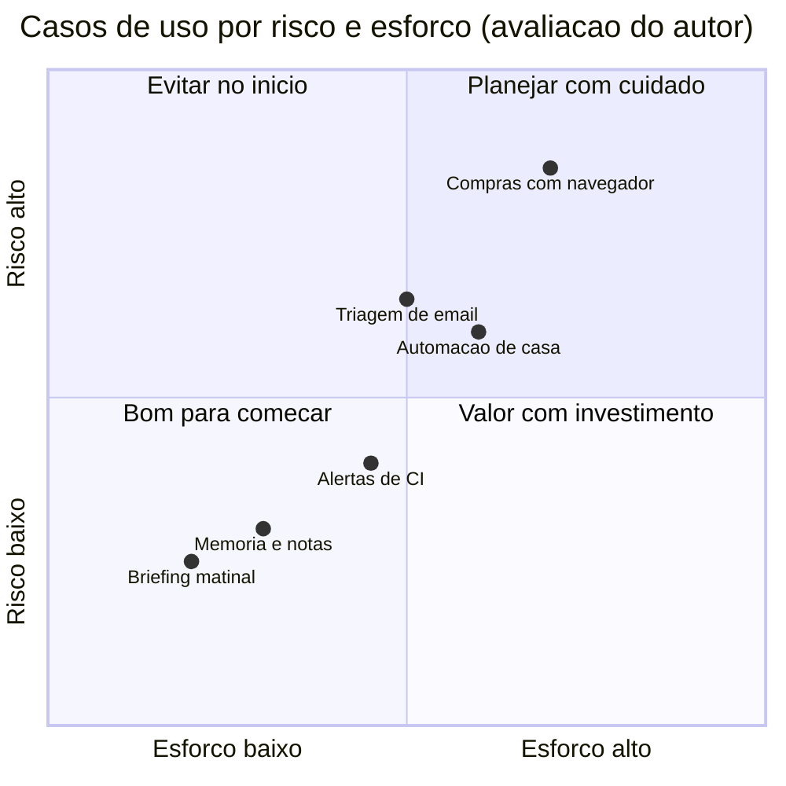

# Mapa de casos de uso - o que a comunidade constrói

## Objetivo

Ter um panorama dos tipos de uso que a comunidade documenta, para escolher por onde começar e reconhecer quais exigem mais cuidado de segurança.

## Explicação

A página de *showcase* da documentação agrupa projetos de usuários em categorias. Os exemplos abaixo vêm dela (versão espelhada em hindi, nomes e descrições preservados); são **projetos da comunidade**, não recursos garantidos do produto.

| Categoria | Exemplos citados | Capacidades que exige |
|---|---|---|
| Código e ferramentas de dev | Revisão de PR via Telegram; captura de tela para Markdown; monitor de sessões do Codex; CLI do Linear | Canais, exec, skills |
| Apps e skills | Skill de adega a partir de um CSV; app iOS enviado ao TestFlight pelo chat | Skills, exec, arquivos |
| Automação e fluxos | Compras de mercado com controle do navegador; reserva de quadra; suporte automático no Slack; briefing matinal agendado | Navegador, automações, canais |
| Conhecimento e memória | Busca semântica em favoritos; cofre de memória do WhatsApp; motor de estudo de idioma | Memória, skills |
| Voz e telefone | Ponte telefônica quase em tempo real; transcrição multilíngue | Voz, provedores |
| Casa e hardware | Home Assistant; aspirador robô; purificador de ar; automação baseada em Nix | Skills, integrações |
| Infra e deploy | Add-on do Home Assistant; empacotamento Nix; upload para R2 com link assinado | Instalação, plugins |

A página não tem categoria de "assistente pessoal"; os usos mais próximos ficam em Automação e Conhecimento e memória.

### Como ler o mapa pelo risco



> [!info] Posicionamento
> O gráfico é **opinião do autor desta nota**, não da documentação. Critério: quanto mais o caso toca em conta logada, dinheiro, execução de comandos ou dados privados, maior o risco.

## Exemplo prático

Escolha seu primeiro caso de uso com três perguntas:

```text
1. Preciso que o agente ESCREVA/EXECUTE algo ou so LEIA e resuma?   (ler = menos risco)
2. Ha dinheiro, credenciais ou contas pessoais envolvidas?          (sim = deixe para depois)
3. Existe um humano para aprovar a acao final?                      (nao = reduza o escopo)
```

Primeiro caso sugerido: um briefing matinal somente leitura (veja [[Projeto - Briefing matinal agendado]]).

## Armadilhas comuns

- Copiar um projeto da comunidade com permissões amplas sem entender cada ferramenta.
- Começar por automações com navegador logado e dinheiro.
- Confundir demonstração com produto suportado.
- Ignorar que skills da comunidade passam pelo mesmo risco de cadeia de suprimentos (veja [[Skills e plugins maliciosos - o caso ClawHavoc]]).

## Resumo

- Sete famílias de uso documentadas na showcase.
- Comece por leitura e resumo; deixe contas logadas e dinheiro para depois.
- Showcase = comunidade, não garantia de suporte.

## Relacionados

- [[Principais capacidades do OpenClaw]]
- [[ClawHub, plugins e o ecossistema]]
- [[Para quem é o OpenClaw e o que ele exige]]
- [[Assistente pessoal em chat - briefing, lembretes e memória]]
- [[Skills e plugins maliciosos - o caso ClawHavoc]]

## Exercícios

1. Cite três categorias da showcase e um exemplo de cada.
2. Por que a showcase não prova que um recurso é suportado?
3. Que critério você usaria para ordenar casos de uso por risco?
4. Qual seria seu primeiro caso de uso e por quê?
