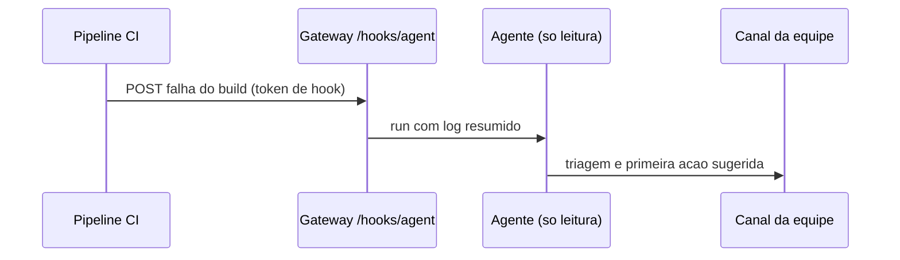

# Operações e DevOps no chat - alertas de CI e revisão de PR

## Objetivo

Mostrar como equipes técnicas usam o OpenClaw como ponte entre pipelines e chat: alertas de CI, lembretes de revisão e resumos periódicos.

## Explicação

Exemplos citados na showcase da doc: revisão de PR via Telegram (o agente lê o diff e responde com recomendação de merge), CLI do Linear, monitor de sessões do Codex. Em receitas de terceiros (Fast.io, 2026):

| Rotina | Gatilho | Resumo |
|---|---|---|
| Alerta de falha de CI | A cada 15 min em horário comercial, ou por evento | Lê o log, categoriza (teste instável, dependência, deriva de config, regressão), publica triagem e sugere uma primeira ação |
| Lembrete de revisão de PR | 10h e 15h | Avisa o revisor após 48 h sem atividade; escala ao líder após 72 h |
| Resumo de dependências | Segunda 9h | Agrupa atualizações por patch de segurança, minor e major |
| Resumo de fim do dia | Dias úteis 17h30 | Compila commits, PRs e tarefas |

Há dois desenhos para CI:

- **Polling por automação** (cron): simples, mas gasta tokens quando não há falhas.
- **Webhook de entrada** (`/hooks/agent`): o pipeline chama o Gateway só quando falha (veja [[Hooks internos e webhooks HTTP de entrada]]); mais barato e imediato.

### Cuidados específicos

- Logs de CI contêm texto controlado por terceiros (nomes de branch, mensagens de commit, saídas de testes): **injeção indireta**.
- Tokens do GitHub e do Slack devem ter escopo mínimo e ficar em SecretRef.
- Em grupos de equipe, exija menção e allowlist (veja [[Grupos - menção obrigatória e groupPolicy]]).



## Exemplo prático

Chamada do pipeline (formato confirmado na doc de webhooks; texto adaptado):

```bash
curl -sS -X POST http://127.0.0.1:18789/hooks/agent \
  -H "Authorization: Bearer $HOOK_TOKEN" \
  -H "Idempotency-Key: ci-$GITHUB_RUN_ID" \
  -H "Content-Type: application/json" \
  -d "{\"message\":\"Build $GITHUB_RUN_ID falhou. Resuma o erro e sugira a primeira acao.\",\"name\":\"ci\",\"agentId\":\"main\",\"deliver\":true}"
```

> [!warning] Alcance do agente
> O agente que recebe logs **não deve** ter `exec` nem credenciais de deploy. Ele resume e sugere; humanos executam.

## Armadilhas comuns

- Expor `/hooks` na internet sem TLS.
- Passar o log inteiro para o modelo: custo e superfície de injeção; envie só o trecho relevante.
- Deixar o agente fazer *rollback* ou *merge* sozinho.
- Reutilizar o token do Gateway como token do hook.

## Resumo

- Webhook para eventos, cron para rotinas.
- Agente de leitura e sugestão; humano executa.
- Tokens mínimos, hooks com token próprio.

## Relacionados

- [[Hooks internos e webhooks HTTP de entrada]]
- [[Automações e cron - agendar tarefas do agente]]
- [[Aprovações de exec e allowlists]]
- [[Grupos - menção obrigatória e groupPolicy]]
- [[Projeto - Webhook de CI que aciona o agente]]

## Exercícios

1. Quando preferir webhook a polling?
2. Por que logs de CI são conteúdo não confiável?
3. Que capacidades o agente de triagem de CI não deve ter?
4. Para que serve o cabeçalho `Idempotency-Key` neste cenário?
