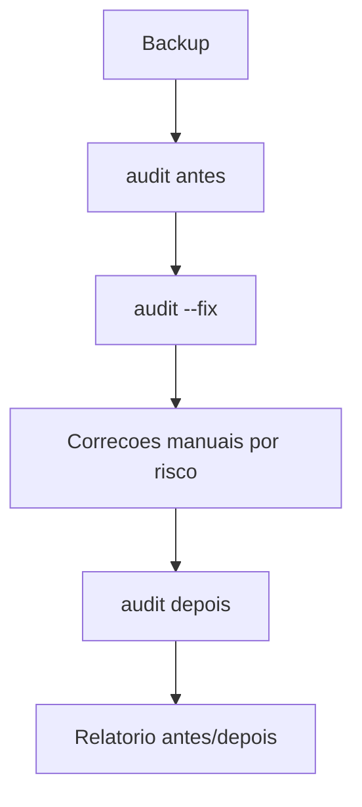

# Projeto - Auditoria e hardening de um agente existente

## Objetivo

Auditar um Gateway já em uso, corrigir o que for seguro corrigir e fechar lacunas com a linha de base. Resultado: relatório antes/depois sem achados `critical`.

## Pré-requisitos

- Um agente existente (de preferência em ambiente de teste primeiro).
- Backup verificado antes de mexer (veja [[Backup e restauração do estado]]).

## Passo a passo

1. Fotografia inicial:

```bash
openclaw backup create --output ~/Backups/pre-hardening --verify
openclaw security audit --deep --json > antes.json
openclaw security audit --deep --json | jq '.summary'
openclaw doctor --lint --severity-min warning
openclaw exec-policy show
openclaw approvals get
```

2. Correções seguras automáticas (permissões e `groupPolicy` aberto; **não** mexe em bind, auth, ferramentas, skills):

```bash
openclaw security audit --fix
```

3. Correções manuais, em ordem de risco:

```text
a. bind em loopback e autenticacao por token/senha forte (SecretRef)
b. tools.profile minimo; deny de group:runtime e group:fs quando possivel
c. tools.exec em ask ou deny; tools.elevated desligado
d. sandbox non-main
e. DMs por pareamento; grupos com allowlist e mencao
f. revisar skills, hooks, automacoes, plugins, nodes
g. procurar chaves dangerous* no openclaw.json
```

4. Reaudite e compare:

```bash
openclaw config validate
openclaw gateway restart
openclaw security audit --deep --json > depois.json
diff <(jq -S '.summary' antes.json) <(jq -S '.summary' depois.json)
```



## Validação

- Nenhum achado `critical`; `warn` restantes têm justificativa escrita.
- Teste de fora confirma que a porta não está exposta.
- O agente continua realizando as tarefas legítimas (teste funcional).

## Extensões

- Agendar o audit semanal (veja [[Rotina de manutenção e checklist de operação]]).
- Registrar as decisões com o [[Template - Revisão]].

## Riscos e mitigação

> [!warning] Endurecer pode quebrar fluxos
> Aplique uma mudança por vez em teste e reaudite. Documente exceções com prazo.

## Resumo

- Backup → audit → `--fix` → correções manuais → audit.
- `--fix` é limitado; o resto é com você.
- Evidência antes/depois.

## Modelo de relatório

Ao final, escreva um relatório curto com: versão do OpenClaw, data, resumo do audit antes e depois, lista de mudanças aplicadas (uma linha cada), exceções aceitas com justificativa e prazo de revisão, e próximos passos. Guarde junto do backup pré-hardening, para poder voltar atrás se uma mudança quebrar um fluxo. Um relatório de uma página já é suficiente e serve de base para a revisão trimestral.

## Relacionados

- [[Auditoria com openclaw security audit]]
- [[Linha de base endurecida em 60 segundos]]
- [[Checklist de hardening e resposta a incidentes]]
- [[Doctor e reparos do estado]]
- [[Rotina de manutenção e checklist de operação]]

## Exercícios

1. Que mudanças `--fix` não faz?
2. Por que aplicar uma correção por vez?
3. Como comparar o antes e o depois do audit?
