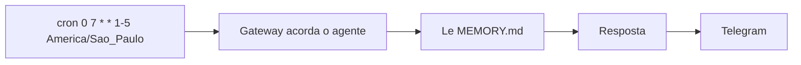

# Projeto - Briefing matinal agendado

## Objetivo

Receber todo dia útil às 7h, no Telegram, um resumo curto gerado pelo agente (resultado: briefing sem fontes sensíveis, somente leitura).

## Pré-requisitos

- O agente do projeto [[Projeto - Primeiro agente no Telegram com pareamento]] funcionando.
- Fuso conhecido (aqui, `America/Sao_Paulo`).
- Gateway rodando como serviço (veja [[O Gateway como serviço em segundo plano]]).

## Passo a passo

1. Teste um lembrete único para validar o mecanismo (formato da doc, texto adaptado):

```bash
openclaw automations create "20m" \
  --name "Teste" \
  --session main \
  --system-event "Teste de automacao: responda apenas OK" \
  --wake now \
  --delete-after-run
```

2. Crie o recorrente com `--cron` e `--tz`:

```bash
openclaw automations create --help   # confirme a sintaxe da sua versao
openclaw automations create --cron "0 7 * * 1-5" --tz America/Sao_Paulo \
  --name "Briefing" --session main \
  --system-event "Faca um briefing de no maximo 5 linhas: data, dia da semana e 3 prioridades que eu registrei em MEMORY.md" \
  --wake now
```

> [!warning] Sintaxe a confirmar
> A doc confirma `--at`, `--every`, `--cron`, `--tz`, `--exact`, `--stagger`, `--name`, `--session`, `--system-event`, `--wake` e `--delete-after-run`, mas a forma exata de combiná-los (argumento posicional versus `--cron`) e a opção de sessão isolada não foram verificadas. Use `--help`.

3. Liste e inspecione:

```bash
openclaw automations list
openclaw automations get <job-id>
openclaw automations runs <job-id>
```



## Validação

- `automations runs` mostra a execução no horário esperado (compare com o fuso).
- O briefing chega com no máximo cinco linhas.
- Segunda-feira de teste: use `--every 5m` temporariamente para ver mais de uma execução e remova depois.

## Extensões

- Adicionar clima e agenda **somente leitura** via skill/MCP auditados.
- Pedir aprovação antes de enviar (padrão de "prévia").
- Medir custo com `/usage cost`.

## Riscos e mitigação

> [!warning] Custo e escopo
> Cada execução gasta tokens; um briefing diário é barato, mas jobs a cada minuto não. Sem humano para aprovar, o job **não** deve usar `exec`.

## Resumo

- Teste com lembrete único, depois recorrente.
- Fuso explícito; sintaxe confirmada por `--help`.
- Validar por `runs`, não por esperar.

## Relacionados

- [[Automações e cron - agendar tarefas do agente]]
- [[Assistente pessoal em chat - briefing, lembretes e memória]]
- [[Projeto - Primeiro agente no Telegram com pareamento]]
- [[Custo e escolha de modelo]]
- [[O Gateway como serviço em segundo plano]]

## Exercícios

1. Que flag define o fuso do cron?
2. Como confirmar que a automação rodou?
3. Por que não usar exec em um job sem humano?
