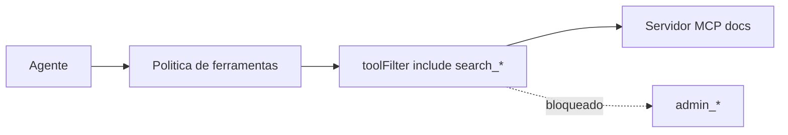

# Projeto - Conectar um servidor MCP e filtrar ferramentas

## Objetivo

Registrar um servidor MCP, verificar que ele responde, e expor apenas as ferramentas necessárias. Resultado: o agente usa uma ferramenta de busca e não enxerga as administrativas.

## Pré-requisitos

- Um servidor MCP **de origem confiável** (aqui, um endpoint HTTP hipotético `https://mcp.example.com/mcp`; troque pelo seu).
- Gateway com recarga a quente ou reinício disponível.

## Passo a passo

1. Registre a definição (formato da doc):

```bash
openclaw mcp set docs '{"url":"https://mcp.example.com/mcp","transport":"streamable-http","timeout":20}'
openclaw mcp list
openclaw mcp show docs --json
```

2. Verifique (salvar não prova alcance):

```bash
openclaw mcp doctor docs --probe
openclaw mcp probe docs
```

3. Filtre as ferramentas:

```bash
openclaw mcp tools docs --include "search_*" --exclude "admin_*"
```

4. Teste no chat pedindo uma busca; depois peça uma operação administrativa e confirme que **não** existe.



## Validação

- `probe` lista as ferramentas, `tools` mostra o filtro e o agente só oferece `search_*`.
- Com o servidor fora do ar, as chamadas informam indisponibilidade (o catálogo retido não concede acesso).

## Extensões

- Autenticar por OAuth (`openclaw mcp login docs`) em vez de cabeçalho fixo.
- Servir o próprio OpenClaw como MCP com `openclaw mcp serve`.

## Riscos e mitigação

> [!warning] Servidor MCP = código e texto de terceiros
> Descrições de ferramentas e respostas entram no contexto: podem carregar injeção. Use o perfil de ferramentas mínimo, filtre por `include`, mantenha tokens em SecretRef e não ponha segredos em `headers` versionados.

## Resumo

- `set` → `doctor --probe` → `tools --include/--exclude`.
- Política global continua valendo.
- Menos ferramentas, menos superfície.

## Checklist de aceitação do servidor

Antes de manter um servidor MCP ligado, responda por escrito: quem o mantém e onde está o código; que ferramentas expõe e quais você realmente precisa; que credenciais ele recebe e com qual escopo; o que acontece se ele devolver texto malicioso; e como removê-lo (`openclaw mcp unset docs`). Registre a resposta no seu diário de manutenção. Revise a lista de ferramentas a cada atualização do servidor, porque novas ferramentas podem aparecer sem aviso e entrariam no catálogo do agente.

## Relacionados

- [[MCP - conectar servidores externos]]
- [[Perfis e política de ferramentas]]
- [[Visão geral das ferramentas do agente]]
- [[Gestão de segredos com SecretRef]]
- [[Fronteiras de confiança na arquitetura]]

## Exercícios

1. Por que `probe` é necessário depois de `set`?
2. Como impedir que o agente veja ferramentas `admin_*`?
3. Que risco há nas descrições de ferramentas de um servidor desconhecido?
