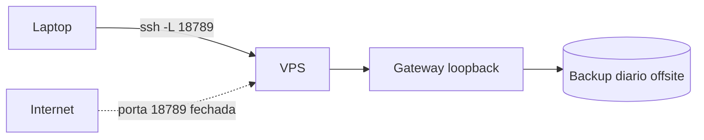

# Projeto - Gateway em VPS com túnel SSH e backup agendado

## Objetivo

Operar um Gateway 24/7 em um VPS Linux, acessível só por túnel SSH, com reinício automático e backup diário verificado. Resultado: um agente que sobrevive a reinícios e a um teste de restauração.

## Pré-requisitos

- VPS Linux com SSH por chave (provedor à sua escolha) e usuário não root.
- Node conforme a doc do dia (veja [[Requisitos e escolha do método de instalação]]).
- Local de backup fora do VPS (outro host ou armazenamento criptografado).

## Passo a passo

1. **Proteja o acesso admin primeiro** (chaves SSH, sem login por senha, firewall que só libera SSH). Exemplo geral:

```bash
sudo ufw default deny incoming
sudo ufw allow OpenSSH
sudo ufw enable
```

2. Instale e registre o serviço:

```bash
curl -fsSL https://openclaw.ai/install.sh | bash
openclaw onboard --install-daemon
systemctl --user enable --now openclaw-gateway.service
openclaw gateway status --deep
```

3. Acesse do laptop por túnel (porta **não** exposta):

```bash
ssh -N -L 18789:127.0.0.1:18789 usuario@IP-DO-VPS
# abra http://127.0.0.1:18789/
```

4. Reinício automático (override da doc):

```bash
systemctl --user edit openclaw-gateway.service
```

```ini
[Service]
Restart=always
RestartSec=2
TimeoutStartSec=90
```

5. Backup agendado e verificado:

```bash
openclaw backup create --output ~/Backups/openclaw --verify
openclaw backup enable --to <local-nomeado> --every 24h --keep-daily 7   # exige armazenamento ja inicializado
```



## Validação

- De fora, `curl -m 5 http://IP:18789/healthz` **falha**; pelo túnel funciona.
- `sudo reboot` e, depois, `openclaw gateway status` mostra o serviço ativo.
- Restaure o backup em diretório limpo (`openclaw backup restore ... --target ~/restore-teste`) e confira o `manifest.json`.

## Extensões

- Tailscale Serve em lugar do túnel.
- Monitor local de `/readyz` (veja [[Health checks e monitoramento do Gateway]]).
- Backup para um repositório Git **privado** (`openclaw backup git`).

## Riscos e mitigação

> [!warning] O VPS é a fonte da verdade
> O arquivo de backup contém credenciais: criptografe, restrinja permissões e guarde fora do host. Não conecte contas pessoais nem perfis de navegador pessoais ao ambiente.

## Resumo

- Segurança do SSH antes do OpenClaw; loopback + túnel.
- `Restart=always`; backup verificado e **testado**.
- Validação inclui reinício e restauração.

## Relacionados

- [[Hospedar em um VPS com segurança]]
- [[Instalação no Linux com systemd]]
- [[Backup e restauração do estado]]
- [[Health checks e monitoramento do Gateway]]
- [[Superfície de rede - bind, autenticação e exposição]]

## Exercícios

1. Por que o firewall e o SSH vêm antes da instalação?
2. Como provar que a porta 18789 não está exposta?
3. Que passo valida que o backup é restaurável?
