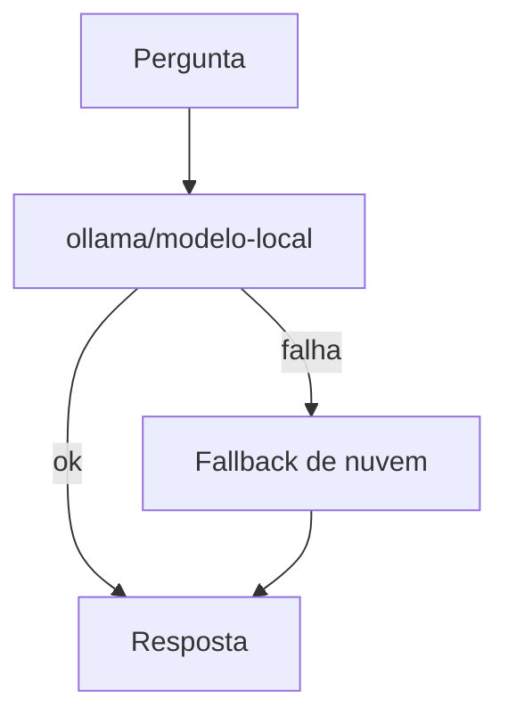

# Projeto - Modelo local com Ollama e fallback

## Objetivo

Usar um modelo local via Ollama como principal em tarefas simples e um modelo de nuvem como fallback. Resultado: respostas sem custo de API quando possível e continuidade se o local falhar.

## Pré-requisitos

- Ollama instalado e rodando, com um modelo baixado (`ollama pull <modelo>`).
- Memória suficiente para o modelo; uma chave de provedor de nuvem para o fallback.
- Leitura da nota [[Modelos locais - Ollama e llama.cpp]] (armadilhas de URL e contexto).

## Passo a passo

1. Aponte o provedor Ollama usando a URL **nativa, sem `/v1`**:

```json5
{
  models: {
    providers: {
      ollama: { baseUrl: "http://127.0.0.1:11434" },   // formato exato do bloco: confirme no esquema
    },
  },
}
```

2. Liste e escolha o modelo (formato `provedor/modelo`):

```bash
openclaw models list
openclaw models set ollama/<modelo-local>
openclaw models status
```

3. Adicione o fallback de nuvem:

```bash
openclaw models fallbacks add <provedor>/<modelo-de-nuvem>
openclaw models fallbacks --help   # confirme a sintaxe
```

4. Teste: pergunte algo simples; depois pare o Ollama (`systemctl stop ollama` ou equivalente) e pergunte de novo.



## Validação

- `models status` mostra principal e fallbacks.
- Com o Ollama parado, a resposta vem pelo fallback (veja em `openclaw logs --follow`).
- O contexto configurado do modelo local é suficiente: confira `/context list`.

## Extensões

- Usar o local só para tarefas de baixo risco e o de nuvem para as sensíveis, em agentes separados.
- Medir diferença de custo com `/usage cost`.

## Riscos e mitigação

> [!warning] Modelos locais pequenos cedem mais à injeção
> Segundo a doc de ameaças, modelos menores são mais fáceis de conduzir. Combine com perfil de ferramentas restrito. Cuide também para o fallback de nuvem **não** receber dados que você queria manter locais.

## Resumo

- `baseUrl` nativa sem `/v1`; `models set ollama/...`; fallbacks.
- Teste a queda real.
- Local não é sinônimo de seguro.

## Relacionados

- [[Modelos locais - Ollama e llama.cpp]]
- [[Failover de modelos e fallbacks]]
- [[Provedores, referências de modelo e a CLI models]]
- [[Custo e escolha de modelo]]
- [[Prompt injection direta e indireta - como se defender]]

## Exercícios

1. Por que a URL do Ollama não leva `/v1`?
2. Como testar o fallback na prática?
3. Que dados podem vazar para a nuvem pelo fallback?
