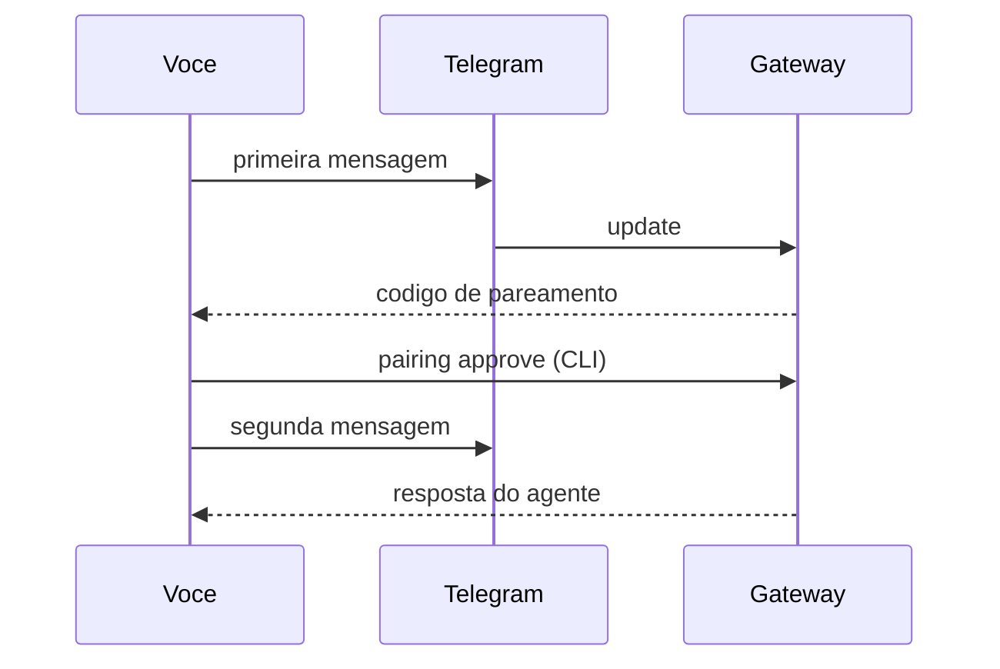

# Projeto - Primeiro agente no Telegram com pareamento

## Objetivo

Ter um agente respondendo apenas a você no Telegram, com DM por pareamento e instalação verificada. Resultado: conversar com o agente pelo celular em cerca de 30 minutos.

## Pré-requisitos

- OpenClaw instalado (veja [[Requisitos e escolha do método de instalação]]) e `openclaw doctor` sem erros.
- Um provedor de modelo configurado no onboarding.
- Conta no Telegram e acesso ao BotFather.
- Máquina que fique ligada durante o teste; **ambiente isolado**, sem contas pessoais sensíveis.

## Passo a passo

1. No Telegram, converse com o **BotFather**, crie um bot e copie o token.
2. Registre o canal (o token não vai em texto puro no histórico: use a variável):

```bash
export TELEGRAM_BOT_TOKEN='<token-do-bot>'
openclaw channels add --channel telegram --token "$TELEGRAM_BOT_TOKEN"
openclaw gateway restart
openclaw channels status --probe
```

3. Envie uma mensagem ao bot. Ele responde com um **código de pareamento**. Aprove:

```bash
openclaw pairing list telegram
openclaw pairing approve telegram <CODIGO>
```

4. Converse e verifique o contexto com `/status` e `/context list`.



## Validação

- `openclaw channels status --probe` mostra o Telegram conectado.
- A segunda mensagem recebe resposta; uma conta de teste **não pareada** só recebe o código.
- `openclaw security audit` não aponta `critical`.

## Extensões

- Adicionar o bot a um grupo com `requireMention` (veja [[Grupos - menção obrigatória e groupPolicy]]).
- Trocar para `dmPolicy: "allowlist"` com seu ID numérico.

## Riscos e mitigação

> [!warning] Quem fala com o bot, fala com o agente
> Mantenha `dmPolicy` em `pairing` e **não** libere grupos abertos. Não coloque o token em repositórios nem em logs colados em fóruns.

## Resumo

- Token do BotFather via variável; `channels add`; `status --probe`.
- Pareamento aprova um remetente por vez.
- Validação inclui o teste negativo (conta não pareada).

## Relacionados

- [[Telegram - configurar o bot passo a passo]]
- [[Pareamento e política de DM]]
- [[Onboarding e verificação pós-instalação]]
- [[Visão geral dos canais e instalação sob demanda]]
- [[Projeto - Briefing matinal agendado]]

## Exercícios

1. Que comando lista pareamentos pendentes do Telegram?
2. Como provar que um usuário não pareado não acessa o agente?
3. Por que usar variável de ambiente para o token?
