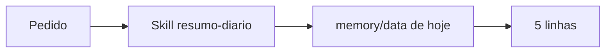

# Projeto - Skill própria de resumo diário

## Objetivo

Criar uma skill local que resume as notas do dia a partir de arquivos de memória, com limites de escopo, e testá-la pela CLI e pelo chat.

## Pré-requisitos

- Workspace padrão (`~/.openclaw/workspace`) e agente funcionando.
- Notas diárias no formato `memory/AAAA-MM-DD.md` (veja [[Arquivos de memória em Markdown]]).

## Passo a passo

1. Crie a pasta e o arquivo:

```bash
mkdir -p ~/.openclaw/workspace/skills/resumo-diario
cat > ~/.openclaw/workspace/skills/resumo-diario/SKILL.md <<'EOF'
---
name: resumo-diario
description: Resume as notas de hoje do workspace em ate cinco linhas, sem sair do workspace.
---

# Resumo diario

Quando o usuario pedir o resumo do dia:
1. Leia apenas o arquivo memory/ com a data de hoje.
2. Nao leia nada fora do workspace e nao execute comandos.
3. Responda em ate cinco linhas, com marcadores.
4. Se nao houver notas, diga isso. Nao invente.
EOF
```

2. Confirme o carregamento e teste:

```bash
openclaw skills list
openclaw skills info resumo-diario
openclaw agent --message "me de o resumo do dia"
```

3. No chat, force a skill: `/skill resumo-diario`.



## Validação

- `skills list` mostra `resumo-diario` elegível.
- Com arquivo vazio, a resposta diz "sem notas" (teste negativo).
- Com a nota presente, o resumo cita só o que está nela.

## Extensões

- Adicionar `metadata.openclaw.requires.bins` se um dia depender de uma CLI (veja [[Anatomia do SKILL.md e requisitos de elegibilidade]]).
- Publicar no ClawHub depois de revisar (veja [[ClawHub - publicar, versões e verificação]]).

## Riscos e mitigação

> [!warning] Escopo é texto
> "Não leia fora do workspace" é instrução, não política. Combine com `tools.fs.workspaceOnly` e perfil restrito para ter limite real.

## Resumo

- Pasta + `SKILL.md` com nome igual à pasta.
- Teste positivo e negativo.
- Instrução limita o modelo; política limita o agente.

## Depuração e boas práticas

Se a skill não aparecer em `openclaw skills list`, confira três coisas: o nome da pasta igual ao `name`, o arquivo chamado exatamente `SKILL.md` e se a sessão atual é antiga (abra uma nova com `/new` ou reinicie o Gateway). Mantenha a `description` em uma linha com menos de 160 caracteres, pois ela é injetada no prompt de todo turno e pesa no contexto. Versione a pasta em Git local, sem segredos, e releia o texto a cada mudança de modelo: instruções que funcionam num modelo podem ser interpretadas de outro jeito em outro.

## Relacionados

- [[Criar a primeira skill - hello-world]]
- [[Anatomia do SKILL.md e requisitos de elegibilidade]]
- [[A CLI openclaw skills]]
- [[Arquivos de memória em Markdown]]
- [[ClawHub - publicar, versões e verificação]]

## Exercícios

1. Por que o nome da pasta deve igualar `name`?
2. Que teste negativo valida a skill?
3. Qual a diferença entre instrução na skill e política de ferramentas?
