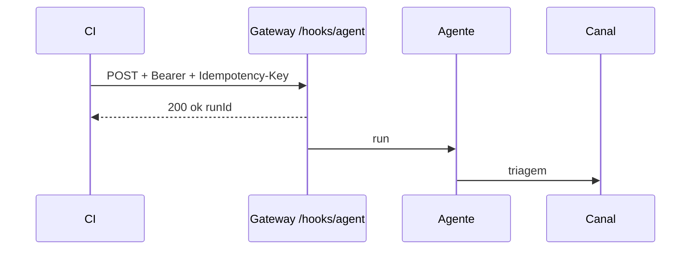

# Projeto - Webhook de CI que aciona o agente

## Objetivo

Fazer o pipeline de CI avisar o agente quando um build falha, recebendo no chat uma triagem curta. Resultado: um endpoint protegido por token exclusivo e uma chamada de teste bem-sucedida.

## Pré-requisitos

- Gateway em loopback e acesso do CI por **Tailscale ou túnel** (não exponha a porta).
- Um canal de entrega já funcionando.
- Token de hook gerado e guardado como segredo.

## Passo a passo

1. Gere o token e configure (chaves da doc de webhooks):

```bash
openssl rand -hex 32
```

```json5
{
  hooks: {
    enabled: true,
    token: "<token do hook, diferente do token do Gateway>",
    path: "/hooks",
    allowedAgentIds: ["main"],
    allowRequestSessionKey: false,
  },
}
```

2. Valide e reinicie:

```bash
openclaw config validate
openclaw gateway restart
```

3. Teste localmente (resposta `200` com `ok` e `runId` significa **admitido**, não concluído):

```bash
curl -sS -X POST http://127.0.0.1:18789/hooks/agent \
  -H "Authorization: Bearer $HOOK_TOKEN" \
  -H "Idempotency-Key: teste-001" \
  -H "Content-Type: application/json" \
  -d '{"message":"Teste de CI: build 1 falhou no passo de testes. Resuma e sugira a primeira acao.","name":"ci","agentId":"main","deliver":true}'
```

4. Repita com o mesmo `Idempotency-Key`: não deve disparar segundo run.



## Validação

- Chamada sem token ou com token errado é rejeitada.
- `openclaw logs --follow` mostra o run e a entrega.
- O segundo envio com a mesma chave não duplica.

## Extensões

- Usar `waitForCompletion` para o CI saber o status final (a resposta traz `completion`, nunca o texto do modelo).
- Enviar só o trecho relevante do log para reduzir custo e superfície de injeção.

## Riscos e mitigação

> [!danger] Entrada HTTP é entrada não confiável
> O `message` pode conter texto de terceiros (mensagens de commit). O agente alvo deve ser de leitura, sem `exec`. Token exclusivo, `allowedAgentIds` estreito, `allowRequestSessionKey: false`, HTTPS se sair do loopback.

## Resumo

- Hooks desligados por padrão; token próprio.
- `200` = admitido; idempotência evita duplicatas.
- Agente alvo sem exec.

## Relacionados

- [[Hooks internos e webhooks HTTP de entrada]]
- [[Operações e DevOps no chat - alertas de CI e revisão de PR]]
- [[Acesso remoto - SSH, Tailscale e modos de bind]]
- [[Gestão de segredos com SecretRef]]
- [[Logs e diagnóstico]]

## Exercícios

1. O que significa uma resposta `200` do endpoint?
2. Como testar a idempotência?
3. Por que o token do hook não pode ser o do Gateway?
